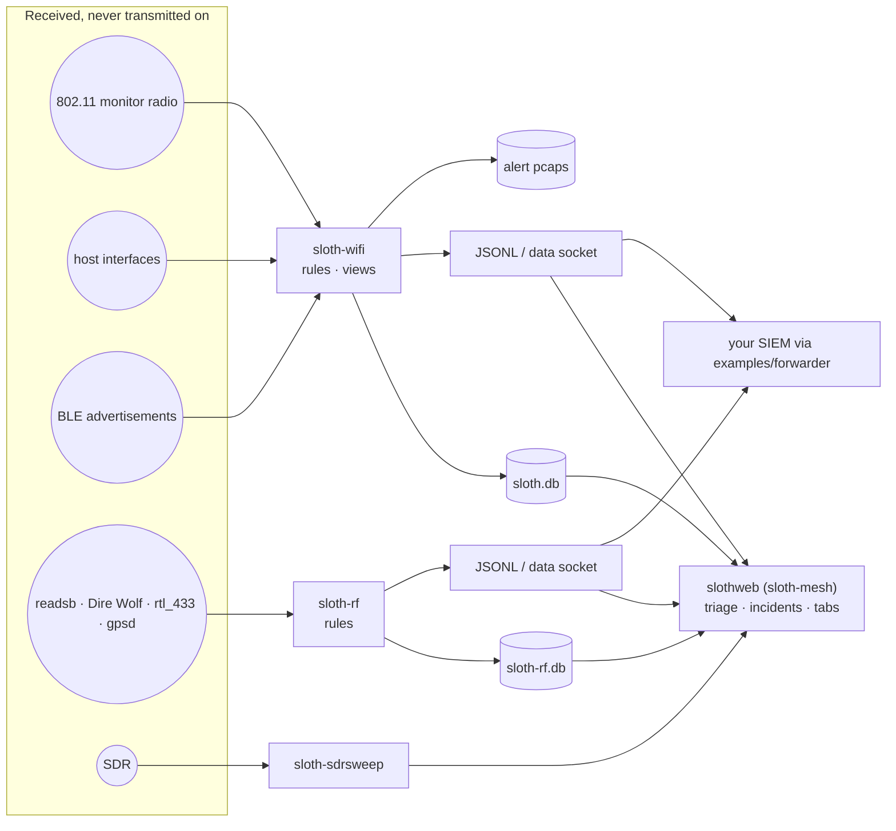

<p align="center">
  
</p>

<p align="center">
  <a href="https://github.com/SpaceTrucker2196/sloth/actions/workflows/ci.yml"></a>
  <a href="https://github.com/SpaceTrucker2196/sloth/actions/workflows/code-review.yml"></a>
  
</p>

<p align="center">
  <a href="Makefile"></a>
  <a href="docs/wiki/mutation-testing.md"></a>
  <a href=".github/scripts/mutate.py"></a>
</p>

# sloth — Citizen SIGINT

Sloth is an open intelligence tool for RF signals intelligence:
**Citizen Signals Intelligence (Citizen SIGINT)**. It lets a private
citizen see and understand the radio spectrum around them — Wi-Fi,
Bluetooth and BLE, ADS-B, APRS, GNSS, wideband SDR sweeps — and the
host network the sensor is attached to. It receives only. It identifies
and characterises emitters, flags hostile or anomalous activity aimed at
the operator's own networks, and reports what it found as assessments,
each with its evidence, its sources and its limits. It runs on Linux and
is written in C99.

The charter is [MISSION.md](MISSION.md). The complete reference is the
[wiki](https://github.com/SpaceTrucker2196/sloth/wiki), authored in
[`docs/wiki/`](docs/wiki/index.md).

## What it is and isn't

Sloth is the eyes, not the hands. The rules of engagement
([MISSION.md §2](MISSION.md)) in short:

1. **No injection.** It never sends a frame onto a network it monitors.
   No flag turns that off. Optional network-using services are off by
   default and announced.
2. **No key recovery.** It never cracks or decrypts anything it
   captured. Handshake export is opt-in, for networks you are
   authorised to test.
3. **Vulnerabilities are flagged, not exploited.**
4. **White hat only.** Not for surveillance, harassment or stalking.
5. **The operator owns the consequences.**
6. **Radios, not people.** Sloth reports a device's presence, its
   technical behaviour and its position or movement relative to the
   sensor. It never infers who uses a device, or what they do.

It collects only what is broadcast in the clear or carried by the
sensor host. You are responsible for the law where you run it (in the
U.S., for example, FCC rules and the ECPA). See
[MISSION.md, "Lawful and ethical use"](MISSION.md).

## What it collects

| Domain | Source | Read by | Wiki |
|---|---|---|---|
| **Wi-Fi (802.11)** | a monitor-mode radio you set up; beacons, probes, auth/assoc, deauth, action and control frames, EAPOL; `--hop` retunes it across channels | `sloth-wifi` | [wifi-sigint](docs/wiki/wifi-sigint.md), [monitor-mode](docs/wiki/monitor-mode.md) |
| **Bluetooth / BLE** | advertisements through the Linux HCI monitor channel (`--bt-monitor`, with `sloth-ble-scan` holding a passive scan), or an Ubertooth capture file you produce (`--bt-capture`) | `sloth-wifi` | [ble](docs/wiki/ble.md), [ubertooth](docs/wiki/ubertooth.md) |
| **ADS-B** | readsb's `aircraft.json`, or its SBS or Beast output on loopback | `sloth-rf` | [adsb](docs/wiki/adsb.md) |
| **APRS** | Dire Wolf's packet log | `sloth-rf` | [aprs](docs/wiki/aprs.md) |
| **ISM-band devices** | rtl_433's JSON event log | `sloth-rf` | [rtl433](docs/wiki/rtl433.md) |
| **GNSS** | a receiver through gpsd or a serial NMEA port: fix, satellites, C/N0, clock | both (`--gps`); the GNSS rules are `sloth-rf`'s | [gnss](docs/wiki/gnss.md) |
| **SDR sweep** | a receive-only 0.5–2000 MHz power sweep of a SoapySDR device, about a minute per run | `sloth-sdrsweep`, shown in slothweb | [sdr-sweep](docs/wiki/sdr-sweep.md) |
| **Host / IP network** | libpcap on the host's interfaces (DNS, TLS with JA3, QUIC, HTTP, NTP, ICMP, ARP, DHCP, mDNS, NBNS, SSDP, NDP and more), plus `/proc`, rtnetlink, nl80211 and INET_DIAG | `sloth-wifi` | [what-sloth-does](docs/wiki/what-sloth-does.md) |
| **Victron (own devices)** | readings from the operator's own Victron gear, written by `sloth-va` | `sloth-rf` | [victron](docs/wiki/victron.md) |

`sloth-va` is the one sloth-family program that transmits: it connects
only to the Victron devices you list, is never enabled by `make`, and
is kept out of the sensor ([ADR 0011](docs/wiki/adr/0011-sloth-va-transmits.md)).

## How it turns signals into intelligence

- **Alert rules.** <!-- count:rules -->101<!-- /count --> alert rules, one per `ALERT_TYPE_*` in
  [`include/sloth_alerts.def`](include/sloth_alerts.def). `sloth-wifi`
  raises <!-- count:rules-wifi -->96<!-- /count --> of the kinds and `sloth-rf` <!-- count:rules-rf -->6<!-- /count -->
  (the four GNSS rules, `ADSB_EMERGENCY` and `SENSOR_SOURCE_DOWN`, which
  both raise for their own sources). Each rule has a row in
  [`docs/views/alerts.md`](docs/views/alerts.md), a cited basis in
  `research/` and a written assessment in
  [`docs/wiki/alert-assessments/`](docs/wiki/alert-assessments/README.md):
  what it checks, the evidence that proves or refutes it, benign
  causes, severity and false-positive judgements.
- **Anomaly and impersonation rules.** Evil twins, KARMA lures, rogue
  RADIUS, deauth and association floods, BTM abuse, FragAttacks, GNSS
  jamming and spoofing, BLE advertising floods, unexpected BLE HID
  devices and watchlisted BLE devices, periodic beaconing to one host. The Wi-Fi impersonation rules carry a confidence separate
  from severity.
- **Finding quality and coverage.** Each finding records whether its
  evidence is complete, its latency, how many radios corroborate it
  and the state of its source. Each rule has an observable / partly /
  blind status for the present configuration, so silence can be told
  apart from blindness ([coverage-assessment](docs/wiki/coverage-assessment.md)).
- **Incidents.** Each occurrence of a finding is an incident with a
  lifecycle (`alert.create`, `alert.update`, `alert.escalate`,
  `alert.resolve`) in the stream and in `sloth.db`.
- **Triage in slothweb.** Verdicts, notes, bulk triage, incidents that
  group alerts, and the FRRS emitter record (below).
- **Reports.** `--report` / `--report-json` (posture, collection
  coverage, and what the designated site reveals to an outside
  observer), `--preflight` before a session, `--handoff DIR` (the site
  handoff packet) and `--interference-report`. See
  [posture-report](docs/wiki/posture-report.md),
  [exposure-report](docs/wiki/exposure-report.md),
  [preflight](docs/wiki/preflight.md), [handoff](docs/wiki/handoff.md).
- **Evidence.** Per-alert pcaps (`--pcap-dir`) with evidence
  manifests, and an optional hash chain over the `-o` file that
  `sloth --verify` checks ([record-integrity](docs/wiki/record-integrity.md)).

The threat-intel matcher ships a **synthetic demo IOC list**, not a
feed, so `THREAT_DOMAIN` and `THREAT_IP` detect nothing until you
replace it. Sloth fetches no feed ([threat-intel](docs/wiki/threat-intel.md)).

## Architecture

The sensor is two daemons built from this tree
([ADR 0010](docs/wiki/adr/0010-wifi-rf-daemons.md)), plus helpers.
Neither daemon needs the other.

| Program | Unit | Role |
|---|---|---|
| `sloth-wifi` (`sloth` is a symlink to it) | `sloth-sensor.service` | Wi-Fi monitor, IP capture, BLE, the terminal views, `sloth.db` |
| `sloth-rf` | `sloth-rf.service` | headless reader for ADS-B, APRS, rtl_433, Victron and GNSS, `sloth-rf.db` |
| `sloth-ble-scan` | `sloth-ble-scan.service` | holds a passive LE scan for `--bt-monitor` |
| `sloth-sdrsweep` | `sloth-sdrsweep.service` (+ `.path`, `-auto.timer`) | one receive-only SDR sweep per run |
| `sloth-va` | `sloth-va.service` | Victron reader for your own devices; transmits |
| `sloth-monitor-up` | `ExecStartPre=` of the sensor | puts the radio in monitor mode before `sloth-wifi` starts (sloth never does) |
| `sloth-migrate-rf`, `packaging/bin/sloth-migrate-sensor` | — | move decoder flags from the Wi-Fi sensor to `sloth-rf`; move a build-tree sensor onto the unit |

Three repositories ([ADR 0001](docs/wiki/adr/0001-three-repos.md)):

- **sloth** (this repository, public): the sensor, the rules, the
  research corpus, the alert assessments, and the contract
  (`make contract`) the others build against
  ([contract](docs/wiki/contract.md)).
- **sloth-mesh** (private): `slothweb`, the browser dashboard, and
  `slothweb-mcp`.
- **sloth-comint** (private): the intelligence packs (OUI names,
  attacker-tool OUIs, camera vendors, tool signatures, the BLE
  watchlist, vendor research) and `sloth-comintd`. This tree builds
  from a pinned snapshot in [`intel/`](intel/)
  ([pack-schema](docs/wiki/pack-schema.md) §6).

Data flow, all of it reads or local hand-offs:



Code layout and the walk-through:
[architecture](docs/wiki/architecture.md),
[platform-vtable](docs/wiki/platform-vtable.md).

## Quick start

Debian or Ubuntu:

```sh
sudo apt-get install -y build-essential pkg-config \
    libncurses-dev libpcap-dev libsqlite3-dev
# optional: libsoapysdr-dev (builds sloth-sdrsweep), libsystemd-dev (builds sloth-va)

make            # sloth-wifi (and the sloth symlink), sloth-rf, the Linux helpers
make test       # the whole suite: no root, no terminal, no network
```

Try it in a terminal. Put a spare adapter in monitor mode first; sloth
never does that itself:

```sh
sudo ip link set wlan1 down
sudo iw dev wlan1 set type monitor
sudo ip link set wlan1 up
sudo ./sloth-wifi --hop      # finds the monitor radio itself; [o] dashboard, [v] alerts
```

Run it as a service:

```sh
sudo make install           # binaries to /usr/local, research corpus, assessments
sudo make install-service   # units, sysusers, /etc/default files; enables nothing
sudoedit /etc/default/sloth      # SLOTH_IFACE, SLOTH_ARGS
sudoedit /etc/default/sloth-rf   # SLOTH_RF_ARGS: the decoder inputs
sudo systemd-sysusers && sudo systemctl daemon-reload
sudo systemctl enable --now sloth-sensor sloth-rf
```

A minimal configuration, with a generic site label:

```sh
# /etc/default/sloth
SLOTH_IFACE=alfa0
SLOTH_ARGS=--site-label attic-sensor --my-ssid ExampleNet --my-bssid 00:00:5e:00:53:01

# /etc/default/sloth-rf
SLOTH_RF_ARGS=--adsb /run/readsb/aircraft.json --gps gpsd://127.0.0.1:2947 --site-label attic-sensor
```

`sloth-sensor.service` waits for a radio named `alfa0`; pin that name
with a `.link` file. The BLE, GPS, SDR sweep and Victron units each need
a step of their own. All of it, key by key:
[deployment](docs/wiki/deployment.md). Every flag:
[cli-reference](docs/wiki/cli-reference.md).

## Hardware

Sloth reads hardware through drivers and decoders you already run. It
does not drive the SDRs that feed `sloth-rf`.

- **Wi-Fi:** any adapter whose Linux driver supports monitor mode
  through nl80211. Several radios can feed one sensor
  ([multi-radio-sensing](docs/wiki/multi-radio-sensing.md)).
- **Bluetooth:** the host's HCI controller, or an Ubertooth One in its
  receive modes ([ubertooth](docs/wiki/ubertooth.md)).
- **SDR:** whatever readsb, Dire Wolf and rtl_433 support (RTL-SDR
  sticks are the common case). `sloth-rf` recognises the USB IDs of
  RTL-SDR, Airspy, HackRF, SDRplay, LimeSDR, bladeRF, USRP and
  PlutoSDR devices. `sloth-sdrsweep` uses any SoapySDR device; its
  defaults are for an SDRplay RSPdx-R2.
- **GNSS:** an NMEA receiver, serial or through gpsd. A u-blox
  receiver's own jamming indicator is read when present.
- **Antenna:** a three-sector passive fixture, build guide in
  [antenna-fixture-rev-n](docs/wiki/antenna-fixture-rev-n.md), design
  files in [`docs/hardware/antenna/`](docs/hardware/antenna/README.md).

## Terminal views and keys

`sloth-wifi` draws <!-- count:views -->37<!-- /count --> live views; `sloth-rf` is headless and is read
in slothweb. `[?]` in sloth shows the current card. Per-view pages are
in [`docs/views/`](docs/views/); the map is
[views-catalog](docs/wiki/views-catalog.md).

| Group | Views (key) |
|---|---|
| Host and IP | Interfaces `1` · Connections `2` · Packets `4` · Processes `5` · Stats `6` · ARP `8` · mDNS `9` · NBNS `0` · DHCP `d` · SSDP `s` · HTTP `h` · TLS `t` · QUIC `u` · DNS `r` · NTP `p` · ICMP `i` |
| Wi-Fi | WiFi `3` · Probe `7` · Beacons `b` · Deauth `a` · PNL `k` · EAPOL `e` · Seqnum `j` · Assoc `w` · Channel `m` · Twins `x` · KARMA `y` · RADIUS `z` · FragAttacks `c` |
| Other radios | BLE `*` · GNSS `#` |
| Synthesis | Alerts `v` · Devices `g` · Dashboard `o` · OSI stack `l` · Research `f` · Help `?` |

| Key | Action |
|---|---|
| `Tab` | next view |
| `n` | names / numeric addresses (resolution only under `--allow-active`) |
| `/`, `\` | filter the current log view; clear the filter |
| `↑` `↓`, `Enter` | move; open a detail panel where the view has one |
| `c` | in a log view, clear its buffer |
| `q` | quit |

Per-view keys: [cli-reference](docs/wiki/cli-reference.md#keybindings-runtime-tui).

Run headless with `--headless`; `--no-color` (or `NO_COLOR`) keeps the
view without colour.

## Strict observation

Sloth originates no network traffic of its own unless asked. Everything
it can do beyond watching:

| | Default | Opt in | Under `--strict` |
|---|---|---|---|
| Reverse-DNS for an observed address | off | `--allow-active` | refused |
| nl80211 passive scan trigger (no probe request) | off | `--allow-active` | refused |
| Channel hopping on sloth's own monitor radio | off | `--hop` | allowed |
| Routable data socket, advertised over mDNS | off | `--data-socket tcp:HOST:PORT --data-socket-allow-remote` | refused |
| Promiscuous mode on the capture interface | on while capturing | — | unchanged |

`--allow-active` prints on stderr what it enabled. Over-the-air
validation of these guarantees is planned (#147); today they are what
the code and the test suite enforce. Details:
[cli-reference](docs/wiki/cli-reference.md), [MISSION.md §2](MISSION.md).

## slothweb

`slothweb`, the browser dashboard, lives in **sloth-mesh** and builds
against this tree's contract. It reads both daemons' data sockets and,
read-only, `sloth.db` and `sloth-rf.db`, keeps its own `slothweb.db`,
and serves one page on loopback by default. It adds what a terminal
cannot: alert triage with verdicts and notes, incidents that group
alerts, the FRRS emitter record and the TACDB tab, tabs for Wi-Fi, BLE,
ADS-B, APRS, GNSS, rtl_433, Victron and the Spectrum waterfall, and,
opt-in, a fleet view across the operator's own sensors that carries
monitor-mode data only ([ADR 0009](docs/wiki/adr/0009-fleet-monitor-only.md)).
`slothweb-mcp` gives a local agent the same reads. See
[slothweb](docs/wiki/slothweb.md), [slothweb-mcp](docs/wiki/slothweb-mcp.md),
[fleet](docs/wiki/fleet.md) and [deployment](docs/wiki/deployment.md) §6.

## JSONL and streaming

The JSONL stream is the contract with any downstream consumer. It is
additive: fields are added, never renamed. Full field tables:
[jsonl-schema](docs/wiki/jsonl-schema.md).

- **`-o FILE`** appends one JSON object per line: protocol records,
  alerts, incident lifecycle records, sensor health and coverage.
- **`--data-socket [SPEC]`** serves the same records on a read-only
  stream socket. Bare `--data-socket` with no SPEC defaults to `unix:/run/sloth/sloth.sock`;
  if `/run/sloth` is missing or wrongly owned, sloth exits 2 and says
  how to fix it rather than falling back to TCP. A `unix:` socket is
  0600, so the kernel's peer-credential check is the authentication.
  Loopback TCP works when typed (`tcp:127.0.0.1:8765`); a routable
  address needs `--data-socket-allow-remote`. Reach it from another
  host through a tunnel ([`examples/stunnel/`](examples/stunnel/)) or
  push it out ([`examples/forwarder/`](examples/forwarder/)). Trust
  boundary: [data-socket-exposure](docs/wiki/data-socket-exposure.md).
- **`--db FILE`** keeps durable, bounded state in SQLite with tiered
  retention ([sqlite-schema](docs/wiki/sqlite-schema.md),
  [retention](docs/wiki/retention.md)). Use it on a long-running
  sensor; `-o` grows without bound.

```json
{"type":"dns","ts":1700000000,"src":"192.168.1.5","qname":"example.com","qtype":"A","answer":"93.184.216.34","is_resp":1}
{"type":"alert","ts":1700000006,"title":"THREAT_DOMAIN","detail":"192.168.1.5 queried malware.testing.com (demo IOC malware.testing.com)","key":"threat-d:malware.testing.com","sev":2,"ty":3,"count":1,"incident_id":"9f2c41ab77e30d58"}
```

`alert` is written once per new key; escalations, changed evidence and
expiry are `alert.*` lifecycle records joined by `incident_id`, so a
pipeline that pages on CRIT must read `alert.escalate`.

Two stdlib-only Python 3 programs ship in [`examples/`](examples/README.md):

```sh
# tail every record, coloured; or --type alert, --raw | jq ., --count
python3 examples/consumer/sloth-stream.py unix:/run/sloth/sloth.sock

# forward to Splunk HEC (also: --sink syslog, --sink elastic)
python3 examples/forwarder/sloth-forward.py unix:/run/sloth/sloth.sock \
    --sink hec \
    --hec-url       https://splunk.example.com:8088/services/collector \
    --hec-token-env SLOTH_HEC_TOKEN
```

The forwarder batches, retries with backoff and drops after
`--max-retries`. For durability, also write `-o FILE` and ship the file
with a log shipper. Adding a sink is about 30 lines
([`examples/forwarder/README.md`](examples/forwarder/README.md)).

## Files sloth writes

Everything sloth writes can hold captured traffic. Directories it
creates are 0700 and files 0600; a path that already exists is checked,
never repaired. Alert pcaps are deleted after 14 days and handshake
exports after 7 by default; crackable material is written only with
`--collect-handshakes`. See [pcap-export](docs/wiki/pcap-export.md) and
[retention](docs/wiki/retention.md).

## Testing

```sh
make test       # the whole suite: no root, no terminal, no network
make gate       # the build matrix, sanitizers, fuzzing, contract and replay checks
make mutate     # mutation-test the suite itself
```

Views draw through the real renderer into an offscreen ncurses screen
and the tests read the cells back. Every real-data path is behind a
fake (`tests/fake_platform.c`). Protocol parsers are tested with byte
arrays built by hand from the RFCs and standards, never from a parser's
own output. `tests/test_docs_consistency.c` holds the docs to the
build: view and rule counts, flags, links. Mutation testing:
[mutation-testing](docs/wiki/mutation-testing.md).

## Status and roadmap

Current release: v1.8.7 (`SLOTH_VERSION` in
[`include/sloth.h`](include/sloth.h)), with <!-- count:views -->37<!-- /count --> views and
<!-- count:rules -->101<!-- /count --> alert rules across `sloth-wifi` and `sloth-rf`. Release notes are the
`RELEASE_v*.md` files. What is planned, by theme:
[MISSION.md §4](MISSION.md) and [ROADMAP.md](ROADMAP.md). What
landed recently: [PROGRESS.md](PROGRESS.md). Architecture decisions:
[`docs/wiki/adr/`](docs/wiki/adr/README.md). Security policy:
[SECURITY.md](SECURITY.md).

## License

Sloth is **source-available**, not open source. The
[Sloth Source-Available License 1.0](LICENSE) allows free individual,
non-commercial use, including private modifications on systems you
control. Modified versions may not be distributed. Commercial,
enterprise and law-enforcement use are not permitted under it.
Packaging unmodified source for distribution repositories is
permitted. For other licensing, see the contact in [LICENSE](LICENSE).
