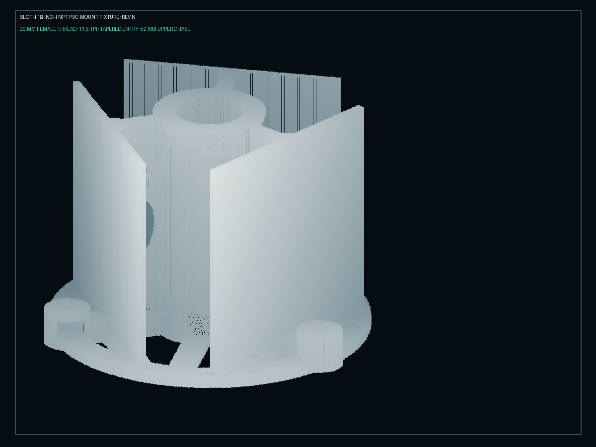

# Three-sector passive Wi-Fi antenna fixture — Rev N

**Summary**: a 3D-printed ABS fixture that holds three Wi-Fi antennas at
120° spacing, each in front of its own foil-faced planar reflector, on a
240 mm base ring that threads onto a 1-1/2 inch NPT PVC male adapter
on a PVC mast. It is a
**receive-only** structure for sloth's monitor radios: it never
transmits, and nothing in this guide changes that ([[sloth]] §2 of
`MISSION.md`). This page replaces the ten-page "Rev N build guide" PDF
and keeps every dimension, standard and procedure it carried (one
instruction is tightened, §9); what it adds is the
material the PDF left to the builder — the bill of materials with the
connector-gender trap, the thread-coupon procedure and engagement
limits, fastener and torque guidance for ABS, a sector-labelling
convention, a passive validation method that uses sloth itself, a
maintenance log, and a frank account of how the three sectors reach
sloth today (one radio at a time, §10).

**Sources**: the Rev N build-guide PDF (ReportLab, 10 pages, created
2026-11-02; its renders are headed `SLOTH 1½-INCH NPT PVC-MOUNT
FIXTURE · REV N`); ASME
B1.20.1 *Pipe Threads, General Purpose (Inch)*; Charlotte Pipe Schedule
80 PVC fitting catalog (1-1/2 in FPT/MPT adapters); Parker NPT thread
reference (60° flank, 1-1/2-11.5 designation); ISO 273 clearance holes;
[[monitor-mode]], [[rf-distance]], [[deployment]] for the sloth side.
The OpenSCAD source the PDF refers to is **not in this repository**;
see §12.

**Last updated**: 2026-11-02 (first wiki edition, from the Rev N PDF).

---

## 1. What it is and what it is for

Three sectors give sloth something one omni cannot: a **coarse bearing**.
A frame heard strongest on sector B and weakest on sector A came from
roughly B's side. That is all it gives — a sector, not an angle, and
only when three radios hear the same emitter in the same second —
which sloth cannot do today (§10).
[[rf-distance]] explains why RSSI alone is a data point and not a
location; three sectors narrow it to a third of the circle.

The fixture does three mechanical jobs:

| Job | How Rev N does it |
|---|---|
| Hold three antennas at known, repeatable azimuths | Three antenna bosses (34 mm OD × 28 mm high) on the base ring, 120° apart |
| Make each sector directional | A 5 mm planar reflector plate behind each antenna, faced with conductive foil after printing |
| Get the three coax leads to one radio stack without exposing them | Internal 10 × 10 mm radial cable trunks into a 52 mm center chase, down through the mast |

It is **not** a calibrated antenna system. The reflector geometry has
never been measured on a range; §9 gives a method for measuring what
*your* copy does.

**Limits stated up front** (each one comes from the PDF and is repeated
where it applies):

- Not pressure-rated. The NPT thread is a mechanical interface only.
- Not a sole overhead restraint. A secondary tether is mandatory
  wherever a fall could reach a person.
- Not weatherproof as printed. ABS yellows and embrittles under UV and
  the 240 mm ring moves with temperature; §11 covers inspection.
- Not for transmission. Nothing attached to it may transmit, jam,
  deauthenticate or interfere; sloth's monitor radios are configured
  receive-only ([[monitor-mode]]).

## 2. Reference dimensions

Every number below is from the Rev N drawing set. Final fit is
controlled by the printer and the specific PVC adapter (§6).

| Feature | Dimension | Notes |
|---|---|---|
| Part envelope | 248 × 240 × 173 mm | Minimum build area 260 × 250 × 180 mm with brim |
| Base ring | 240 mm OD, 200 mm ID, 8 mm thick | Six recessed mounting locations |
| Mounting pattern | 6 × ⌀7.2 mm on a 216 mm bolt circle | 60° apart; see §7 for fastener fit |
| Reflector plates | 3 × 5 mm thick, planar, at 120° | Vertical in the print orientation |
| Antenna boss | 34 mm OD × 28 mm high | One per sector, on the base ring |
| Mounting deck | 5 mm thick | Top of the boss; carries the bulkhead |
| Bulkhead bore | ⌀6.8 mm | Fits a standard SMA/RP-SMA bulkhead body (¼-36 UNS, ⌀6.35 mm) with 0.45 mm clearance |
| Wrench bay | ⌀24 mm × 18 mm high | Under the deck; side tool port into it |
| Cable trunks | 10 × 10 mm, radial | One per sector, boss → center chase |
| Center chase | ⌀52 mm | Open from the top of the NPT collar upward |
| Female thread | 1-1/2–11.5 NPT, 20 mm long | ASME B1.20.1; the render labels a tapered entry |
| Structural cutaways | three, rounded | Between spokes |

Derived figures the builder needs and the PDF did not state:

- NPT pitch at 11.5 TPI is **2.209 mm**, so the 20 mm thread zone is
  about **9 threads**. ASME B1.20.1 hand-tight engagement L1 for
  1-1/2 NPT is 0.400 in (10.16 mm, ≈4.6 threads); the remaining ≈4
  threads are the wrench make-up allowance. The taper is 1:16 on
  diameter (¾ in per foot), which is why the adapter tightens
  progressively and why §6 says never to bottom it out.
- A 216 mm bolt circle puts the six holes 108 mm from center, 12 mm in
  from the 240 mm OD edge and 8 mm outside the 200 mm ID — the recess is
  what leaves room for a washer there.
- Free-space wavelength: 2.4 GHz band ≈ 122–125 mm (λ/4 ≈ 31 mm);
  5 GHz band ≈ 51–58 mm (λ/4 ≈ 13–15 mm); 6 GHz band ≈ 42–50 mm. The
  antenna-to-reflector spacing sets the forward gain and front-to-back
  ratio of each sector, is fixed by the boss position in the SCAD
  source, and is one of the numbers to record in §11 when you measure
  your copy — the drawing set does not call it out.

## 3. Bill of materials

The PDF listed parts generically. These are the choices that matter and
the trap in each.

| Qty | Item | Specification and why |
|---|---|---|
| 1 | Printed Rev N fixture | ABS (§4). ASA is a drop-in with better UV life if the printer handles it; the print settings are the same. |
| 3 | Wi-Fi antenna elements | Dual- or tri-band (2.4/5/6 GHz) articulating dipoles, 3–5 dBi, **RP-SMA male** on the antenna is the market default (it mates the
RP-SMA female jack on the adapter). Identical model on all three sectors or the sectors are not comparable (§9). |
| 3 | Bulkhead pigtails | Panel-mount bulkhead on the deck, matching the antenna's gender (next row), to the radio's connector at the other end. ⌀6.35 mm body through the ⌀6.8 mm bore; use the **D-flat / anti-rotation** style if the boss accepts it, else a star washer. |
| — | **Connector gender** | Consumer Wi-Fi adapters (including the Alfa cards the reference host uses, see [[deployment]]) carry **RP-SMA female** jacks; their stock antennas are RP-SMA male. SMA and RP-SMA thread together but the center pin/socket are swapped, so SMA-female on RP-SMA-male screws together with **no center
contact** (socket on socket), and SMA-male on RP-SMA-female puts pin
against pin, does not seat, and can bend both. Decide the gender once, write it on the BOM line, and check every pigtail with a continuity test before it goes in the trunk. |
| 3 | Coax | RG316 (⌀2.5 mm, ~1.1–1.3 dB/m at 2.4 GHz, ~2 dB/m at 5.8 GHz) for runs under 0.5 m; LMR-195 (⌀5 mm, ~0.6 dB/m at 2.4 GHz, ~1.0 dB/m at 5.8 GHz) or RG58 (~1.0 dB/m at 2.4 GHz) if the radios sit at the mast foot; LMR-240 (~0.4 dB/m at 2.4 GHz) if the run is longer than a metre. The 10 × 10 mm trunk takes either. Every metre of thin coax costs sensitivity; keep the radios close. |
| — | Conductive foil | Copper or aluminium tape with **conductive adhesive** (the non-conductive-adhesive kind leaves seams open). Width ≥ 50 mm so a plate takes few strips and few seams. |
| 1 | PVC male adapter | 1-1/2 in **MPT × socket** (slip) adapter, Schedule 80 preferred (Charlotte Pipe catalog, 1-1/2 in). The "1-1/2" is nominal pipe size; the thread OD is 1.900 in (48.26 mm). |
| 1 | Mast | 1-1/2 in Schedule 40 or 80 PVC pipe to suit the adapter socket. |
| 6 | Base fasteners | M6 or ¼ in bolts, length to suit the mounting surface + 8 mm ring + washer + locknut. **Flat washers under every head** (§7). |
| 6 | Locknuts + washers | Nylon-insert, for the far side of the mounting surface. |
| 1 | Secondary restraint | Stainless cable or UV-rated strap from the ring (through a mounting hole, under a washer) to structure, for any elevated mount. |
| — | Grommet / spiral wrap | For the center-chase exit (§5). |
| — | Labels | Heat-shrink or laminated tags: sector letter and azimuth, at both coax ends. |

**Tools**: calipers; socket or nut driver **under 22 mm OD** (to fit the
24 mm bay); small open-end wrench or crowfoot for the side port; 1-1/2–11.5
NPT tap; deburring tool and fine file; fish tape or pull cord;
multimeter; ABS-compatible adhesive (acetone-based or solvent cement)
only if a boss needs secondary retention; isopropyl alcohol for the
reflector faces.

## 4. Printing (ABS, FDM)

### 4.1 Settings

| Parameter | Value | Why |
|---|---|---|
| Printer | Fully enclosed, stable warm chamber | A 240 mm ABS ring lifts at the corners of its spokes in any draught |
| Build area | ≥ 260 × 250 × 180 mm | Envelope plus a 10–15 mm brim |
| Nozzle | 0.6 mm | Wall count and speed; the thread still resolves at 2.2 mm pitch |
| Layer height | 0.28–0.32 mm | Coarser layers print the overhanging thread flanks worse; finer costs hours for no strength |
| Walls | 6–8 perimeters | The decks and bosses carry a tightened nut; the thread zone is all perimeter |
| Infill | 35–50 % gyroid | Isotropic in the ring; lighter patterns let the ring flex under the mast |
| Orientation | **Base down** | Ring and spokes flat on the bed, plates vertical. See 4.2 |
| Adhesion | 10–15 mm brim, clean bed | Brim on the ring OD and on each plate's foot |
| Supports | Removable, under the antenna decks only if bridging is poor | The 24 mm bay roof is a bridge; nothing else should need it |
| Cooldown | Slow, enclosed, before removal | Pulling a warm ABS part off the bed is how it ends up 1 mm out of round |
| XY compensation | From an ABS calibration print | Decides whether the 6.8 mm bore and the thread fit at all (4.3) |

### 4.2 Orientation

Never rotate the model onto a reflector face. The plate-to-base joints
and the cable trunks are designed for base-down layers: on their side,
the plates print as a tall thin wall with layer lines across the joint
(the weakest direction) and every trunk becomes an unsupported tunnel.

### 4.3 Slicer checks before committing 10+ hours

Walk the sliced preview layer by layer and confirm:

1. All six mounting bores and their top recesses are open.
2. The three 24 mm wrench bays and the side tool ports are open and
   not filled by supports you cannot reach.
3. Every 10 × 10 mm cable trunk is continuous from boss to chase —
   step through the layers at the trunk height and watch for a slicer
   that has "healed" the slot.
4. The 52 mm center chase is open above the NPT collar.
5. The thread is modelled, not smoothed away: at 0.3 mm layers each
   thread is ~7 layers.

### 4.4 Thread coupon — do this first

A 20 mm female NPT thread in ABS is the one feature that cannot be fixed
after the fact without a tap, and the tap only corrects undersize. Print
a coupon before the full part:

1. From the SCAD source, export only the NPT collar as its own STL. If
   you only have the full STL, cut it in the slicer just above the
   20 mm thread zone.
2. Print it with the production profile — same nozzle, layers, walls,
   material, chamber — or the result means nothing.
3. Let it cool fully. Deburr the entry.
4. Thread the **exact** adapter you will use into it by hand. Record the
   hand-tight depth with calipers from the collar face to the adapter
   shoulder.
5. Target: hand-tight at **8–12 mm** of engagement (near ASME's 10.16 mm
   L1). Stops in under 6 mm → the bore is undersize; add XY
   compensation (typically 0.1–0.2 mm) or scale the thread in SCAD and
   reprint. Runs past 14 mm by hand → oversize; the adapter will bottom
   out before it tightens and the joint will wobble — back the
   compensation off.
6. Record the compensation value that passed; it goes in the build
   log (§11) because a new spool of ABS can move it.

Pass the same coupon over the 6.8 mm bulkhead bore: a bulkhead body
should drop through with visible clearance and no force.

## 5. Assembly

### 5.1 Before anything else

- Deburr every opening without thinning the walls; the deck around the
  6.8 mm bore and the thread entry are the places a file does the most
  damage.
- Pull a cord through each trunk end to end. A trunk that will not pass
  a cord will not pass a connector; open it now with a drill or a hot
  tool, not after the bulkheads are in.
- Dry-fit the exact PVC adapter (§6). Chase the thread with the tap if
  it binds after one or two turns.
- Mark the sectors (5.4) **before** the foil goes on; a marker will not
  take on foil.

### 5.2 Install each antenna bulkhead

Cross-section, bottom to top: wrench bay (⌀24 × 18 mm, side tool port
into it) → 5 mm deck with the ⌀6.8 mm bore → antenna.

1. Feed a pull cord from the center chase outward through the sector's
   trunk so its end is at the boss.
2. Insert the bulkhead connector **downward** through the bore in the
   deck, antenna side up.
3. Inside the wrench bay, fit the lower washer (star washer if the
   bulkhead has no D-flat) and the nut.
4. Hold the upper connector body stationary (a second wrench on its
   flats or the supplied jam nut, never by the antenna) and tighten the
   lower nut through the side port with a socket, crowfoot or small
   wrench.
5. **Secure, not torqued.** A ¼-36 bulkhead nut on a 5 mm ABS deck is
   snug at about 1 N·m — finger-tight plus an eighth of a turn. The nut
   must not spin when the antenna is screwed on; the deck must not
   crack or dish. If the connector turns when the antenna is tightened,
   add the star washer rather than more torque.
6. Tie the pigtail's free end to the pull cord with a tapered,
   taped-over knot and draw it inward through the trunk toward the
   center.
7. Continuity-check the finished sector: center pin at the antenna
   port to center pin at the radio end, and **no** continuity center to
   shell. Do it now; it is the last time the connector is reachable
   without undoing the foil.

Repeat for the other two sectors, one trunk at a time.

### 5.3 Route the coax to the center

Routing rules (from the PDF, with the numbers filled in):

- Respect the coax's minimum bend radius: for RG316 roughly 10 × OD ≈
  25 mm for a repeated bend, 5 × OD for a one-time install bend; for
  RG58/LMR-195 about 50 mm / 25 mm (check the datasheet; LMR's
  foil-and-braid shield kinks sooner than its OD suggests). A tight bend at the trunk-to-chase
  corner is the most common place to kink it.
- Pull **one cable at a time** and label it by sector before its end
  reaches the center.
- The last short rise inside the chase lifts each cable **above the
  NPT thread** before it drops down the mast, so the adapter cannot
  pinch it when it is screwed in.
- At the chase exit fit a soft grommet or spiral wrap; coax must not
  rub on a printed edge.
- Leave a service loop of one or two turns in the chase, and keep every
  cable and connector **clear of the foil reflector faces** (a shield
  touching a reflector changes the pattern and may rattle).

### 5.4 Sector labelling convention

Pick one and keep it for the life of the fixture; it is what makes a
bearing from §9 mean the same thing next year.

- Sectors are **A, B, C clockwise viewed from above**, A being the
  sector whose reflector face carries the fixture's single alignment
  mark (a notch filed into the ring under sector A's boss works).
- On installation, point sector A at a recorded true bearing
  (default: **000° true**, so B ≈ 120°, C ≈ 240°) and write the actual
  bearing in the log. A compass app's magnetic bearing needs the local
  declination applied.
- Each coax carries the sector letter at **both** ends; the radio
  connected to it is recorded by its interface name (§10).

## 6. Mounting to the PVC mast

NPT size is nominal, not the measured thread diameter: a "1-1/2 inch"
male adapter measures 1.900 in (48.26 mm) across the threads at the large end.

1. Deburr the thread entry. Start the adapter **by hand**; it must enter
   squarely and turn freely for the first two or three threads. If it
   binds at once, chase the thread with the 1-1/2–11.5 NPT tap — a few
   turns, by hand, backing out to clear chips — and try again.
2. Hand-tighten. Expect to stop at roughly 8–12 mm of engagement (§4.4).
3. Apply **modest tool torque only**: one turn beyond hand-tight for
   plastic-on-plastic, never the two-to-three turns a metal NPT joint
   takes. Stop when the adapter shoulder is still visibly short of the
   collar face. Both ABS and PVC split under excessive tapered-thread
   engagement, and a printed collar splits along a layer line.
4. **Never bottom the adapter out**, and do not use PTFE tape or
   sealant to "take up slack": tape adds radial load to a printed
   collar that splits along a layer line, and there is nothing to seal;
   if the adapter runs in too far the thread is oversize (reprint,
   §4.4).
5. Solvent-weld the mast into the adapter socket **before** the adapter
   goes into the fixture, or the cement fumes and the twisting load end
   up in the printed thread.
6. Fit the **secondary restraint** for any outdoor, moving, overhead or
   safety-critical mount — a cable from a ring mounting hole to the
   structure, slack enough not to load the thread, short enough that a
   failed thread drops the fixture a few centimetres and no further.

Base-plate mounting (the six 7.2 mm holes) is the alternative to the
mast, or an addition to it on a flat roof plate; see §7.

## 7. Fasteners for the base ring

The ⌀7.2 mm holes are a loose clearance for **M6** (ISO 273 fine 6.4 /
medium 6.6 / coarse 7.0 mm) and a medium clearance for **¼ in**
(6.35 mm). Either works; M6 is the designed size.

- Flat washers under every head and nut, sized to span the recess
  (M6 form A, 12 mm OD, or a 1-in fender washer where the surface
  allows). A bolt head bearing directly on ABS creeps loose over the
  first thermal cycle.
- Torque to **snug plus a quarter turn**, about 2–3 N·m for M6 into a
  nylon-insert locknut. ABS cold-flows under a highly loaded washer
  and the bolt loosens itself; a 10 N·m metal-spec torque crushes the
  recess.
- Use all six holes. Three alternate holes carry the static load and
  not the wind load on three plates nearly the height of the part.
- Re-check after the first day and the first cold night (§11).

## 8. Reflector foil

Apply foil to the **outward planar face** of each 5 mm plate, as the
drawing set says; check against your print that this is the face the
sector's antenna sees, since a reflector only works on the side that
faces its antenna.

1. Clean the ABS with isopropyl alcohol (acetone softens it) and let it
   dry fully.
2. Cut the foil slightly **undersize** on every edge so it cannot wrap
   round into a cable opening or reach connector hardware.
3. Apply from the center outward with a soft squeegee; chase out
   wrinkles and air pockets as you go — a bubble is a hole in the
   reflector at 5 GHz.
4. Where a plate needs more than one strip, overlap by 5–10 mm and
   bridge each seam with conductive tape. (An overlapped seam is
   capacitively continuous at Wi-Fi frequencies even with a
   non-conductive adhesive, but it fails the multimeter check below,
   and a DC-continuous reflector is the one you can verify.)
5. Verify **continuity across each whole reflector** with a multimeter:
   under 1 Ω corner to corner, across every seam.
6. Treat all three plates identically — same foil, same coverage, same
   seam layout — or the sectors will not be comparable in §9.
7. The reflector is not grounded to anything; it floats. Do not run a
   wire from it to a coax shell.

Record foil type and coverage in the log.

## 9. Validation — passive, using sloth

The reflector geometry has never been characterised on a range. Measure
your copy with signals you are entitled to receive — your own AP
transmitting its normal beacons is enough. The PDF said "legal,
controlled test signals"; this page narrows that to signals already
on the air for their own purpose, so the test adds nothing to the
spectrum.

**Setup**: fixture on its mast in the open (no walls within ~5 m if you
can manage it), sector A pointed at a recorded bearing, sloth's
monitor radio connected to one sector at a time (§10 — sloth drives one
radio; measure the sectors in turn, or run three sloth instances). Your
own AP (`--my-bssid`) at a known bearing and 10–20 m, line
of sight.

**Procedure**:

1. Note the AP's RSSI as the connected sector reports it, averaged
   over ~30 s of beacons (the Wi-Fi/AP views; the JSONL `wifi_merged`
   record's `best_rssi`). Each sloth instance's record is that sector's
   reading; with one radio, finish one sector's twelve positions before
   moving the pigtail.
2. Rotate the fixture 30° and repeat, through 360° — twelve positions.
3. Tabulate RSSI per sector per bearing. A working sector shows a
   smooth peak when it faces the AP and a trough when its reflector
   faces it. Three near-identical curves offset by 120° is a pass. The
   depth of the front-to-back dip is not predicted here — the plate
   has not been characterised, and this table is where that number
   comes from.
4. Record the table and the peak offsets in the log. The offsets are
   the fixture's calibration; a bearing read later is only as good as
   this table.

**What a bad result means**: one sector flat → that antenna, pigtail or
gender (§3) — recheck continuity first; one sector peaking off-axis →
its antenna is leaning or its foil does not cover the plate; all three
flat → the test site is reflective (indoors, metal roof) and the method
is not telling you about the fixture.

Repeat the validation after any reprint, re-foiling or antenna change.

## 10. Connecting the sectors to sloth

**Today sloth drives one monitor radio.** `probe_open()` takes the
first monitor-capable interface `find_monitor_iface()` returns and opens
one pcap handle (`src/capture/probe.c`); `sensor_health` reports a
single `monitor_iface`; the `wifi_merged` record carries one
`best_rssi`; `--hop` retunes that one radio; and `--iface` (repeatable)
scopes the **IP** capture only — the 802.11 monitor radio sits outside
its allow-list by owner ruling (2026-10-04). `src/position_track.h`
says it in one line: sloth has one antenna and no bearing. A second
and third adapter plugged into the same sloth are ignored.

So the three sectors reach sloth in one of two ways:

1. **One radio, one sector at a time.** Connect the pigtail of the
   sector you want to the radio. The fixture is then a switchable
   directional antenna: more gain and less clutter from behind, no
   bearing. For validation (§9) move the pigtail between sectors.
2. **Three sloth instances, one radio each.** Each instance needs its
   own monitor interface to be the first one its discovery finds — in
   practice three hosts, or three network namespaces each holding one
   adapter — its own `--site-label` naming the sector (`…-sector-a`),
   its own data socket and database, and the clocks disciplined to the
   same source ([[deployment]] §7.3) so the three JSONL streams can be
   lined up by time. slothweb reads one database; a per-sector
   comparison is a join across three, done outside sloth.

Nothing combines three radios into one receiver — and it should not:
summing three sectors through a passive combiner throws the sector away
and costs ~4.8 dB of splitter loss on top of the coax.

**What would make three sectors native** is a multi-radio probe: one
`SENSOR_WIFI` per monitor interface (the sensor table already carries an
`iface` per sensor, and `poll.c` notes that a second monitor radio
"would merge under its own sensor id"), per-sensor RSSI in `wifi_merged`
beside `best_rssi`, and a sector field on the monitor rows. A bearing
estimate in the style of [[rf-distance]] — loudest sector, margin over
the next, against the §9 table — would sit on top of that as a data
point, with no alert rule reading it. None of it exists; this page is
the requirement, not the description.

## 11. Inspection, commissioning and maintenance

### 11.1 Commissioning checklist

Mechanical:

- [ ] No layer separation, warping or cracks — look along each plate's
      foot and around each boss.
- [ ] All three reflector plates vertical and rigid; no flex at the
      base joint when pushed.
- [ ] All six base fasteners present, washered, snug (§7).
- [ ] PVC adapter square to the ring and not over-tightened (§6);
      shoulder visibly short of the collar face.
- [ ] Antenna nuts secure and still serviceable through the side ports.
- [ ] Wrench bays and the three drain cutaways clear.
- [ ] Secondary restraint fitted where required.

Cable and RF:

- [ ] All three coax leads labelled at both ends with the sector letter.
- [ ] No cable pinched, kinked or bent under its minimum radius.
- [ ] Chase exit has edge protection and strain relief.
- [ ] Bulkhead center pins undamaged; gender confirmed (§3).
- [ ] Reflector foil smooth, continuous, under 1 Ω end to end.
- [ ] Foil clear of every connector and cable.
- [ ] Passive scan shows all three sectors hearing your own AP (§9).

### 11.2 Build and installation record

Keep this with the fixture (a card inside the chase in a bag works) and
in the site notes:

| Field | Value |
|---|---|
| Fixture revision | Rev N |
| Printer / firmware |  |
| Material (brand, colour, lot) |  |
| Slicer profile (nozzle, layers, walls, infill) |  |
| XY compensation / thread scale that passed the coupon |  |
| Hand-tight engagement depth (mm) |  |
| Antenna model (×3) |  |
| Pigtail / coax type and length (×3), connector gender |  |
| Reflector foil type, coverage, seam count |  |
| Base fasteners, torque |  |
| Mast / adapter (schedule, source) |  |
| Sector A bearing (° true), B, C |  |
| Interface names A / B / C |  |
| Validation table date and peak offsets (§9) |  |
| Installation date, site, height |  |

### 11.3 Re-inspection schedule

Reinspect after the first thermal cycle (first cold night), after any
transport, after high wind, and at least each season outdoors:

- fasteners and the adapter for loosening (ABS creeps; expect a
  quarter turn on the first visit);
- the thread collar and plate feet for cracks;
- foil for lifting edges and oxidation (aluminium dulls, copper
  greens — both raise seam resistance; re-measure);
- UV chalking or yellowing of the ABS — paint with a UV-stable
  acrylic or move to ASA at the next reprint;
- water in the chase: the cutaways drain the ring, but the chase
  drains only down the mast — if the mast is capped, drill a weep hole.

## 12. Source files and revision

- The parametric model is **OpenSCAD**. The PDF says to use it "for
  dimensional adjustment" — the thread scale and XY compensation from
  §4.4 belong there, not in the slicer alone, so the next print starts
  from the corrected model.
- The source is not in this repository. When it is added it needs a
  home outside the root (`agents/AGENTS.md` "no new files at repo
  root"); `docs/hardware/` next to this page's assets, or a
  `hardware/` tree if more fixtures follow, is an owner call.
- Revision discipline: a change to any dimension in §2 is a new
  revision letter, a new coupon (§4.4), a new validation table (§9),
  and an update to this page and the record in §11.2.

## 13. Standards and references

- **ASME B1.20.1** — *Pipe Threads, General Purpose (Inch)*: 1-1/2–11.5
  NPT form, 60° flank, 1:16 taper, L1 hand-tight engagement 0.400 in.
- **Charlotte Pipe** Schedule 80 PVC fitting catalog — 1-1/2 in FPT and
  MPT adapters; dimensional source for the mating part.
- **Parker** NPT thread reference — 60° flank and the 1-1/2–11.5
  designation; the quick-reference the PDF cites.
- **ISO 273** — clearance holes for bolts and screws (M6 fine 6.4 /
  medium 6.6 / coarse 7.0 mm).
- Coax loss figures are the manufacturers' published nominal values
  for RG316 and RG58/LMR-195 and vary by brand; use the datasheet of
  the cable you buy.

## Related pages

- [[monitor-mode]] — the radio mode each sector's adapter runs in.
- [[rf-distance]] — why RSSI is a data point, which is also why a
  sector is a sector and not a bearing.
- [[deployment]] — the hardened unit, the `.link` interface pinning and the
  single `SLOTH_IFACE` the hardened unit brings up.
- [[cli-reference]] — `--iface` (IP capture only), `--monitor-only`,
  `--hop`, `--my-bssid`, `--site-label`.
- [[wifi-sigint-guide]] — what a listener can and cannot infer from
  what the three sectors hear.
- [[location]] — the sensor's own position, which a bearing would be
  relative to.
