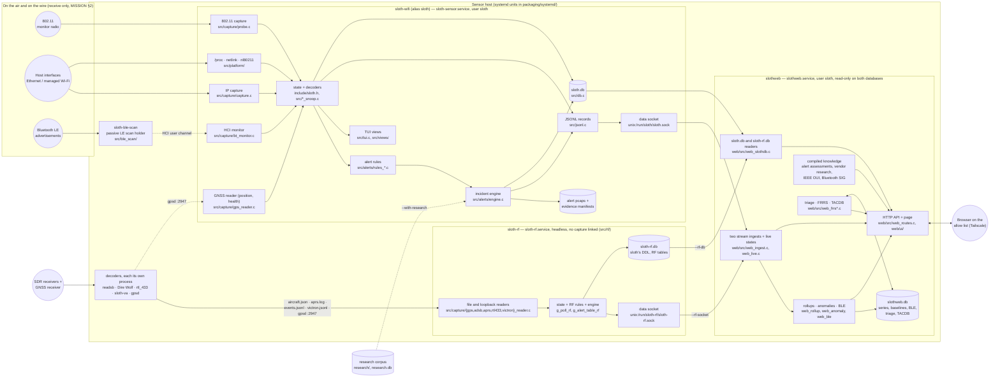

# Architecture

**Summary**: How sloth's source is organised: header → CLI → platform vtable → capture pipeline → per-protocol parsers → state → views. The sensor is two daemons from one tree since the cutover (#216): `sloth-wifi` (the capture, the monitor radio, BLE and the terminal; `sloth` is a symlink to it) and `sloth-rf` (the SDR decoders and the GNSS records, headless).

**Sources**: `CLAUDE.md`, `Makefile`, `tests/test_build_recipe.c`, `tests/tmp_dir.h`, `tests/test_tmp_dir.c`, `tests/main_test.c`, `web/tests/wt_tmp.h`, `web/tests/web_test_main.c`, `src/sloth_clock.h`, `src/poll.h`, `src/poll.c`, `src/poll_core.c`, `src/poll_gnss.c`, `src/poll_rf.c`, `src/run_flag.h`, `tests/test_poll.c`, `src/rf/main.c`, `src/rf/rf_args.c`, `src/rf/platform_rf.c`, `src/capture_side.h`, `src/rf_side.h`, `src/rf_moved.h`, `src/sys_status_rf.c`, `src/db.h`, `src/alerts/rules.h`, `src/alerts/rules_table_rf.c`, `src/jsonl_internal.h`, `src/sys_status.h`, `src/daemon_start.h`, `tests/test_rf_build.c`, `src/dot11_frame.h`, `src/capture/frame_edge.h`, `src/capture/probe.c`, `src/worker_thread.c`, `tests/test_worker_thread.c`, `docs/views/connections.md`, `docs/views/packets.md`, `docs/views/dashboard.md`, `docs/views/devices.md`.

**Last updated**: 2026-11-16 (#209: the descriptor guard at every test-case boundary, the harness teardown behind it, and the two modules whose pinned directory nothing released); 2026-11-15 (#216, the cutover: `sloth-wifi` and `sloth-rf` in the system map, the threads and the build layout; the RF side as data, `check_wifi_no_rf`, two tables not three, the per-binary counts); 2026-11-15 (#213 review: the `nm` gate's lists as widened, by member and by family; 49 members, measured); 2026-11-15 (#213: `sloth-rf`, the second daemon; the capture side as data the shared services take; the `nm` gate on its link); 2026-11-15 (#212: source groups, the run flag's own file, the stage table as data); 2026-11-03 (#180: fragattack's sixth table, no new lock edge); 2026-11-02 (the system map: sensor, BLE scan helper, slothweb and its stores); 2026-10-27 (temporary files: the leak guard, interrupts and a long TMPDIR; #95, #118, #141, #132, #130, #109)

---

## System map

How the pieces connect at run time: the receive-only inputs, the sensor's two daemons, and slothweb, which reads each daemon's stream and database (read-only) and keeps its own store. Every arrow is a read or a local hand-off; nothing here transmits onto a monitored network (`MISSION.md` §2).

The sensor is two daemons since the cutover (#216, [ADR 0010](adr/0010-wifi-rf-daemons.md), [[architecture-rf-split]]). **`sloth-wifi`** is the original program under its new name: the IP capture, the 802.11 monitor radio, BLE and the terminal views; `sloth` is a symlink to it. **`sloth-rf`**, drawn below it, reads what the SDR decoders and `sloth-va` write and has its own stream and its own database; it has no terminal. `sloth-wifi` reads none of the decoders and refuses their flags. Both link the one GNSS reader: `sloth-wifi` for the position stamp, the device and sensor tracks, the twin rules' motion check and the receiver's health, `sloth-rf` for the `gnss_*` records, tables and alerts as well. Neither needs the other at run time, and slothweb reads both (`--socket` / `--sloth-db` and `--rf-socket` / `--rf-db`).



## Tree

```
include/sloth.h            -- central header: shared structs; re-includes the two below
include/sloth_view.h       -- view_t, VIEW_COUNT, view_label(), view_for_key()
include/sloth_views.def    -- the view list: one X(ID, label, key, slug) row per view
include/sloth_alert.h      -- alert_type_t, ALERT_TYPE_COUNT, alert_type_name(), alert_technique()
include/sloth_alerts.def   -- the alert-type list: one X(ID, technique) row per rule
include/sloth_compat.h     -- SLOTH_STATIC_ASSERT, the C99 compile-time assertion
tools/docs_counts.sh       -- `make docs-counts`: rewrites the prose counts from the .defs
src/main.c                 -- `sloth-wifi` (alias `sloth`): CLI, signal handlers, poll loop
src/rf/main.c, rf_args.c   -- `sloth-rf` (#213): its CLI and headless poll loop
src/rf/platform_rf.c       -- sloth-rf's platform vtable: two file reads, nothing else
src/capture_side.c         -- what sloth-wifi registers with the services both daemons share
src/rf_side.c              -- what sloth-rf registers with them (#216)
src/rf_moved.c             -- the six decoder flags sloth-wifi refuses, and the line it prints
src/daemon_start.c, gnss_flags.c
                           -- the flag checks and start-up steps both mains call
src/rf_flags.c             -- the decoder flags' checks: sloth-rf's
src/tui.c / tui.h          -- ncurses rendering, colour init, key polling (ANSI fallback)
src/platform/linux*.c      -- rtnetlink, nl80211, /proc readers, INET_DIAG
src/capture/capture.c      -- libpcap thread; dispatches to per-protocol parsers
src/capture/frame_edge.c   -- the pcap-edge gate both capture callbacks call first (#141)
src/{dns,tls,quic,http,ntp,icmp}_log.c  -- ring buffers + snapshot ([[ring-buffers]])
src/{alerts,beacon_detect,devices,threat_intel,filter,jsonl,alert_pcap,
     top_hosts,ip_color,ip_owner}.c     -- synthesis + export
src/views/*.c              -- one file per VIEW_*
src/md5.c                  -- embedded MD5 for JA3 (RFC 1321 vectors verified)
src/sloth_clock.c          -- the one clock seam: sloth_wall() / sloth_mono_ms()
tests/                     -- unit tests, fake platform, scenarios
tests/fuzz/fuzz_*.c        -- libFuzzer harnesses; one rule per archive builds them all
build/<cfg>/               -- objects + libsloth_core.a per configuration (ignored)
docs/views/*.md            -- per-view deep dives
```

## Seams

- **Platform vtable** (`platform_ops_t` in `sloth.h`) — see [[platform-vtable]].
  Views never call platform ops directly; they read `sloth_state_t`.
- **Capture pipeline** — `src/capture/capture.c` runs a libpcap thread,
  decodes Ethernet → IPv4/v6 → TCP/UDP, then dispatches to
  `dns_log`, `tls_log`, `quic_log`, `http_log`, `ntp_log`, `icmp_log`.
  ARP, LLC, and unknown ethertypes are filtered before the ring buffer.
  The packet ring itself is private to the capture thread and reaches
  `sloth_state_t` only as a per-poll copy (`capture_ring_snapshot()`,
  the first SNAPSHOT stage of `poll_tick()`, #111/#113) — see [[ring-buffers]]. The
  802.11 side (`src/capture/probe.c`) follows the same rule, and every
  module it feeds, `src/fragattack.c` included since #111, holds its
  tables behind its own mutex.
- **Pcap-edge gate** (`src/capture/frame_edge.h`, #141) — the first
  thing both capture callbacks do. `frame_view_init()` turns a libpcap
  record header into a `frame_view_t` or refuses the frame before a byte
  of it is read: capture length 0, above the 65535-octet snaplen both
  handles open with, or above the record's own wire length, or a
  timestamp whose microseconds are out of range. Everything after it
  reads the view, never `hdr`; the unchecked `(int)hdr->caplen` casts
  in `on_packet()` and `on_probe_frame()` are gone (CWE-1284). Refusals
  count as `parse_fault_frame_edge` ([[jsonl-schema]]).
  `frame_view_radiotap()` is the monitor DLT's half — radiotap
  verdict, FCS strip, 802.11 minimum — and is the one call both
  `on_probe_frame()` and `decode_frame()`'s `DLT_IEEE802_11_RADIO` arm
  make, so the two radio entry points cannot disagree on what a valid
  header is. libpcap-free, so it is unit-tested and fuzzed
  (`fuzz_frame_edge`) without `WITH_PCAP`. The IP length clamp is not
  here; it is the next stage's.
- **IP to transport, once** (`src/capture/capture.c`, #132) — behind the
  edge gate, `l4_from_ipv4()` / `l4_from_ipv6()` reduce an IP packet to
  its transport segment and `decode_l4()` is the one TCP/UDP/ICMP
  dispatch for both versions; until #132 each IP version carried its own
  copy and the IPv6 one had silently lost Kerberos and SNMP. The IP
  length field (Total Length / Payload Length) clamps the segment, so
  link-layer padding never reaches a payload parser; a non-first
  fragment is labelled `IPv4 frag` / `IPv6 frag` and not parsed; IPv6
  extension headers (0, 43, 60, 51, 44) are walked. `decode_tcp()`
  reads the data offset once and the `try_*` observers take the
  payload, not the segment. Faults count as `parse_fault_ip_truncated`
  / `parse_fault_ip_fragment` ([[jsonl-schema]]).
- **802.11 frame view** (`src/dot11_frame.h`, #122) — each monitor frame
  is decoded **once**: `probe.c :: on_probe_frame()` and the
  `DLT_IEEE802_11_RADIO` arm of `capture.c :: decode_frame()` strip the
  FCS radiotap announces (`dot11_fcs_strip_len()`, truncation-aware,
  called from `frame_view_radiotap()` since #141),
  hand radiotap's FCS/DATAPAD/BADFCS flags to `dot11_frame_decode()`
  as hints, and read type, subtype, flags, header length, body offset
  and the Table 9-26 address roles out of the resulting `dot11_frame_t`.
  The §9.2.4.1.10 rule (Order means HT Control only in management and
  QoS data frames) lives in that one function. Since #130 every observer
  takes the view: `eapol_observe_frame`, `frag_observe_frame`,
  `pm_forge_observe_frame`, `queue_evict_observe_downlink_frame`,
  `beacon_parse_frame`, `deauth_parse_frame`,
  `assoc_request_parse_frame`, `action_observe_frame` and
  `ctrl_observe_frame` are what `on_probe_frame()` calls, and none of
  them reads Frame Control — type, subtype, the DS bits, Retry, PwrMgt
  and Protected all come from the view, and the protocol-version check
  three parsers did by comparing FC octet 0 whole is the view's `proto`.
  The data-frame questions (TID, A-MSDU bit, CCMP PN) are
  `dot11_frame_tid/amsdu/ccmp_pn()`. The old `(dot11, len)` entry
  points, and the byte-pointer helpers in `src/dot11_data.h`, remain as
  wrappers that decode once and call the view form, because the unit
  tests and fuzz harnesses are written against them. A DATAPAD data
  frame is handed on as the on-air frame through `dot11_frame_depad()`,
  which moves the view onto the depadded copy without decoding it again.
  `tests/test_dot11_frame.c` arms a decode counter around
  `probe_test_dispatch()` and holds it at one decode per frame, every
  frame type included; `grep -n '(dot11\[0\] >> 2)\|dot11\[1\] &
  0x40\|dot11\[22\]' src/` is empty. Protected handling stays per
  observer and is now read from `f->protected_`: deauth/disassoc and
  Action decline the ciphertext body (they are the robust management
  frames), the data observers branch on it as before, and Beacon and
  (Re)Association Request — never robust, never encrypted — ignore it
  as they always did. Detector output is unchanged; `make replay-check`
  matched the golden without regeneration. Tests build frames with
  `tests/frame_build.h`, which appends optional fields only when the
  test states them. Two consequences an operator can see: the monitor
  packets band's per-frame length excludes the FCS when radiotap says
  one is present (it used to include the four trailer octets), and a
  (re)association response of 30–35 octets now reaches the assoc
  tracker (a stale 36-octet floor dropped them).
- **Alert engine** — `src/alerts/engine.c` runs every rule each poll in
  the order of `src/alerts/rules_table.c`, dedupes by stable key, fires
  JSONL + per-alert pcap. The rules live in `src/alerts/rules_<domain>.c`
  (#118). See [[alerts]].
- **Clock seam** (`src/sloth_clock.h`, #109) — `sloth_wall()` for
  evidence (timestamps, export) and `sloth_mono_ms()` for durations
  (windows, TTLs, cooldowns); `sloth_clock_test_set()` swaps either for
  tests, `NULL` restores the real one. Stamping through the seam and
  checking against libc is a bug no test can see while both read real
  clocks: the evil-twin taint did exactly that, so under an injected
  clock it never matched and in production an NTP step mis-aged its
  TTL. `src/sloth_clock.c` is the only file in `src/` that reads a libc
  clock: `tests/test_clock_seam.c` walks every `.c` and `.h` under
  `src/` and fails naming any other file that calls `time(NULL)` or
  `clock_gettime()` (comments included — say "the wall clock" in
  prose). Per-poll rate code takes `sloth_mono_ts()`, a timespec view
  of the same monotonic clock. Views render ages through `sloth_wall()`
  too, so a test can pin the age column. The #88 `flood_wall()` /
  `flood_mono_ms()` / `flood_test_set_clock()` forwards were deleted
  once nothing called them.
- **Correlation seams** — modules that answer a question sloth's own
  sensors cannot. `src/inventory.c` reads the operator's approved-BSSID
  file ([[inventory]]); `src/wired_attach.c` is a one-slot in-process
  registration point for a future switch/controller/DHCP correlator, so
  the twin surfaces can render "is this AP on the wire" without any of
  them pretending RF answers it (#89 slice 3). Both are read-only,
  in-process, and neither is a control surface or a plugin loader.

## Build layout

Since #115 every binary is derived from one set of source lists in the
`Makefile`; nothing keeps a list of its own.

- `APP_SRCS` = `src/main.c`, `src/tui.c` and the real platform vtable
  (`src/platform/linux.c` on Linux) — what only the shipped
  `sloth-wifi` links. `TARGET` is `sloth-wifi` since #216;
  `TARGET_ALIAS` is `sloth`, a relative symlink to it that `make`
  makes beside it (remade if a regular file of that name, a
  pre-cutover binary, is in the way) and `make install` puts in
  `$(PREFIX)/bin`. One program under two names: nothing in it reads
  `argv[0]` to decide what it is.
- `CORE_SRCS` = everything else the current `WITH_*` configuration
  compiles: `CORE_COMMON_SRCS` plus whichever feature groups
  (`LINUX_PLATFORM_SRCS`, `LINUX_WIFI_SRCS`, `PCAP_CORE_SRCS`,
  `SQLITE_CORE_SRCS`) the flags leave on. It is archived as
  `build/<cfg>/libsloth_core.a` and linked after the app objects.
- `CORE_COMMON_SRCS` is the union of three named groups since #212, the
  build seam for the two daemons of [[architecture-rf-split]] (ADR
  0010). A new `src/*.c` still goes in exactly one list, once:
  - `RF_SRCS` — only ADS-B, APRS, rtl_433 or Victron: `src/adsb.c`,
    `src/adsb_beast.c`, `src/aprs.c`, `src/rtl433.c`, `src/victron.c`,
    their `src/capture/*_reader.c`, `src/alerts/rules_adsb.c`,
    `src/poll_rf.c`, since #213 `src/jsonl_rf.c`,
    `src/alerts/rules_table_rf.c` and `src/rf_flags.c`, and since #216
    `src/sys_status_rf.c` and `src/rf_side.c`. What sloth-rf owns, and
    what sloth-wifi does not link (`check_wifi_no_rf`, below). The
    ADS-B terminal view, `src/views/adsb.c`, was in this group until
    the cutover and is deleted: sloth-rf is headless.
  - `GNSS_SRCS` — only the `--gps` / `--location` receiver:
    `src/gps.c`, `src/capture/gps_reader.c`, `src/position_track.c`,
    `src/alerts/rules_gnss.c`, `src/views/gnss.c`, `src/poll_gnss.c`,
    `src/gnss_flags.c`. Both daemons link the reader, the track and the
    flags; the view is sloth-wifi's alone and `rules_gnss.c` sloth-rf's
    alone (the four `GNSS_*` rules are on `check_wifi_no_rf`'s list).
  - `CORE_BASE_SRCS` — the rest: the Wi-Fi, wired and BLE modules and
    what both daemons share (the alert engine, JSONL, the clock, the
    run flag, the poll runner). `src/sys_status.c` and
    `src/alerts/rules_sensor.c` read every source and stay here.

  The test for the first two is the include graph, not the topic: a
  file belongs there only if nothing in the base has to move with it.
  Every consumer still reads the union: it all goes into one archive,
  and each binary's linker takes the members something it links
  references. The two daemons differ by what their own objects name,
  not by a second list; the test, no-flag, bench and fuzz builds link
  what they linked before.
- **`sloth-rf` (#213)** is linked from three objects of its own
  (`RF_APP_SRCS`: `src/rf/main.c`, `src/rf/rf_args.c`,
  `src/rf/platform_rf.c`) and the same `libsloth_core.a`, so only the
  archive members something references come in: 51 of them (49, and
  `--victron`'s `victron.o` and `victron_reader.o`), against
  159 before the seams below were cut, and no libpcap, ncurses or
  resolver. There is no second source list. `RF_LDFLAGS` is `LDFLAGS`
  without `-lpcap` and the curses library; the binary's `DT_NEEDED` is
  libm, libsqlite3 and libc. Built by `make`, removed by `make clean`,
  relinked through its own stamp (`build/sloth-rf.link`), installed by
  `make install` (#215).
- **The `nm` gate on it** (`check_rf_no_capture`, beside
  `check_no_hci_builder`, which runs on it too): after the link, the
  binary must import no `pcap_*`, no resolver call (`getnameinfo`,
  `getaddrinfo`, `gethostby*`, `res_*`), none of the calls a netlink
  or raw-socket module is made of (`sendto`, `sendmsg`, `sendmmsg`,
  `recv`, `recvfrom`, `recvmsg`, `recvmmsg`, `ioctl`,
  `if_nametoindex`, `if_indextoname`; its own sockets are read, and
  its one write to a peer is `send()` of gpsd's `?WATCH`), and no
  `initscr` or `newterm`; and must define none of a list of sloth's
  own entry points - `capture_open`, `capture_run`, `capture_start`,
  `probe_open`, `probe_run`, `bt_monitor_open`, `bt_capture_run`,
  `ble_mon_ingest`, `bt_stream_feed`, `btle_ll_parse`, `replay_run`,
  `dot11_frame_decode`, `radiotap_parse`, `beacon_parse_frame`,
  `deauth_parse_frame`, `eapol_observe_frame`, `action_observe_frame`,
  `frag_observe_frame`, `ctrl_observe_frame`, `karma_observe_frame`,
  `assoc_request_parse_frame`, `pm_forge_observe_frame`,
  `mle_bss_observe_frame`, `dot11_ie_find`, `dot11_data_addrs`,
  `evidence_ring_init`, `alert_pcap_dump`,
  `evidence_export_pcap_unique`, `linux_wifi_scan`,
  `linux_wifi_set_channel`, `linux_wifi_get_stations`,
  `linux_get_ifaces`, `linux_get_conns`, `linux_tcpdiag_fill`,
  `linux_neigh6_fill`, `linux_get_dhcp`, `linux_get_self_macs`,
  `resolve_pids`, `discovery_publish`, `dns_init`, `dns_resolve`,
  `tui_init` - nor any symbol of twelve families held by pattern
  (`linux_*`, `dot11_*`, `*_observe_frame`, `*_parse_frame`, `bt_*`,
  `ble_*`, `btle_*`, `evidence_*`, `eapol_*`, `discovery_*`, `view_*`,
  `tui_*`). A name guards the archive member that defines it, which is
  why the backend and the decoders are listed member by member. What
  the gate holds out is what opens, decodes or captures; the 802.11
  tables and labels sloth-rf does link are listed in
  [[architecture-rf-split]] §10. A failure deletes the binary. It is checked on the link
  because a Makefile list cannot see one new call from a shared file
  pulling a capture module in. `tests/test_rf_build.c` holds every
  name on the list to a definition in the tree (a renamed symbol would
  otherwise stop guarding), every pattern to a named definition it
  matches, and the shared files to including no capture header.
- **The mirror gate on `sloth-wifi`** (`check_wifi_no_rf`, #216):
  after the link, the binary must define no symbol of the decoders or
  their readers (`adsb_*`, `aprs_*`, `rtl433_*`, `victron_*`), of
  their rules and the receiver's (`rule_adsb_*`, `rule_gnss_*`,
  `rules_adsb_*`, `rules_gnss_*`), of their records and
  `sensor_health` blocks (`jsonl_emit_{gnss,adsb,aprs,rtl433,victron}`,
  `jsonl_sh_{adsb,aprs,rtl433,victron,rf}*`, `jsonl_emit_state_rf`,
  `jsonl_emit_sensor_health_rf`) or of sloth-rf's own stages, tables
  and side (`poll_st_*_rf`, `g_poll_rf`, `g_alert_table_rf`,
  `rf_flags_*`, `rf_flag_*`, `rf_side_install`,
  `sys_status_rf_fill`). All patterns, file-local symbols included.
  The GNSS reader, the position track and the GNSS view are not on
  it, and `rf_moved_*`, this daemon's refusal of the six flags, is not
  matched. It is a list of names, so it holds RF *files* out of the
  link, not RF code in a shared file: `src/db.c`'s writers for the
  RF tables are compiled into both daemons and are kept off in
  `sloth-wifi` at run time by `db_set_rf_side()`, which
  `tests/test_rf_db.c` holds ([[architecture-rf-split]] §12). Until the cutover every RF file was in the one binary;
  what keeps them out now is only that nothing sloth-wifi references
  leads to them, so the gate is on the link for the reason sloth-rf's
  is. `tests/test_rf_build.c` holds each pattern to a named definition
  it matches and to not matching what sloth-wifi keeps. Seen to fail
  with a call to `adsb_state_name()` and then to `rules_gnss_forget()`
  added to `src/main.c`. A failure deletes the binary.
- **The RF side is data too (#216).** Three shared files named the
  decoders until the cutover, so linking them linked the decoders.
  Each takes that part from the daemon, as the capture side does:

  | Service | What it no longer names | Where it comes from |
  |---|---|---|
  | `sys_status` (`src/sys_status.c`) | the `adsb`, `aprs`, `rtl433` and `victron` source rows | `sys_status_set_rf_side()`; the rows are `src/sys_status_rf.c`. The `gnss` row stays in `src/sys_status.c`: both daemons report it |
  | Database (`src/db.c`) | `adsb_row_sig()`, `adsb_emergency_name()`; and whether to write `gnss_fixes`, `gnss_sightings`, `adsb_*`, `aprs_*`, `victron_*` at all | `db_set_rf_side()` (`src/db.h`). Unregistered, none of those tables is written, whatever the state holds: sloth-wifi has a receiver's fix and sky in its state and still writes no `gnss_*` row |
  | JSONL (`src/jsonl.c`) | the five `jsonl_emit_*` RF records and the five `jsonl_sh_*` decoder blocks | not called there any more; `src/jsonl_rf.c` is sloth-rf's |
  | Poll (`src/poll.c`) | `health_rf`, `sensors_rf` | `g_poll_wifi` has neither |
  | Rule table (`src/alerts/rules_table.c`) | the four GNSS rules, `rule_adsb_emergency`, their `*_forget()` | `g_alert_table_rf` only |

  sloth-rf hands the first two and its rule table over in one call,
  `rf_side_install()` (`src/rf_side.c`), first thing in `main()`.
  sloth-wifi does not link that file. The test binary links both
  sides: `capture_side_install()` clears the RF side as well as
  installing the capture's, so every test starts as sloth-wifi, and a
  test of a decoder selects sloth-rf's shape (`tests/rf_profile.h`).
  The persisted numbers do not move: `sys_src_id_t`, `sensor_kind_t`
  and `alert_type_t` are one enum each for both daemons, and a row a
  daemon does not have is absent, not renumbered.
- **The capture side is data (#213).** Linking the alert engine,
  `sys_status` or the JSONL writer used to link the capture, because
  each named its modules. Each now takes that part from the daemon:

  | Service | What it no longer names | Where it comes from |
  |---|---|---|
  | Alert engine (`src/alerts/engine.c`) | the rule table, the rules' `*_forget()`, the two pcap exporters | the selected `alert_rule_table_t` (`src/alerts/rules.h`): `g_alert_table_wifi` or `g_alert_table_rf` |
  | `sys_status` (`src/sys_status.c`) | the capture, monitor, btmon and btcap source rows; the beacon-recall sample | `sys_status_set_capture_side()`; the rows are `src/sys_status_capture.c` |
  | Memory sample (`src/sensor_health.c`) | the resolver's call count | `sh_set_resolver_calls_fn()` |
  | JSONL (`src/jsonl.c`) | split in three: the sink, builders, alert records and shared `sensor_health` blocks are `src/jsonl_core.c`; the GNSS, ADS-B, APRS and rtl_433 records are `src/jsonl_rf.c`; the capture's records stay in `src/jsonl.c` | link: a daemon references the files it needs (`src/jsonl_internal.h`) |
  | Poll (`src/poll_core.c`) | the EMIT stage and `persist_health_poll()` | `src/poll.c` (sloth-wifi), `src/poll_rf.c` (`poll_st_jsonl_rf`) |
  | `libver` | `pcap_lib_version()` | `src/libver_pcap.c`; `libver_format_libs()` takes the word |
  | Platform | `src/platform/linux.c`'s vtable | `src/rf/platform_rf.c`: `sys_read` and `sys_list` only |

  sloth-wifi hands all of the first three over in one call,
  `capture_side_install()` (`src/capture_side.c`), first thing in
  `main()`; the test binary calls it before every test. sloth-rf does
  not link that file: it registers its own side (above) and no
  capture, which is what "no capture" means to the three services.
  [[architecture-rf-split]] lists each seam with the symbol that
  forced it.
- The worker run flag (`capture_run_flag_t`, #95) is `src/run_flag.c`
  / `run_flag.h` since #212. It was defined in `src/capture/capture.c`,
  so the GNSS, ADS-B, APRS and rtl_433 readers needed the capture
  module to have a stop flag; none of their objects references a
  `capture.o` symbol now. `capture/capture.h` includes the new header,
  so the capture, monitor and Bluetooth workers read it as before.
- `sloth_test` links every `tests/*.c` against a core archive built
  from `CORE_SRCS_ALL` plus `src/tui.c`, `src/reset_all.c` and the
  library halves of the research tools (`TEST_ONLY_SRCS`), compiled
  with `-DWITH_NCURSES -DWITH_PCAP` — the configuration `sloth` ships
  in, since #116. Every view draws through the real renderer into an offscreen
  ncurses screen (`tui_init_offscreen()`, output to `/dev/null`) and
  tests read the cells back (`tui_test_line()`, `ASSERT_LINE_HAS`,
  `ASSERT_SCREEN_HAS`). Only the platform is a stand-in
  (`tests/fake_platform.c`); `src/main.c` is not linked.
  `tests/test_views_render.c` walks `sloth_views.def` through
  `tui_draw()`: each view's tab is the one reverse-video label, its body
  is what its own draw renders, and the dashboard draws no tab bar. It
  also ratchets the remaining `ASSERT(1)` smoke asserts — a ceiling that
  only moves down, and a list of converted files that must hold none.
- `sloth_test_noflags` is the same suite without the two flags,
  against the ANSI renderer and probe.h's stubs: built, never run, so
  the `#ifndef` halves keep compiling. Before #116 that was the
  configuration the suite *ran* in, with a no-op renderer
  (`tests/null_tui.c`) and the capture path in a second binary,
  `sloth_test_pcap`.
- `make fuzz` builds every `tests/fuzz/fuzz_<name>.c` with one rule
  against a clang-built core archive (plus the ANSI half of `src/tui.c`
  and the fake platform; no fuzz binary links ncurses). The archive keeps each target narrow: the linker pulls only
  the members the harness reaches, so `fuzz_radiotap_parse` still links
  no snooper and no alert code. A new module or harness needs no
  Makefile edit — the hand-kept inline lists this replaced failed CI on
  2026-10-14 when a module they named gained a dependency.
- The exception is a harness whose seam exists only under `WITH_PCAP`
  (`fuzz_decode_frame`, over `capture_test_decode_frame()`, #125). Those
  are named in `FUZZ_PCAP_TARGETS` and link a second archive,
  `build/fuzz-pcap/`, compiled with `-DWITH_PCAP` and linked with
  `-lpcap`. `make fuzz` runs them after the plain targets; `FUZZ_PCAP`
  says what a missing `<pcap.h>` means — `auto` (default) prints a
  `SKIPPED` line naming each target, `1` fails, `0` never runs them.
  `make fuzz-pcap` runs only that half.
  `tests/test_docs_consistency.c :: test_every_fuzz_harness_is_built`
  holds the list to the directory: no name without a harness, no
  WITH_PCAP-seam harness off the list, no plain harness outside
  `FUZZ_SRCS`.
- Objects live in `build/n<NCURSES>p<PCAP>w<WIFI>s<SQLITE>/` (`embedded`
  is `n0p0w1s0`), `build/test/`, `build/test-pcap/`, `build/fuzz/` and
  `build/fuzz-pcap/`.
  Each directory carries a flags stamp, so changing `EXTRA_CFLAGS`
  recompiles instead of reusing objects built without, say, `-Werror`;
  `sloth` relinks when the configuration changes even if no object is
  newer. Header dependencies come from `-MMD`.
- `make cppcheck` still scans the `src` and `research` directories — the
  exact command CI runs. `tests/test_build_recipe.c ::
  test_cppcheck_target_matches_ci` holds the two argument lists equal
  until CI calls the target itself (#119).

The "`make clean` between configs" rule in `agents/AGENTS.md` stays in
force until the per-config directories have a week of green CI behind
them; relaxing it belongs to the batched `agents/` change (#119).

## Tick

One pass of the main loop is `poll_tick()` (`src/poll_core.c`, #113): a
table of named stages, each tagged with a phase, run in table order.
`main.c :: poll_data()` builds the `poll_ctx_t` — one wall and one
monotonic reading through the clock seam, the research handle, and two
hooks for consumers that live in the app rather than the core library
(the tui alert-hot list, the channel-hop scheduler) — and passes the
table.

The table is data the application supplies (#212). There are two
(`poll_table_t`, `src/poll.h`); until the cutover (#216) a third,
`g_poll_sloth`, was their union and what the one binary ran:

| Table | Stages | Defined in | Passed by |
|---|---|---|---|
| `g_poll_wifi` | the one table's stages, in the order it always had, without `health_rf` and `sensors_rf` | `src/poll.c` | `sloth-wifi` (`src/main.c`) |
| `g_poll_rf` | `health_gnss`, `health_rf`, `health_host`, `sensors_gnss`, `sensors_rf`, `alerts`, `positions`, `jsonl`, `db` | `src/poll_rf.c` | `sloth-rf` (#213, `src/rf/main.c`) |

The stage bodies are split the same way: the Wi-Fi, wired and BLE
stages in `src/poll.c`, the receiver's in `src/poll_gnss.c`, the
decoders' in `src/poll_rf.c`, and the runner with the three stages
every table carries with one body (`health_host`, `alerts`, `db`) in
`src/poll_core.c`. Two more are in every table since #213:
`positions` (`poll_st_positions()`, `src/poll_gnss.c`), on the ruling
that both daemons write the sensor's own track, and `jsonl`, which is
one stage name with two bodies: `poll_st_jsonl()` in `src/poll.c`
writes the capture's records and so cannot be linked without the
capture, and `poll_st_jsonl_rf()` in `src/poll_rf.c` writes sloth-rf's
(`jsonl_emit_state_rf()`). `tests/test_poll.c` holds that this is the
only stage the two tables share by name with different bodies.

Two former stages became several, with the calls in
the order the single functions made them:

- `health` → `health_capture` (capture, monitor and Bluetooth workers,
  and since #213 `persist_health_poll()`, two of whose three sinks are
  the capture's exporters),
  `health_gnss`, `health_rf` (ADS-B, APRS, rtl_433), `health_host`
  (`sys_status_poll()`), `capture_scope`. The receiver
  runs before the decoders because the APRS region check reads
  `s->gps`; the host status runs after both because it reads every
  source's state.
- `sensors` → `sensors_wifi` (monitor radio, HCI monitor, Ubertooth),
  `sensors_gnss`, `sensors_rf`. A sensor's id is the registry slot it
  is given and `wifi_merged` publishes it (`sensor_mask`,
  `best_sensor`), so this order is part of the stream: the radio is
  sensor 0 whatever else is configured.

`tests/test_poll.c` spells out `g_poll_wifi`'s order stage by stage
and `g_poll_rf`'s nine, holds the seven stages both carry to one
phase, one relative order and (but for `jsonl`) one body, pins
sloth-wifi's four registry slots with every source configured, and
runs each table alone: sloth-rf's with no capture stage (no platform
read, no radio registered), sloth-wifi's with no decoder polled or
registered.

| Phase | What runs | Reads |
|---|---|---|
| PLATFORM | `g_platform` ifaces / conns / Wi-Fi / ARP / DHCP; the health stages (capture workers, GNSS, RF decoders, host status + persist health); scope pins; first-tick stats baseline | the kernel |
| SNAPSHOT | `capture_ring_snapshot()` first, then every capture-fed `*_snapshot(s)` | module tables, under their locks |
| DERIVE | history + bandwidth, channel summary + control-frame annotation, RF quality, scan, beacon detection, recurring transit, sensor registration + merged Wi-Fi model, twins | this tick's snapshots |
| ALERTS | `alerts_update()` | everything above |
| POST | research coverage, KARMA, alert-hot, devices, top hosts, channel hop | this tick's alerts |
| EMIT | JSONL connections, twin episodes, state snapshots | all of it |
| DURABLE | `db_tick()` on its own cadence | all of it |

`test_phases_are_monotonic` pins that no stage precedes a stage of an
earlier phase, in both tables; the end-to-end tests in
`tests/test_poll.c` run the real tables on the fake platform. The hand-sequenced `poll_data()` it replaced
had six stale reads, each one tick late: JSONL state before the
snapshots, twins before beacons, the channel summary before beacons,
sensor and `wifi_merged` records before registration, recurring transit
after the alert pass, and RF quality / beacon detection on the raw wall
clock while the alert engine read the seam. Stages gated on `WITH_PCAP`
keep that gate; the suite is built `WITH_PCAP` since #116, so they run
in `sloth_test` with the rest.

Not in the table: the `(out, max)` copies (`pm_forge`, `wps_track`,
`queue_evict`) that a rule takes under the module's own lock at the
point it reads them. They have no `sloth_state_t` field for a stage to
fill.

## State

`sloth_state_t` is the single shared structure. Each view declares ring
buffers + counters + selection index on it. Views read; platform code
and the main-thread `*_snapshot()` copies write. Nothing on a capture
thread writes `sloth_state_t` directly: each capture-fed module keeps
its own table behind its own mutex and main copies it out once per
poll.

## Threads, signals and locks (#95)

### Threads

| Thread | Started by | Exists when |
|---|---|---|
| main | — | always: CLI, poll loop, `alerts_update()`, every `*_snapshot()`, rendering, JSONL / SQLite sinks |
| capture worker | `capture_run()` (`src/capture/capture.c`) | a libpcap handle is open on the capture interface(s) |
| probe worker | `probe_run()` and the `[m]` retarget in `probe_set_iface()` (`src/capture/probe.c`) | a monitor-mode radio is open |
| DNS worker | `dns_init()` (`src/dns.c`) | only under `--allow-active`; never under the default or `--strict` policy |
| GNSS reader | `gps_reader_run()` (`src/capture/gps_reader.c`) | `--gps`; in `sloth-wifi` and in `sloth-rf`, each its own copy of the one reader |
| ADS-B, APRS, rtl_433, Victron readers | `adsb_reader_run()`, `aprs_reader_run()`, `rtl433_reader_run()`, `victron_reader_run()` (`src/capture/*_reader.c`) | their flag; in `sloth-rf` only since #216 (`sloth-wifi` links none of them) |

The first four rows are `sloth-wifi`'s threads (main, capture, probe,
DNS) with the GNSS reader when `--gps` is given. `sloth-rf` (#213) is
its main thread and up to five reader threads (GNSS and the four
below it), and nothing else: no capture, probe or DNS worker exists in
it, because none is linked. Its main thread runs `g_poll_rf`,
`data_socket_tick()` and the wait, and stops the readers (GNSS,
ADS-B, APRS, rtl_433, Victron) before closing the sinks. SIGINT and
SIGTERM set its quit flag as they do `sloth`'s; SIGUSR1, which is
`sloth`'s report signal and whose default action is to terminate, is
ignored.

Every one of them is created through `worker_thread_create()`
(`src/worker_thread.c`), which blocks SIGINT, SIGTERM and SIGUSR1 in the creating
thread around `pthread_create()` so the new thread inherits them blocked
and then restores the creator's mask. POSIX delivers a process-directed
signal to any thread that does not block it; with the workers blocking
them, `on_signal()` can only run on the main thread, which is the thread
that acts on `g_quit`, and a Ctrl-C can no longer land on the capture
worker inside `pcap_dispatch()`. SIGUSR1 (#190, write the live posture
report now) is in the set for the same reason, and it arrives on a
sensor that keeps capturing. SIGHUP is not handled — it keeps its
default action — so it is not in the set.

`tests/test_worker_thread.c` holds this three ways: the helper's thread
starts with all three signals blocked and the creator's mask comes back
exactly; a live DNS worker's mask, read from the kernel at
`/proc/self/task/<tid>/status`, is exactly {SIGINT, SIGTERM, SIGUSR1}; and no
`.c` under `src/` other than the helper calls `pthread_create()`, which
is what covers the capture and probe workers that a unit test cannot
start without a pcap handle.

### Locks

Every mutex is a file-scope `static` in the module that owns the data;
no header exports one. `stab_t` tables (`src/stab.h`) can carry a mutex
pointer, but all 23 are declared with it `NULL`, so they are guarded by
the owning module's lock and `stab.c` takes none of its own. Within a
file, two of its own mutexes are never held at once.

| Mutex | Guards | Takes, while held |
|---|---|---|
| `sensor_health.c` `g_mu` | eviction tallies (`sh_evict_note`) | nothing (leaf) |
| `sensor_health.c` `g_pf_mu` | parse-fault tallies (`sh_parse_fault_note`) | nothing (leaf) |
| `dns.c` `g_mu` (+ `g_cv`) | resolver cache, request queue, worker running flag | nothing (leaf) |
| `cleartext_creds.c` `g_mu` | cleartext credential ring | nothing (leaf) |
| `alerts/engine.c` `g_taint_mu` | evil-twin BSSID taint table | nothing (leaf) |
| `rf_quality.c` `g_mu` | per-channel retry / bad-FCS counters | nothing (leaf) |
| `beacon_snoop.c` `g_mu` | beacon AP table | `sensor_health` `g_mu` (eviction in `beacon_record`) |
| `assoc_track.c` `g_mu` | association pair table | `beacon_snoop` `g_mu` (`beacon_find_ssid` in `assoc_observe` / `assoc_snapshot`); `sensor_health` `g_mu` |
| `assoc_track.c` `g_req_mu`, `g_ring_mu` | assoc-request flood table; request event ring | `g_req_mu`: `sensor_health` `g_mu` |
| `eapol_log.c` `g_mu` | EAPOL event ring, pending-handshake table, 22000 / pcap export state | `assoc_track` `g_mu` (`assoc_observe`), `beacon_snoop` `g_mu`, `engine` `g_taint_mu` (via `append_22000_line_for_bssid`), `sensor_health` `g_mu` |
| `fragattack.c` `g_mu` | the six FragAttacks tables (the per-BSSID AP identity since #180) | `eapol_log` `g_mu` (`eapol_key_generation`), `sensor_health` `g_mu` |
| `pm_forge.c` `g_mu` | PM-forge per-station table | `beacon_snoop` `g_mu` (`beacon_find_interval_ms`), `sensor_health` `g_mu` |
| `dhcp_snoop.c`, `mdns_snoop.c` `g_mu` | DHCP event table; mDNS host table | `dns` `g_mu` (`dns_set_resolved`), `sensor_health` `g_mu` |
| `smtp_snoop.c` `g_mu` | SMTP flow table | `cleartext_creds` `g_mu`, `sensor_health` `g_mu` |
| `evidence_ring.c` `g_mu` | raw-frame evidence arena and metadata ring | `sensor_health` `g_mu` (eviction) |
| `capture/probe.c` `g_mu` | probe-client table | `sensor_health` `g_mu` (`record_probe` eviction) |
| `bgp`, `kerb`, `ldap`, `mqtt`, `nbns`, `ndp`, `onvif_discovery`, `rdp`, `smb`, `snmp`, `ssdp`, `ssh` `_snoop.c` `g_mu`; `eap_track.c`, `wps_track.c`, `queue_evict.c`, `probe_pnl.c`, `seqnum_track.c` `g_mu`; `dns_log`, `http_log`, `quic_log`, `tls_log` `g_mu`, `icmp_log` `icmp_mu`, `ntp_log` `ntp_mu` | that module's flow / session / event table or ring | `sensor_health` `g_mu` only (bounded-table eviction) |
| `action_snoop.c` `g_mu`, `g_btm_mu`, `g_ring_mu`, `g_saq_mu`, `g_mfpv_mu`, `g_csa_mu`, `g_rrm_mu` | protected-action counter; BTM steer pairs; BTM event ring; SA Query pairs; MFP violations; CSA events; RRM pairs | nothing |
| `capture/capture.c` `g_mu` | worker exit reason / detail, per-stream freshness, allow-list valid bits | nothing |
| `capture/probe.c` `g_frame_mu` | frame totals, bad-clock and radiotap-reject counters, last frame time | nothing |
| `capture_run_flag_t.mu` (`run_flag.h`) | one worker's running / stop flag | nothing |
| `http_log.c` `g_flow_mu` | request→response flow pairing | nothing |
| `auth_track`, `captive_portal`, `ctrl_frames`, `deauth_snoop`, `host_cache`, `mle`, `observe`, `jsonl`, `data_socket`, `updater` `g_mu` | that module's ring / table / file handle / client list / policy | nothing |

**The order.** Read the third column as edges; together they are acyclic,
and the longest chain is

    fragattack → eapol_log → assoc_track → beacon_snoop → sensor_health

The rule new code follows is therefore *acquire downward only*: while
holding a lock, call only into modules whose locks sit below it in this
table, and never call anything from a leaf's critical section. A call
that would add an edge pointing back up — for instance `beacon_snoop`
asking `eapol_log` anything under its lock — would close a cycle and is
a deadlock waiting to happen between whichever two threads take the
pair in opposite orders (the probe worker records, main snapshots).

**What this replaces.** #95 asked for the stronger rule *no module takes
another module's lock while holding its own*. Checked against the code
on 2026-10-19 it does not hold: the table above is the measured set of
cross-module edges — 34 into `sensor_health` `g_mu` and 9 others — found
by walking every lock region and the direct calls it reaches (calls
through function pointers are not followed; the only ones under a lock
are the `stab_t` key comparators, which take nothing) and then
confirming each edge by reading the function. They are recorded,
not removed — none forms a cycle, and the `sensor_health` ones are a
counter increment taken only when a bounded table is full. Whether the
non-trivial ones (`eapol_log` holding its lock across `assoc_observe()`
and file writes, `fragattack` across `eapol_key_generation()`) should
be restructured to drop the lock first is an open question for the
owner, not something this page decides.

## Test discipline

- `make test` returns 0. Never commit a red test.
- `make` is warning-clean.
- Views and alert types are each one list, not several kept in step
  (see *Generated lists* below). Adding a row is the whole registration;
  `make docs-counts` then updates the prose counts, and
  `tests/test_docs_consistency.c` fails until it has.
- Parser tests use raw byte arrays built from RFCs — no parser-feeds-itself
  circular tests.

### Temporary files

`make test` and `make web-test` leave nothing behind in `$TMPDIR`
(`/tmp` when unset), and a test that does fails the run. Before
2026-10-27 every test helper wrote under a hard-coded `/tmp/...`; on
the development host 47,082 `/tmp/sloth_*` entries (2.8 GB) had piled
up in a 7.4 GB RAM-backed `/tmp` since 2026-10-19 and turned
`test_compact_alerts_900k_rows` red for want of space. Most came from
two causes: suites that never removed their shared file
(`sloth_db_*`, 438 KB a run), and directories cleaned name by name that
stopped emptying when #92 slice 3 added a
`sloth-manifest-<ts>-<rand>.jsonl` beside the export.

Three layers, outermost first:

1. **Make.** The `test`, `web-test` and `bench` recipes run the binary
   with `TMPDIR` set to a fresh `mktemp -d "<base>/sloth_mk.XXXXXX"`,
   removed by an `EXIT` trap whatever the exit status, for the exits
   the binary never sees (a sanitizer abort, SIGSEGV, SIGKILL). The
   recipe traps INT, TERM and HUP into an exit, so a Ctrl-C (which
   reaches the whole process group, the recipe shell included) or a TERM
   from `timeout` still runs that trap. `<base>` is `$TMPDIR` only when
   it is at most `TEST_TMP_DIR_MAX` − 37 = 19 characters, room for
   `/sloth_mk.XXXXXX` and the runner's `/slothweb_test.XXXXXX` both;
   otherwise `/tmp`. So the runner below never falls back, and its
   directory is always inside this one. `TEST_TMP_DIR_MAX` is a
   Makefile variable passed to the runners as `-D`, so the two checks
   cannot disagree. A second Ctrl-C can make make SIGKILL the recipe,
   and nothing removes anything then.
2. **Runner.** `tests/main_test.c` and `web/tests/web_test_main.c`
   make `<TMPDIR>/sloth_test.XXXXXX` (`slothweb_test.XXXXXX`), 0700,
   point `TMPDIR` at it before the first suite (SQLite's own temp files
   follow), and remove it recursively at exit — only from the process
   that made it, so a fork child leaving through `exit()` cannot take it
   from the parent. A directory that cannot be removed fails the run
   (`_exit(1)` from the atexit handler), and a directory of our own that
   a failed refusal test left at 0500 or 0000 is opened up to 0700
   first. SIGINT, SIGTERM and SIGHUP remove it too, then re-raise, so
   `./sloth_test` run by hand and interrupted leaves nothing either;
   the handler hands the tree to `rm -rf` in a `vfork()` child, because
   `fork()` in a handler took glibc's malloc lock and hung on a futex
   when the signal landed inside `malloc()`. Run by hand with `TMPDIR`
   longer than `TEST_TMP_DIR_MAX` (56) less `/<prefix>.XXXXXX` (37 for
   `sloth_test`, 34 for `slothweb_test`), the runner falls back to
   `/tmp` with a note rather than truncate a test path; then only the
   atexit and signal handlers stand between a crash and `/tmp`.
3. **Leak guard.** After the last suite, and under `WT_ONLY` too, the
   runner walks the run directory. Anything there is printed as
   `LEAK: <path>` (at most 20, then `...and N more`), counted as a
   failure, and the run exits non-zero. Seen red on 2026-10-27 under
   three mutations, each restored byte-identical: dropping the
   `test_rm_tree(tmp_dir)` at the end of `run_alert_pcap_tests` (9
   paths: `sloth_pcap_*` with its four `alert_*.pcap` and four
   manifests), putting back the old `rmdir(EXP_DIR)` in
   `test_evidence_export.c` (3 paths, naming the
   `sloth-manifest-*.jsonl`), and dropping `rmdir(R.dir)` in
   web `test_replay.c`'s `rig_down` (6 `slothweb-replay-*`).

Rules for a test that makes a file:

- Build the path with `test_tmp_path(buf, sizeof(buf), "sloth_x_XXXXXX")`
  or, for a file-scope template, `mkstemp(test_tmp_tpl(buf, sizeof(buf),
  "sloth_x_XXXXXX"))` on a `static char buf[TEST_TMP_MAX]`. Never a
  `"/tmp/..."` literal: it bypasses the run directory and the guard.
- Remove what you made, in the test or at the end of the suite;
  `test_rm_tree()` removes a directory with whatever an exporter wrote
  into it. The run directory is the backstop, not the cleanup.
- A refusal check that needs a world-writable parent makes a 01777
  subdirectory of its own (`test_discovery.c`), not a file in the
  host's `/tmp`. A literal `"/tmp"` passed only to be refused, and
  parse-only strings such as `unix:/tmp/x`, are fine.
- Size path buffers from `TEST_TMP_MAX` (96), not a round number:
  `-Wformat-truncation` holds the derived `"<dir>/<file>"` buffers to it,
  but not a buffer filled from a runtime string. `test_data_socket.c`'s
  `char spec[80]` for `"unix:<run dir>/sloth-test-ds-<pid>.sock"`
  passed under `/tmp` and truncated the socket path under a 19-character
  `TMPDIR`, failing 141 assertions; it is `TEST_TMP_MAX + 8` now.

`SLOTH_TEST_KEEP_TMP=1` keeps both directories and prints where they
are, for reading what a failing test wrote. `make deploy-test` and
`make web-quickstart-check` already worked in a `mktemp -d` under
`$TMPDIR` with an EXIT trap (`KEEP=1` keeps the deploy tree); an
interrupt now exits through that trap instead of resuming.
`make bench` writes its manifest bench files (up to 16 MB) under
`$BENCH_DIR`, else `$TMPDIR`, inside the same outer directory.
`make replay-check` keeps `build/replay/run` in the tree on purpose:
it is under `build/`, not `/tmp`, replaced on the next run, and what a
failing diff is read against. The fuzz harnesses write nothing.

`tests/test_tmp_dir.c` covers what a passing run never reaches: a 0500
and a 0000 directory removed, a close that cannot remove reported, and
a SIGINT and a SIGTERM that remove the tree and still kill the process.
Seen red on 2026-10-27, each restored byte-identical: without the
`chmod(path, 0700)` (both mode cases), without `rc = -1` in
`tmp_run_dir_close` (the close case), without the `execv` of `rm`
(both signal cases). The Makefile trap and the runner's handler were
checked by interrupting a run in its own session: without
`trap 'exit 130' INT` a Ctrl-C under `make test` left `sloth_mk.*`;
without `tmp_run_dir_trap_signals()` a Ctrl-C to `./sloth_test` left
`sloth_test.*` with a live SQLite file and its `-wal` and `-shm`.

### File descriptors (#209)

The other shared resource a test case can walk off with, and the one
that does not leave anything to be found: a leaked descriptor shows up
only as the next `open()` failing, anywhere in the run. CI hit that
twice in November 2026 — `jsonl_open()` refused a test's own `mkstemp`
path on the ASan job, `db_open()` refused one on the plain job, both
green on a rerun of the same code — and for a file this process had
just created 0600, `sfile_open()`'s only reachable refusal is the
`openat()` itself, which under `ulimit -n 1024` means `EMFILE`.

So `tests/fd_guard.h` samples the open-descriptor count at every
test-case boundary, and `RUN_TEST` fails the suite naming the case whose
count did not come back: `FDLEAK: <case> left N descriptor(s) open (A at
entry, B at exit): fd N -> <readlink>`, at most `FDG_NAMED` (6) named.
The verdict is the **count**, not the identity — a case that closes fd 3
and opens fd 7 returned what it borrowed. `/proc/self/fd` where it
exists, else an `F_GETFD` probe of every descriptor up to the soft limit
(both routes exported, and `test_both_scan_routes_agree` runs them
against the same table so the fallback is not dead code only Darwin
reaches). Cost is one scan per boundary, below run-to-run noise on the
suite's 20 s, so it is unconditional; there is no flag.

The exit sample is taken **after** a teardown that runs the reset
registry (`g_test_teardown`, `src/reset_all.h`), which is what makes the
finding mean "nothing releases this": a module that holds a descriptor
for a whole run by design — the evidence manifest's open manifest per
pinned directory, `alert_pcap`'s `--pcap-dir`, eapol export's
`--eapol-dir`, the data socket's listener — is released by its
registered reset, and before the teardown existed 24 cases looked like
leaks for borrowing one. What the guard found that the registry could
*not* release: `alert_pcap` had no registered reset at all (its pinned
`g_dirfd` and the sweep's open `DIR*` lived until the next
`alert_pcap_set_dir()`), and `eapol_clear()` — the operator's `[c]` key
in the `[e]` view, which must not stop export — left `g_out_fd` pinned.
Hence `alert_pcap_clear()` and `eapol_export_clear()`, both registered.

`tests/test_fd_guard.c` covers the part a green run never reaches: a
leak caught and named, a clean case not reported, a descriptor that
merely moved not reported, a descriptor closed but not opened reported
the other way, the list capped, and both scan routes agreeing. The
wiring through `RUN_TEST` was seen red by adding one
`open("/dev/null")` to `test_rm_tree_removes_a_0500_dir_of_our_own`:
one failure, named, with `fd 4 -> /dev/null`, and the next case clean —
an accumulating leak is blamed once, at its site, not smeared over
every case after it. Restored byte-identical.

Rules for a test that opens a descriptor:

- Close what you open, in the case that opened it. A `mkstemp()` whose
  fd is never closed is the shape this guard exists for.
- A module that pins a descriptor for the life of a run needs a
  `void <mod>_clear(void)` in `src/reset_all.h` that releases it —
  `tests/test_reset_registry.c` already requires every declared
  `_clear(void)` / `_reset(void)` to be registered, so writing one is
  enough to make the harness release it.

## Generated lists (#117)

Two enums used to be hand-synced across five places each. `VIEW_COUNT`
was hardcoded as `35` in two tests, the label table, the `tui.c` draw
switch and the `main.c` key switches all listed every view again, and
`alert_type_name()` / `alert_technique()` were two 75-arm switches held
total only by `-Wswitch` under CI's `-Werror`. Every slice adding a view
or a rule edited all of them, plus about six prose counts in the docs —
the collision point when slices land in parallel.

Each list is now an X-macro `.def` file, and everything else is expanded
from it:

| List | Row | Expanded into |
|---|---|---|
| `include/sloth_views.def` | `X(ID, "label", "key", slug)` | `view_t` + `VIEW_COUNT`; `view_label()` (`"[key] label"`, assembled at compile time) and `view_for_key()` in `src/view_labels.c`; the draw dispatch in `src/tui.c` (`view_<slug>_draw`); the per-view key dispatch (`view_<slug>_key`) and the global view-select in `src/main.c` |
| `include/sloth_alerts.def` | `X(ID, "T1xxx" or "")` | `alert_type_t` + `ALERT_TYPE_COUNT`; the `alert_type_name()` and `alert_technique()` tables in `src/alerts/engine.c` |

Both lists are one per tree, not one per daemon (#216). The views list
is sloth-wifi's whole terminal (sloth-rf has none); it lost its last
row, ADS-B, at the cutover, so no view's number moved. The alert list
is shared by both daemons because its numbers are persisted: a kind
only sloth-rf raises (`GNSS_*`, `ADSB_EMERGENCY`) keeps its row and its
number, and which daemon runs which rule is the two rule tables
(`src/alerts/rules_table.c`, `rules_table_rf.c`), not this list.

Row order is the enum order. For views that is the Tab cycle and the
help card's order; for alert types the values are carried by the JSONL
`ty` field and the SQLite store, so rows are appended, never inserted or
reordered. `alert_type_name()` is the enum spelling stringized, so it
cannot drift from the enum. The dispatch switches have no `default:`, so
`-Wswitch` still names a missed value if one is ever hand-written back.

`SLOTH_STATIC_ASSERT` (`include/sloth_compat.h`) is the C99 form — a
negative-size array typedef, since `_Static_assert` is C11 — and pins
each table's length to its count and each view key to one character.

`sloth.h` re-includes both headers, so none of its includers changed.
They came first because neither depends on anything else in `sloth.h`.

**Prose counts.** The docs that state how many views or rules there are
carry the number inside a marker, `<!-- count:views -->N<!-- /count -->`
or `<!-- count:rules -->…`. Since #216 a count has a binary: `views` is
sloth-wifi's, `rules` is the kinds in the shared list, and two more
markers, `count:rules-wifi` and `count:rules-rf`, are the kinds each
daemon raises (one kind, `SENSOR_SOURCE_DOWN`, is in both, so the two
do not add up to `rules`). `make docs-counts` (`tools/docs_counts.sh`)
counts the `X(` rows at column 0 of each `.def` and the rows of the two
rule tables and rewrites every marker; `tests/test_docs_consistency.c` asserts each marker against the
compiled count (the per-daemon ones against the compiled rule
tables, `test_counts_say_which_binary`), asserts the row counts the
script uses agree with the compiler's, and still runs the free-prose scanner over every page, which
now reads through the comments. `log.md` carries no markers: it is
history. `agents/` is outside this change (its edits are batched in #119)
and keeps its unmarked counts, still checked by the prose scanner.

## Related pages

- [[platform-vtable]]
- [[jsonl-schema]]
- [[ring-buffers]]
- [[views-catalog]]
- [[alerts]]
- [[pcap-export]]

## Rule: do not add arrays to `sloth_state_t`

`sloth_state_t` is 2.2 MB and is copied into from 43 snapshot functions.
New modules expose an accessor (`const T *mod_rows(int *n)`, or the
`frag_bss_copy` / `stab_snapshot` style) instead of adding a ring to the
struct. Existing members move out one header at a time, never in a flag
day (#117, #143).
