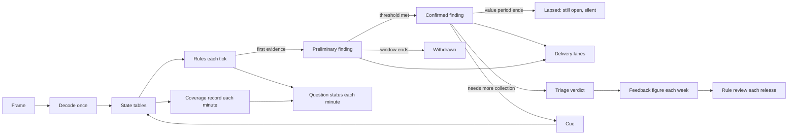

# The collection cycle: how sloth processes data over time

**Summary**: sloth works in nested cycles. A frame is decoded at once. A tick applies the rules. Each minute the sensor reports its own coverage. Each hour it maintains its stores. Each day and week it reviews and refreshes. Each session and each handoff closes with a report. Each release re-checks the rules against what readers said about them. The steps follow the intelligence process in US Army FM 2-0 (2004): plan, prepare, collect, process, produce, with analyze, disseminate and assess running all the time. sloth is passive. It only receives. Nothing in any cycle puts a frame on the air.

**Status**: draft, 2026-11-23. Rows marked **today** describe code that exists (sources named). Rows marked with an issue number are proposals and are not built.

**Sources**: FM 2-0 (2004) Chapter 4 and Chapter 8; FM 6-02.43 (2009) Chapter 2, Chapter 3, Appendix A; [[retention]]; [[sqlite-schema]]; issues #241 to #251, sloth-mesh #13, #14, #17 to #19.

---

## 1. The process, mapped to sloth

| FM 2-0 function | Meaning in the manual | In sloth |
|---|---|---|
| Plan | identify requirements and the means to satisfy them (4-4) | site questions (#244), designated networks, roster, hop plan |
| Prepare | verify that procedures and equipment are in place, rehearse (4-8 to 4-11) | `--preflight` (#247), installation record (sloth-mesh #19) |
| Collect | collect and report in response to tasking; report without delay (4-18, 4-25) | capture, decode once, preliminary findings (#245), passive cueing (#248) |
| Process | convert data into a form for analysis; correlate (4-28) | parsers, state tables, JSONL, `sloth.db` |
| Produce | evaluate and combine into products that are timely, relevant, accurate, predictive, usable (4-31, 4-32) | alert engine, quality fields (#246), reports (#243, #249, #250) |
| Analyze | find what pertains to the questions (4-35 to 4-38) | baseline and drift (#23), question status (#244), the alert rules |
| Disseminate | right information, right person, right time; more than one means (4-39 to 4-47, 8-32) | data socket, dashboard, four delivery lanes (sloth-mesh #18) |
| Assess | continuous; are the questions answered, is collection effective, is there deception and denial (4-48 to 4-51, 8-34, 8-35) | coverage assessment and `SENSOR_SUPPRESSED` (#242), reader feedback (sloth-mesh #17) |

"Intelligence only reduces uncertainty ... it does not eliminate it" (FM 2-0, 4-6). Each surface in sloth keeps the hypothesis wording that [[mac-randomisation]] and [[alerts]] already require.

## 2. The cycles

### 2.1 Per frame (microseconds)

| Step | Status |
|---|---|
| Decode once into the shared parsers (`libsloth-wire` after Stage 0) | today |
| Update the state tables (devices, beacons, probes, associations, EAPOL, BLE) | today |
| Count the frame by type, band and channel for the coverage record | #242 |
| Count capture drops and table evictions | today (counts); used by `SENSOR_SUPPRESSED` in #242 |

Rule: the per-frame path never waits on disk or network.

### 2.2 Per tick (250 ms TUI refresh; 1 s database write)

| Step | Status |
|---|---|
| Run the alert rules over the state | today |
| Incident engine: open, update, close | today |
| Emit a **preliminary** finding at first qualifying evidence for the listed types | today for `PMKID_HARVEST` and `HANDSHAKE_HARVEST` (#245, [[alerts]] § Finding lifecycle); the other four listed kinds #245 |
| Confirm or withdraw a preliminary finding | today (#245: confirmed by the kind's normal threshold under the same key; withdrawn at the kind's window or when its evidence ages out) |
| Attach quality fields: completeness, latency, corroboration, source state | #246 |
| Issue a cue when a finding needs more collection, inside the cue limits | #248 |
| Write change-only JSONL records | today |
| One database transaction for the tick | today (`db_tick()`) |

Rule: a report is not held to make it better. FM 2-0 4-25: "must not delay reports for the sole purpose of editing". A late refinement goes out as a follow-up (8-32).

### 2.3 Per minute

| Step | Status |
|---|---|
| Coverage record: time on each channel and band, frames by type, sources up or down | #242 |
| Rule status: `observable`, `partly`, `blind`, with a reason | #242 |
| Question status: `finding`, `no finding`, `not observable` | #244 |
| `SENSOR_SUPPRESSED` check | #242 |
| `sensor_health` record (change-only) | today |
| Dashboard minute pass; refresh of the serving table | today (minute pass); serving table in sloth-mesh #13 |
| Mark findings past their value period `lapsed` (open, notifications stop) | today (#245; checked every tick, 300 s by default, `--value-period`) |

Rule: a quiet site and a blind sensor must never look the same. Each "no finding" is shown beside the status of the rules behind it.

### 2.4 Per hour

| Step | Status |
|---|---|
| Database maintenance: tier age-out, size guard, incremental vacuum | today (`db_maintain`, at most once per 3600 s) |
| Alert pcap age sweep | today (§2d of [[retention]]) |
| Planner statistics: `PRAGMA optimize` | today (#239: `PRAGMA analysis_limit=400; PRAGMA optimize` in `db_maintain`) |
| Integrity chain: close the block, record the chain head; optional signature | #251 |
| Location estimates refreshed for open findings, when two or more sensors hear them | sloth-mesh #19 |

### 2.5 Per day

| Step | Status |
|---|---|
| Handshake export sweep | today (§2c of [[retention]], every 24 h and at startup) |
| Baseline drift report: what is new, missing, changed against the site baseline | today (#23 baseline); daily report proposed with #243 |
| Exposure summary updated | #243 |
| Delivery lane test: a test message on each configured lane | sloth-mesh #18 |
| Interference episodes of the day joined into the interference report | #250 |

### 2.6 Per week

| Step | Status |
|---|---|
| Registry refresh on the comint host (FAA, FCC) by the data-fill agent | planned in the comint design, not built |
| Reader feedback figures for each alert type (30 and 90 days) | sloth-mesh #17 |
| Siting check: which designated access points only one sensor hears, or none hears well | sloth-mesh #19 |
| Review of rules with a high withdrawal or false share | #245, sloth-mesh #17 |

### 2.7 Per session, sweep and handoff

| Event | Steps | Status |
|---|---|---|
| Session start | `--preflight`; record the configuration and intel pack | `db_session_begin` today; preflight #247 |
| Session end | `--report` with "new since last survey", exposure section, coverage statement | report today; sections #242, #243 |
| Sweep | preflight, sweep hop plan, sweep report against the room baseline, operator accepts a new baseline | #249 |
| Handoff | handoff packet: baseline, roster, open findings, known false-positive sources, configuration, last preflight | #250 |
| Sensor lost or stolen | revoke keys, record the time after which its records are not trusted | runbook in #251 |

### 2.8 Per release

| Step | Status |
|---|---|
| Each new alert type has a cited source, a question, declared inputs and a value period | research corpus test today; question, inputs and value period #242, #244, #245 |
| Replay goldens unchanged, or the diff explained | today (`make replay-golden`) |
| Reader feedback and withdrawal rates reviewed for each changed rule | sloth-mesh #17, #245 |
| Intel pack pinned and named in `sensor_health` | today (#184 Stage 2, #231: `jsonl_intel_pack()` on every `sensor_health` record) |

## 3. Data flow through the cycles

## 4. Rules that hold in every cycle

1. **Receive only.** No cycle transmits on a monitored segment. Preflight and the delivery lanes use only the operator's own outbound path, each opt-in and named in `sensor_health` (MISSION §2).
2. **Report first, refine after.** A preliminary finding is better than a late confirmed one, and it is marked "not evaluated".
3. **Say what was not seen.** Every "none found" carries the coverage behind it.
4. **Hypothesis wording.** A finding is evidence about a radio, never an identification of a person.
5. **Do not depend only on shared data.** "One should not depend solely on intelligence reach" (FM 2-0, 1-28). The sensor works with its compiled snapshot when comint is absent (ADR 0005).
6. **Collection is limited by law.** FM 2-0 1-17 and 4-7. The limits on longitudinal correlation in [[mac-randomisation]] and the opt-in for crackable material in [[retention]] apply in every cycle. This page is not legal advice.
7. **Assess all the time.** The coverage record, the question status and the reader feedback are not reports for later. They change what the next cycle collects.

## Related pages

- [[retention]]: what each cycle deletes, and what it does not.
- [[sqlite-schema]]: the tables the cycles write.
- [[alerts]]: severity, confidence and the incident engine.
- [[posture-report]]: the session-end report.
- [[fleet]] and [[direction-finding]]: more than one sensor.
