# slothweb

A browser dashboard for [sloth](../README.md), the passive network
monitor. It runs beside sloth on the same host, reads sloth's live
record stream (the data socket) and, if you point it there, sloth's
SQLite file, and serves one page on `http://127.0.0.1:8770/`: live
counts and a record ticker, time series with hour-of-week baselines,
anomaly episodes, the device table, WiFi, a time-travel History view,
and the protocol flows. It never sends anything onto a network and
never writes to sloth or to `sloth.db`.

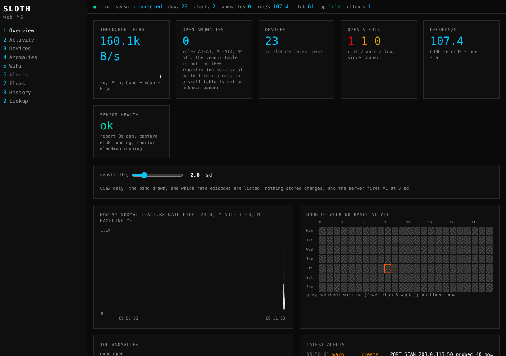

The spec is [`docs/web-ui-spec.md`](../docs/web-ui-spec.md) (the
rulings table at its top overrides the body); the wiki page is
[`docs/wiki/slothweb.md`](../docs/wiki/slothweb.md). Everything below
the Security section is reference: the command line, every route, and
how each part works.

## Five minutes

### Prerequisites

- Linux, a C99 compiler (`cc`),
  `make`, and the SQLite 3 headers and library: `libsqlite3-dev` on
  Debian and Ubuntu, `sqlite-devel` on Fedora.
  SQLite 3.31 or newer; nothing else is linked but libc, pthreads and
  libm.
- A browser on the same host, or an SSH tunnel to it.
- `curl`, only for the checks in this section.
- For real data: sloth, built from this tree (`make`) and run with
  `--data-socket` (below). Not needed for the demo.

### Build

From the top of this tree:

```sh
make web            # ./slothweb (with SQLite, the default)
make web-demo       # build/web/slothweb-demo, the synthetic data for the demo below
```

`make web WITH_SQLITE=0` builds a slothweb with no SQLite at all: no
`--sloth-db`, no `--store`, history in memory only.

**The vendor table.** The IEEE registry CSVs (MA-L, MA-M, MA-S and
IAB) are committed in `web/data/` (owner ruling 2026-10-26), so `make
web` builds the full table and rule A4 (vendor unknown) is on by
default; `/api/health` says `"vendor_table":"ieee"`. Neither the build
nor slothweb ever fetches anything. `web/data/SOURCE.md` names where
the files come from, their package version and SHA-256 (`make
web-test` checks the hashes). `make update-oui` refreshes them by hand,
from `/usr/share/ieee-data` when Debian's `ieee-data` package is
installed and otherwise from the IEEE; review and commit the result.
`make web WEB_OUI_DIR=DIR` builds from another directory, and one
without the CSVs gives sloth's own small table (about 120 vendors) with
A4 off.

The full table costs the binary about 2.8 MB: slothweb is 3.3 MB with
it and 0.5 MB without (x86-64, `-O2`, measured 2026-10-26); the
generator itself runs in under 0.1 s, and a clean `make web` takes
about the same either way (7 to 8 s here).

### Try it on synthetic data

No sensor needed. `slothweb-demo` writes a made-up `sloth.db` from
sloth's own schema and serves a generated record stream on a unix
socket, the way sloth's `--data-socket` does. Everything in it is
invented: documentation addresses (`192.0.2.0/24`, `198.51.100.0/24`,
`203.0.113.0/24`), locally administered MACs, `example` names.

<!-- quickstart:begin -->
```sh
make web web-demo
SRC=$PWD; cd "$(mktemp -d)"
"$SRC/build/web/slothweb-demo" db sloth.db
"$SRC/build/web/slothweb-demo" feed unix:sloth.sock &
"$SRC/slothweb" --socket unix:sloth.sock --sloth-db sloth.db --store slothweb.db
```
<!-- quickstart:end -->

Open `http://127.0.0.1:8770/`. The status strip should say `live`, the
footer `sock connected`, `db open`, `store open`. Stop with Ctrl-C,
then `kill %1` for the demo stream. `make web-quickstart-check` runs
exactly these steps in a temporary copy of the tree and checks the
answer (`web/tools/quickstart_check.sh`).

The time series start empty and fill at 10 s a bucket; baselines need
three weeks of a given hour before they draw a band, so a fresh store
says "no baseline yet". The demo's sloth.db already holds a month of
devices, alerts, sessions and flows for the Devices, WiFi, History and
Flows views.

Every MAC in the demo is locally administered, so the full vendor table
has nothing to name there: no device gets an IEEE vendor and A4 (vendor
unknown) never fires, though `/api/health` says `"a4":"on"`. That is the
rule working, not the table missing. To see the table, type a globally
administered MAC into Lookup (`00:1b:63:00:00:01` is an Apple block), or
run beside sloth on real traffic.

### Run it beside sloth

Start sloth with its data socket, and, for the Devices, WiFi, History
and Flows views, its database:

```sh
sudo ./sloth --headless --data-socket unix:/run/sloth/sloth.sock --db /var/lib/sloth/sloth.db
```

(`docs/wiki/deployment.md` has the systemd unit, which creates
`/run/sloth` with `RuntimeDirectory=sloth`; by hand,
`sudo install -d -m 0750 -o sloth /run/sloth`.) Then run slothweb as
the user sloth runs as: the `sloth` account after its privilege drop
(`docs/wiki/deployment.md`), or the `--user NAME` you gave it (put that
name in place of `sloth`). That account usually cannot reach a
checkout in your home directory, so install the binary first, and give
it a store in a directory it owns (`/var/lib/sloth` is `sloth`'s, mode
`0700`):

```sh
sudo install -m 0755 slothweb /usr/local/bin/slothweb
sudo -u sloth /usr/local/bin/slothweb --sloth-db /var/lib/sloth/sloth.db --store /var/lib/sloth/slothweb.db
```

- **The data socket.** `--socket` defaults to sloth's own default,
  `unix:/run/sloth/sloth.sock`; `--socket tcp:127.0.0.1:8765` reads a
  loopback TCP stream instead (`sloth --data-socket
  tcp:127.0.0.1:8765`). sloth creates its unix socket `0600` inside a
  `0750` directory, so the kernel's permission check is the stream's
  only authentication: slothweb must run as the same user as sloth, or
  as one the directory and socket admit. slothweb only ever reads the
  socket and reconnects on its own if sloth restarts.
- **`--sloth-db PATH`** is sloth's `--db` file, opened read-only. It
  may not exist yet: slothweb retries on every request.
- **`--store PATH`** is slothweb's own file (time series, baselines,
  anomaly episodes), default `./slothweb.db` in the directory you start
  it from, which must be one the user slothweb runs as can write. It is created `0600`; never point it at `sloth.db` (refused).

**As a service.** `packaging/systemd/slothweb.service` is all of the
above as a unit: `User=sloth`, `--socket unix:/run/sloth/sloth.sock
--sloth-db /var/lib/sloth/sloth.db --store /var/lib/slothweb/slothweb.db`,
no capability, `/var/lib/sloth` read-only, loopback unless
`/etc/default/slothweb` says otherwise (a Tailscale bind is documented
there, commented, with a single `/32` in `--web-allow`). `make install`
places the binary (after `make web`), `make install-service` the unit
and, only where there is none, the defaults file;
`sudo packaging/bin/sloth-migrate-sensor --dry-run --with-slothweb`
shows what installing it beside a migrated sensor would do, and the
same without `--dry-run` installs, starts and verifies it, rolling back
only slothweb if it fails. `docs/wiki/deployment.md` §4.3, §4.4 and §6.

### Open the page

`http://127.0.0.1:8770/` on the same host. From another machine,
forward the port rather than exposing it:

```sh
ssh -L 8770:127.0.0.1:8770 user@sensor     # then open http://127.0.0.1:8770/ locally
```

Keys: `1`..`9` switch views (`6` is the Alerts page), `/` searches
devices, `[` hides the view list and the footer, `Esc` closes the device drawer; the
view is also in the address (`#flows`, `#alerts?state=open`,
`#alert?id=d42`), so a reload stays on it and Back returns from a
drill-down. Every Overview tile is a link to the view of what it
counts ([Alerts](#alerts)).
The button at the right of the top bar switches to the light theme;
the choice is kept in this browser only (`localStorage`, key
`slothweb.theme`), dark is the default, and a browser that keeps
nothing just gets dark ([Design](#design)).

| | |
|---|---|
| 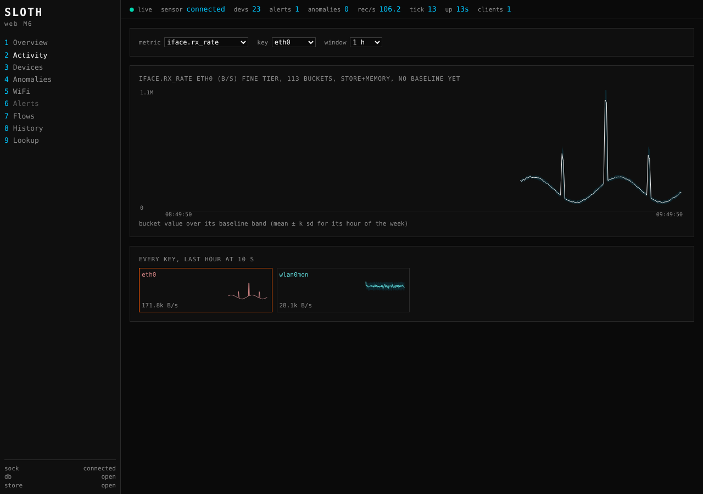 | 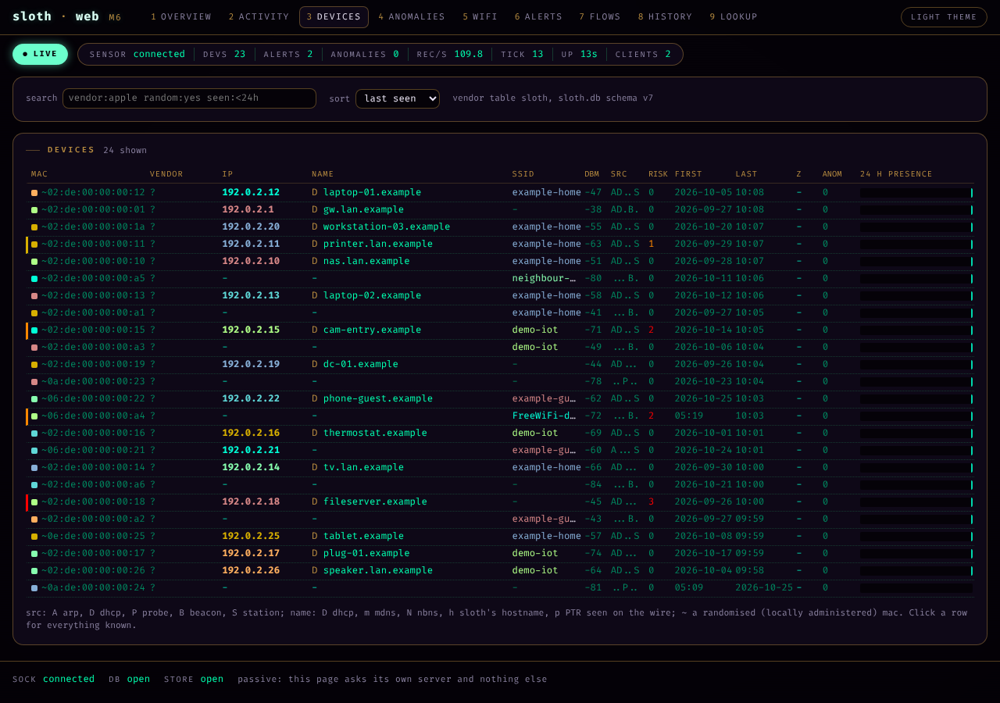 |
| 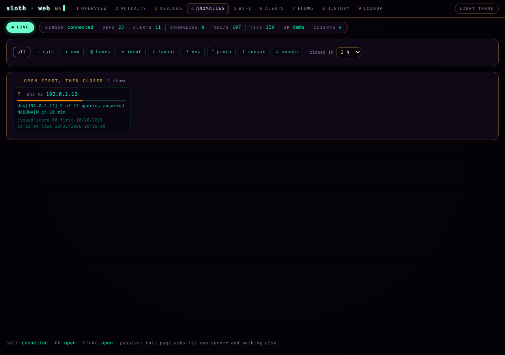 | 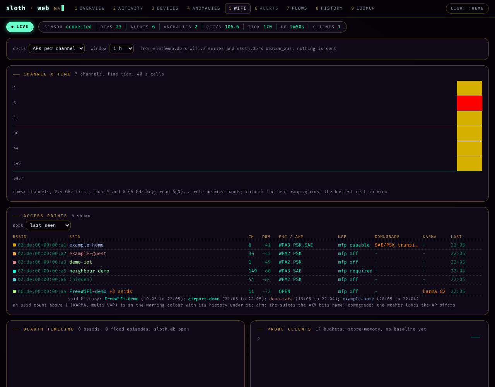 |
| 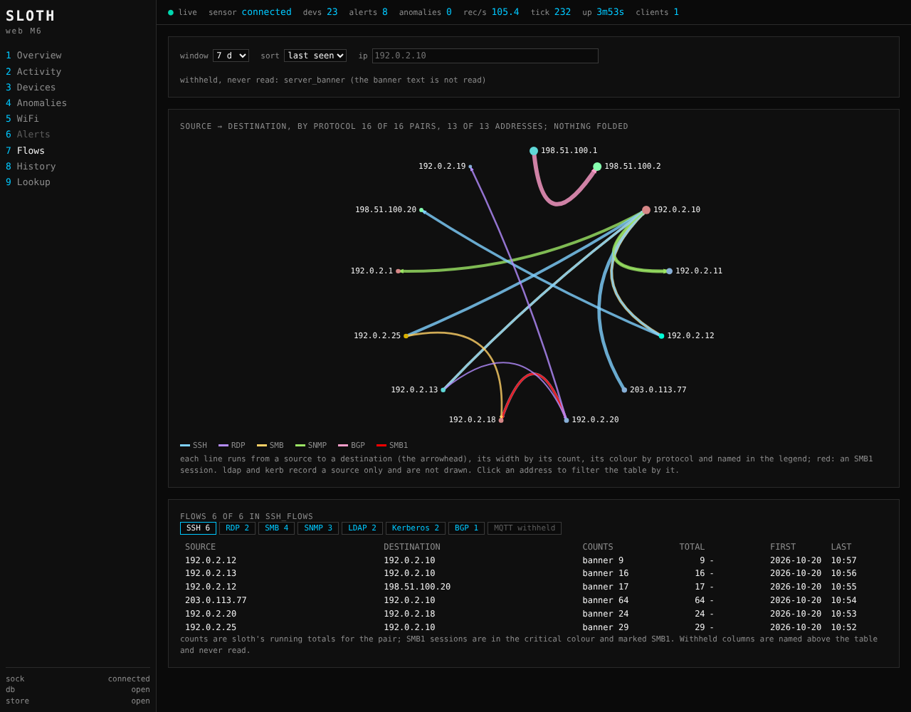 | 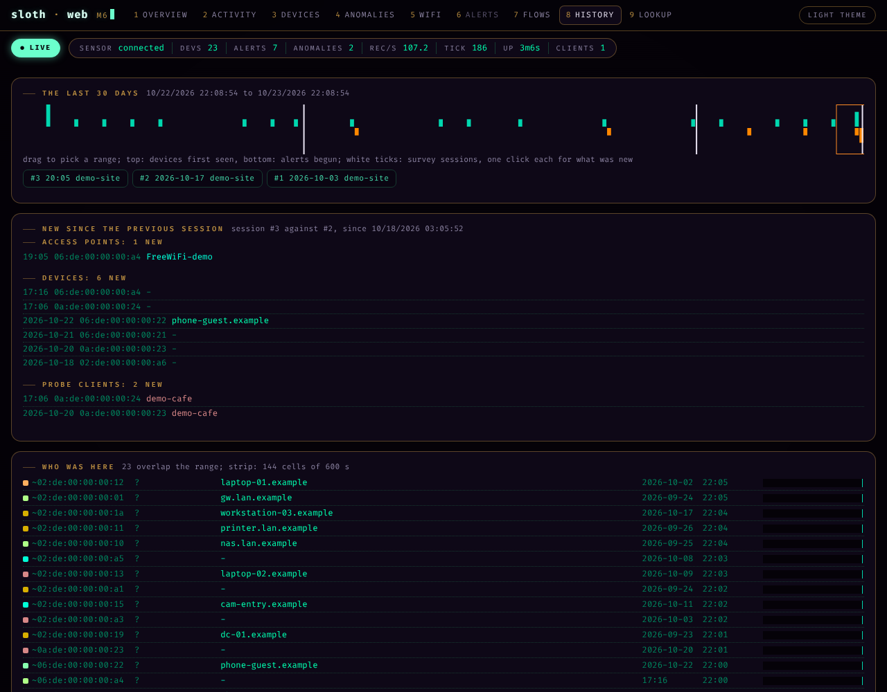 |
| 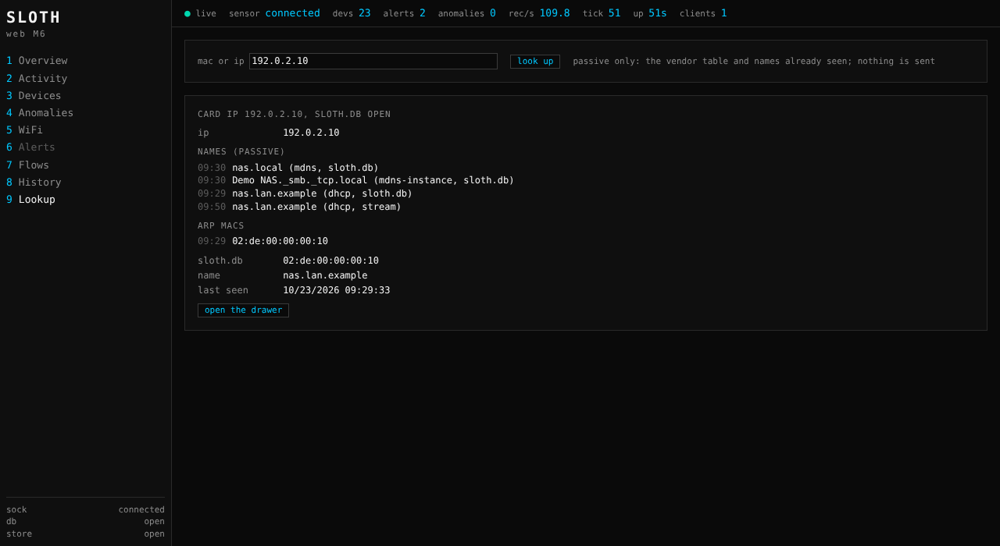 | 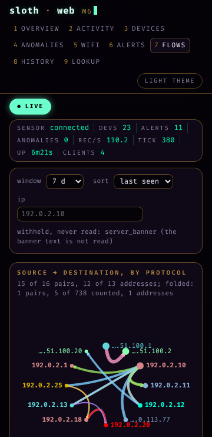 |
| 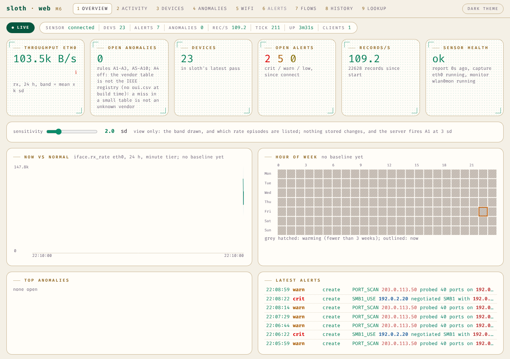 | 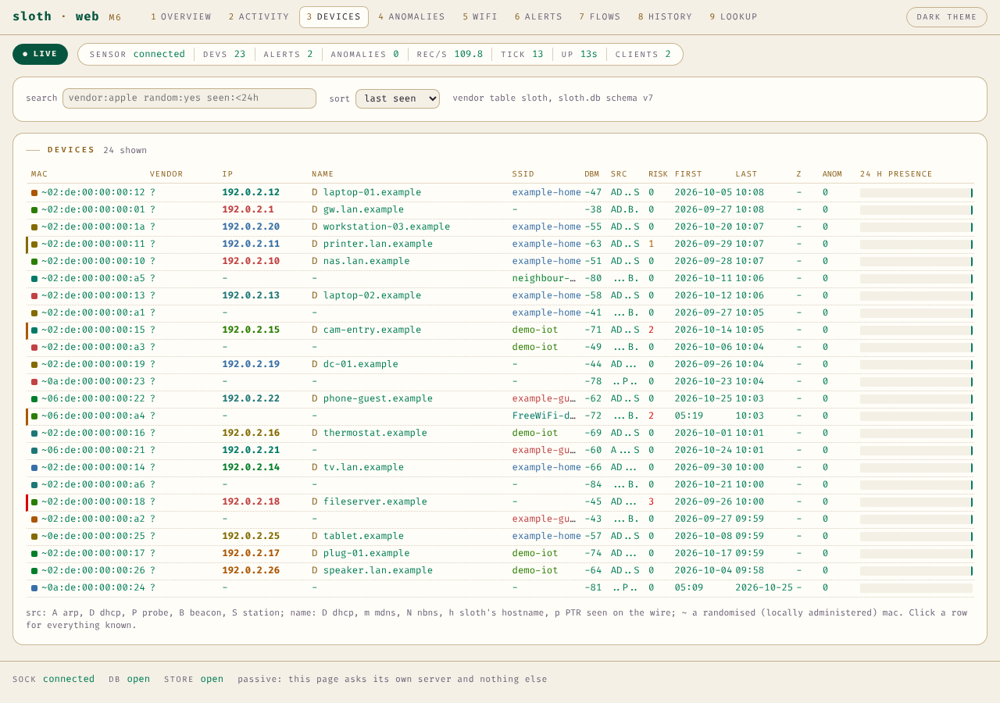 |
| 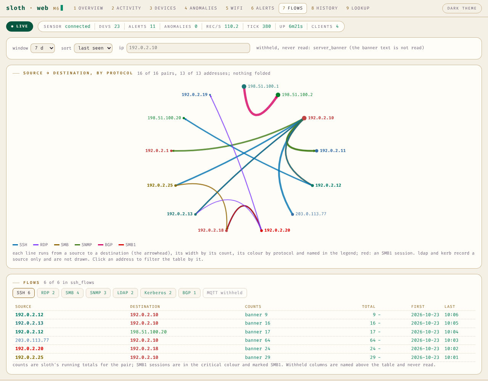 | 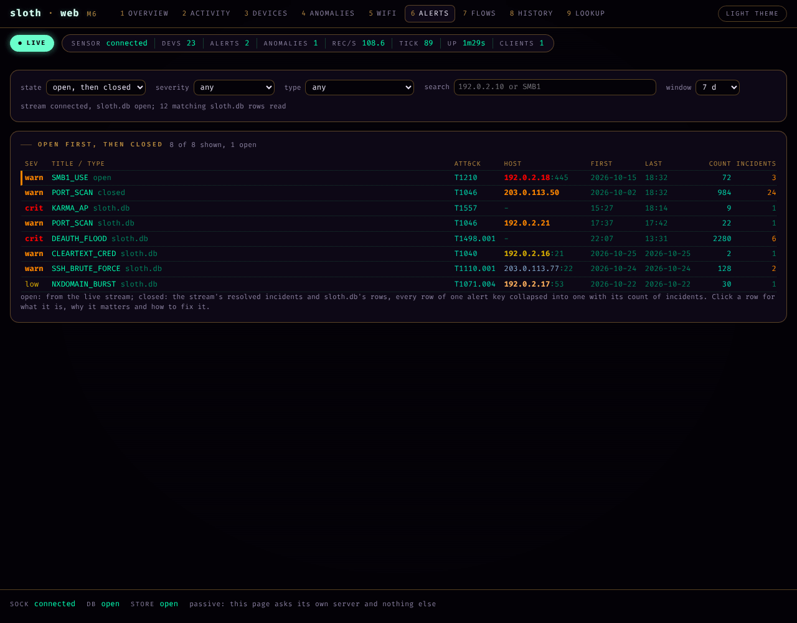 |
| 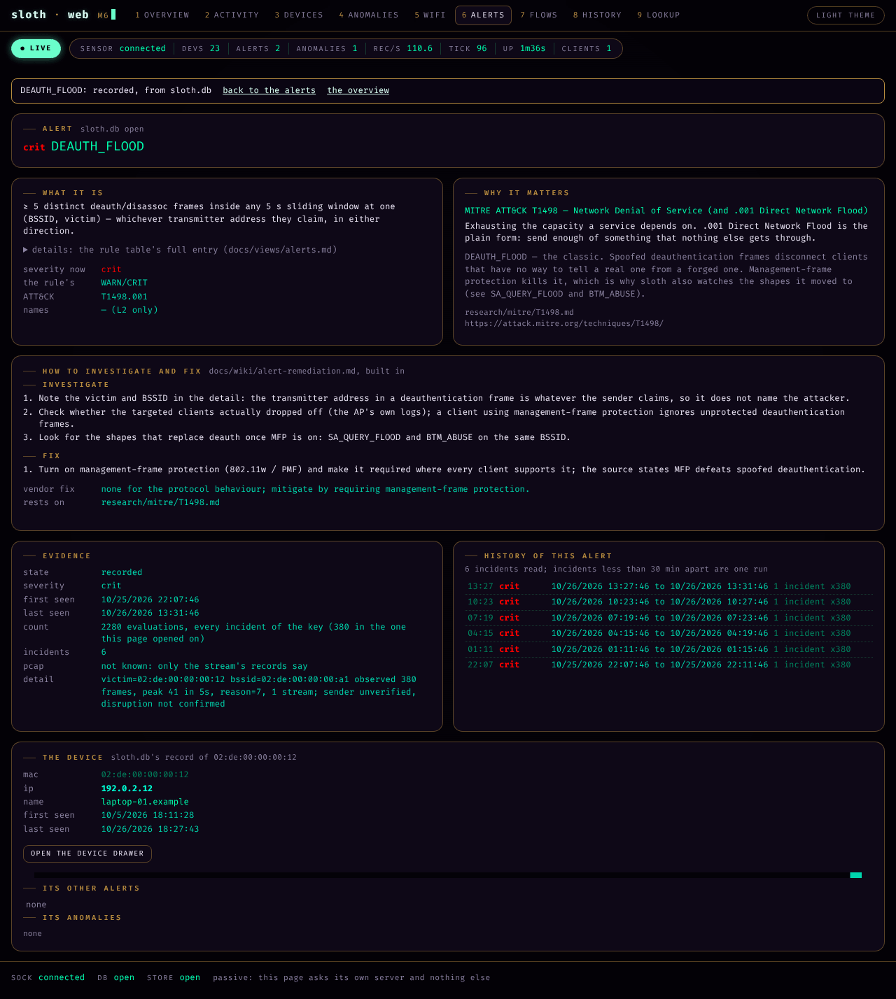 | 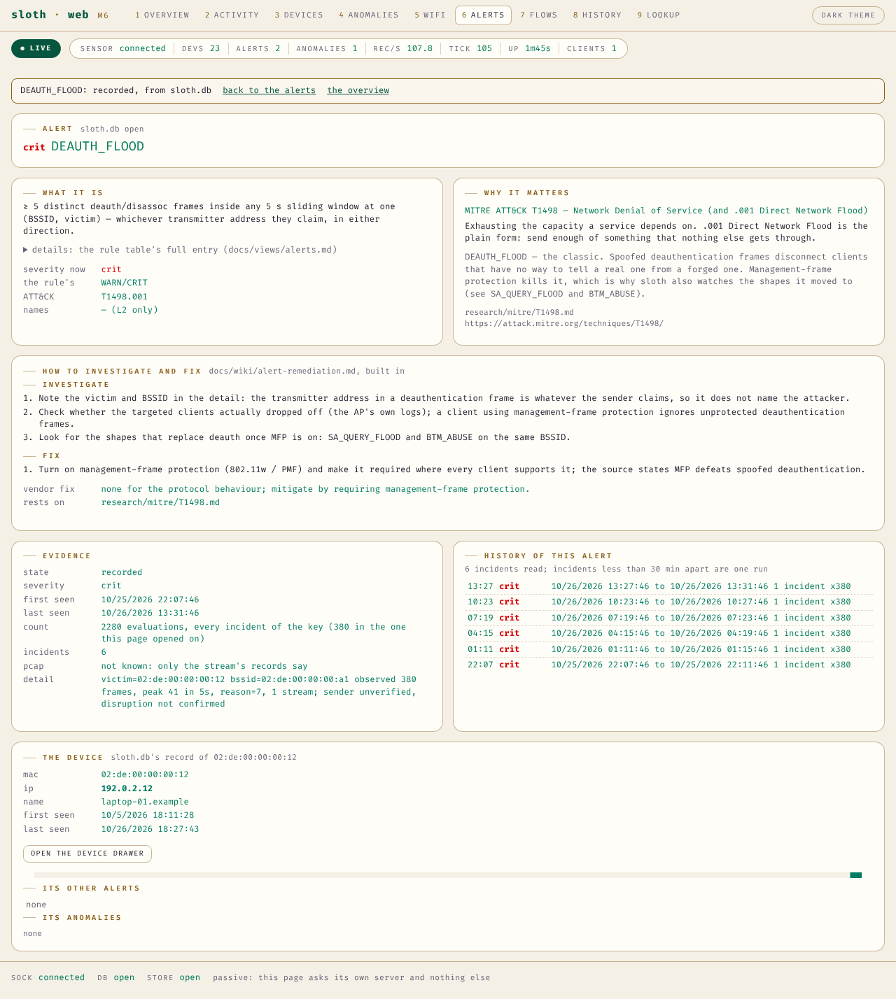 |

All screenshots are of the synthetic demo above, taken by headless
Chromium; none shows anything captured from a real network.

## Troubleshooting

Every message slothweb can print as it starts, from the source (a test,
`web/tests/test_readme.c`, fails when one is missing here). `PATH`,
`ADDR`, `N` and `ERR` stand for the values printed. Exit status: `2` for
a usage error or a policy refusal, `1` when the bind, the store or a
thread fails; slothweb is not running after either.

**Command line and policy** (exit 2):

| Message | Remedy |
|---|---|
| `slothweb: unknown option OPT (see --help)` | `./slothweb --help` lists the flags. |
| `slothweb: --flag needs an argument` | Give the flag its value. |
| `slothweb: --web-max-keys V: want a whole number from N to N` (also `--web-max-mb`, `--web-retain-days`) | Use a whole number in the range printed. |
| `slothweb: empty --web-bind` | `--web-bind 127.0.0.1:8770`. |
| `slothweb: bad --web-bind ADDR (want A.B.C.D:PORT or [V6]:PORT)`, `bad --web-bind ADDR (want [V6]:PORT)`, `bad --web-bind address in ADDR`, `--web-bind ADDR: bad port` | A literal address and a port: `127.0.0.1:8770`, `[::1]:8770`. |
| `slothweb: --web-bind ADDR: not a literal IPv4 address (names are not resolved)` | slothweb never resolves a name, its own bind included: `localhost:8770` is refused, write `127.0.0.1:8770`. |
| `slothweb: refusing to bind ADDR: not a loopback address.` | Keep it on loopback and use `ssh -L` (above), or, deliberately, add `--web-allow-remote` and name the peers with `--web-allow` (Security). |
| `slothweb: --strict refuses a non-loopback --web-bind (ADDR).`, `--strict refuses a non-loopback --web-allow (CIDR).`, `--strict refuses a non-loopback --socket (SPEC).` | `--strict` means loopback only, whatever else is given; drop one of the two. |
| `slothweb: --web-allow CIDR admits non-loopback peers; that needs --web-allow-remote.` | Add `--web-allow-remote` if you mean it. |
| `slothweb: --web-allow CIDR: empty address`, `bad address`, `not a literal IPv4 or IPv6 address`, `bad prefix`, `prefix too long`, `host bits set past the prefix` | A CIDR with its host bits zero: `10.0.0.0/8`, not `10.0.0.1/8`; no names. |
| `slothweb: too many --web-allow entries (max N)` | Use fewer, wider prefixes. |
| `slothweb: --socket SPEC: want unix:PATH or tcp:ADDR:PORT`, `want tcp:A.B.C.D:PORT or tcp:[V6]:PORT`, `want tcp:[V6]:PORT`, `bad address`, `bad port` | `--socket unix:/run/sloth/sloth.sock` or `--socket tcp:127.0.0.1:8765`. |
| `slothweb: --socket SPEC: not a literal IPv4 address (names are not resolved)` | A literal address, never a name. |
| `slothweb: --socket SPEC: the path must be 1..N bytes` | A unix socket path is limited to 107 bytes by the kernel: use a shorter path, or a relative one from the directory you start in. |
| `slothweb: --sloth-db: empty or too long a path`, `--store: empty or too long a path` | Give a path, shorter than 4,080 bytes. |
| `slothweb: --sloth-db needs SQLite; this slothweb was built with WITH_SQLITE=0`, `--store needs SQLite; this slothweb was built with WITH_SQLITE=0`, `--web-allow-sql needs SQLite; this slothweb was built with WITH_SQLITE=0` | Rebuild with `make web` (SQLite is the default), or drop the flag. |
| `slothweb: --sloth-db and --store name the same file (PATH): sloth.db is sloth's, the store is slothweb's own` | Point `--store` somewhere else. |
| `slothweb: --web-allow-sql needs --sloth-db PATH: the box reads sloth.db and nothing else.` | Add `--sloth-db`, or drop `--web-allow-sql`. |
| `slothweb: --strict refuses --web-allow-sql.` | The SQL box is a query surface; `--strict` refuses it. Drop one. |
| `slothweb: --web-max-mb N is below what --web-max-keys N needs: the baselines and episodes can take about N MB and the ceiling keeps N MB of history beside them (a week of hour rows for each of N series).` | Use the `--web-max-mb` it names, or a lower `--web-max-keys`. |

**Warnings** (slothweb runs; each names an exposure you asked for):

| Message | Meaning |
|---|---|
| `slothweb: WARNING: listening on ADDR, which is not a loopback address.` | `--web-allow-remote` and a routable `--web-bind`: every admitted peer reads everything, with no authentication and no TLS. |
| `slothweb: WARNING: admitting non-loopback peers in CIDR (--web-allow, authorised by --web-allow-remote).` | As it says. |
| `slothweb: WARNING: --web-allow-sql with --web-allow-remote: the SQL box (/api/query) ...` | Every admitted peer can run read-only SQL over sloth.db. |
| `slothweb: WARNING: reading the data stream from SPEC, which is not loopback.` | The stream crosses a network unencrypted; read it on the sensor instead, or tunnel it. |

**Starting up** (exit 1 unless said):

| Message | Remedy |
|---|---|
| `slothweb: bind: Address already in use` (or another `bind: ERR`), `socket: ERR`, `IPV6_V6ONLY: ERR` | Another program (often another slothweb) holds the port: stop it, or `--web-bind 127.0.0.1:8771`. |
| `slothweb: store: PATH: not a slothweb store (another program's database, sloth.db perhaps); refused, left as it is. Use a separate --store` | `--store` names a file that is not slothweb's: give a new path. |
| `slothweb: store: PATH: application_id N is another program's database; refused, left as it is. Use a separate --store` | The same. |
| `slothweb: store: PATH: not a readable SQLite database (ERR); refused, left as it is` | The same, or the file is damaged: move it aside. |
| `slothweb: store: PATH: written by a newer slothweb (schema vN; this build writes vN); refused, left as it is. Use a separate --store` | Run the newer slothweb, or a separate `--store`. |
| `slothweb: store: PATH: slothweb store with no readable schema version; refused, left as it is` | Move the file aside; slothweb makes a new one. |
| `slothweb: store: PATH: schema vN could not be migrated to vN (ERR); the file is unchanged from vN` | Usually a full disk or a read-only directory; fix that and start again. |
| `slothweb: store: PATH: mode 0644 gives group or other access; it must be 0600 (not repaired)` | `chmod 600 PATH`. |
| `slothweb: store: PATH: owned by uid N, not this user` | Run as the file's owner, or use another `--store`. |
| `slothweb: store: PATH: a symlink is refused`, `not a regular file`, `has N links; it must have one`, `PATH: fstat: ERR`, `PATH: ERR` | Name the real file, in a directory you own. |
| `slothweb: store: PATH: changed while it was being opened; refused` | Something else is writing that path; give slothweb its own. |
| `slothweb: store: PATH: SQLITE_DBCONFIG_DEFENSIVE refused`, `libsqlite3 VERSION is older than 3.31.0`, `PATH: prepare: ERR` | The SQLite library is too old or built without what slothweb needs: install 3.31 or newer. |
| `slothweb: store: PATH: slothweb was built without SQLite (WITH_SQLITE=0); no store` | Not printed by a normal start (a memory-only build has no store); rebuild with `make web` for one. |
| `slothweb: store: the saved baselines or anomaly episodes could not all be read; starting from what was` | Runs on (no exit): the rows that could not be read are skipped. |
| `slothweb: time series: out of memory` | Lower `--web-max-keys`. |
| `slothweb: SQL box: cannot start its thread`, `slothweb: pipe: ERR`, `slothweb: pthread_create failed` | Out of threads or descriptors: check `ulimit -u` and `ulimit -n`. |

**sloth.db** (not fatal; slothweb runs and retries on every request,
and the page says why in each view that needs it):

| Message | Remedy |
|---|---|
| `slothweb: no --sloth-db: the Devices view and the drawer's sloth.db record are off; Lookup answers from the stream and the vendor table` | Add `--sloth-db PATH` for the Devices, WiFi AP table, History and Flows views. |
| `slothweb: sloth.db PATH: missing (PATH: not there (yet): sloth makes it with --db); Devices and A2's durable first_seen wait for it, retried on every request` | Start sloth with `--db PATH`, or fix the path. The same line carries each reason below. |
| `PATH: written by a newer sloth (schema vN): not read; update slothweb` | Build slothweb from the same tree as sloth. |
| `PATH: schema vN is older than any sloth.db`, `PATH: no schema_version in its meta: not a sloth.db`, `PATH: no devices table with sloth's columns`, `PATH: not a sloth.db (ERR)` | `--sloth-db` names something that is not sloth's database. |
| `PATH: a symlink is refused`, `PATH: not a regular file` | Name the real file. |
| `PATH: needs recovery by sloth, which it does when it next opens it (ERR)` | sloth stopped mid-write; start sloth and it recovers the file. |
| `PATH: SQLITE_DBCONFIG_DEFENSIVE refused`, `PATH: query_only: ERR` | The SQLite library lacks what slothweb needs: 3.31 or newer. |
| `no --sloth-db`, `slothweb was built without SQLite; no sloth.db` | The reason `/api/health` gives (`db_error`) when there is no sloth.db to read. |

**Normal start notices** (not problems): `listening on`, `vendor
table: ieee (...)`, or `vendor table: sloth (...); A4 off: built
without the IEEE CSVs in web/data/` for a `WEB_OUI_DIR` build without
them (see Build), `sloth.db ...: schema vN, N devices, read-only`, `reading
SPEC`, `time series in`, `baselines (N restored)`, `store schema vN
migrated to vN`, and in a `WITH_SQLITE=0` build:

| Message | Meaning |
|---|---|
| `slothweb: built without SQLite: time series in memory only (10 s buckets, no minute or hour tier to read back); baselines and anomaly episodes in memory, lost at exit; rules A1 (z only, no MAD), A2, A3, A5-A8 and A10 active (A4 with the IEEE table), A9 needs the store` | What a memory-only build keeps; `make web` (with SQLite) keeps the rest. |

**After start**, the stream's state is in `/api/health`
(`socket`, `socket_last_error`) and in the footer: `sock retrying`
with `connect: No such file or directory` means sloth is not running or
not with `--data-socket`; `Permission denied` means slothweb runs as
another user than sloth (above).

## Security

Read this before exposing slothweb to anything but your own loopback.

- **Loopback by default.** slothweb binds `127.0.0.1:8770` and admits
  only loopback peers (`127.0.0.0/8`, `::1`); any other peer is closed
  at `accept()` before a byte is read. Two separate opt-ins widen that:
  `--web-allow-remote` permits a non-loopback `--web-bind`, and each
  `--web-allow CIDR` admits that prefix (it needs `--web-allow-remote`
  too). Each is announced on stderr at start. Loopback stays admitted
  whatever is added. Prefer `ssh -L` to either.
- **GET and HEAD only.** Every other method is `405`, on every path,
  for good: there is no endpoint that changes anything in sloth,
  slothweb, the host or the network.
- **No authentication.** Whoever can reach the port reads everything
  slothweb serves: every device, name, SSID, flow and alert. There are
  no accounts and no token; the allow list is the only gate.
- **No TLS.** Use an SSH tunnel (or a VPN you already trust) for
  another host.
- **The Host check.** A request is answered only when its `Host` is
  `localhost` or a literal IP address (with an optional port); anything
  else is `421` before any route. This stops a web page that points its
  own name at `127.0.0.1` (DNS rebinding) from reading slothweb through
  your browser.
- **CSP and no external requests.** The page is one embedded file
  served with `Content-Security-Policy: default-src 'none'` plus the
  hashes of its own one script and one style, and `connect-src 'self'`:
  it loads no font, script, image or anything else from anywhere, and
  can talk only to slothweb. No CORS headers are sent.
- **Read-only towards sloth.db.** `--sloth-db` is opened
  `SQLITE_OPEN_READONLY | SQLITE_OPEN_NOFOLLOW` per request, through a
  file layer that never creates a file. In WAL mode that means:
  slothweb never checkpoints and never writes the WAL into the main
  file; when sloth is running it reads sloth's `-shm` index read-only;
  when sloth is not running it reads the file as of sloth's last
  checkpoint (`"db_mode":"immutable"` in `/api/health`) rather than
  create a `-wal` or `-shm` beside it; and every statement is its own
  short read transaction with a time budget, so slothweb cannot hold
  sloth's WAL from being reset or stall a sloth write. A file that
  needs recovery is left for sloth to recover.
- **Secret columns withheld everywhere.** sloth.db holds some
  credential material by design (a cleartext-credential username, an
  RDP cookie, an MQTT username, an EAP identity, the alert key and
  detail that name them). slothweb reads sloth.db only through a
  column allow-list enforced by an SQLite authorizer, so those columns
  cannot be read by any route, and the same withheld list is refused
  inside the SQL box. `mqtt_flows` is not read at all; Kerberos'
  preauth counts are left out because the allow-list refuses any
  column named for a credential word.
- **`--web-allow-sql`.** Off by default. With it, `/api/query` runs one
  read-only `SELECT` at a time over sloth.db (5 s, 10,000 rows, the
  withheld columns refused) for every admitted peer. Combined with
  `--web-allow-remote` that is announced as a warning.
- **`--strict`** refuses every non-loopback bind, allow entry and
  `--socket tcp:` address, and the SQL box, even when the opt-in flags
  are given.
- **No name resolution, ever.** slothweb resolves nothing: not its bind
  address, not `--socket`, no reverse DNS, no WHOIS. Every name it
  shows was already in sloth's stream or database.
- **Third-party data.** The page shows other people's data: MAC
  addresses, device and host names, SSIDs and probe lists, flows
  between hosts. Treat the page, screenshots of it, and `slothweb.db`
  as you would the capture itself, under whatever authorisation and
  retention rules apply to the network you monitor.

## Reference

The rest of this file describes each part in detail, milestone by
milestone (W0, M0 to M6; tracker #102).

## Command line

| Flag | Effect |
|---|---|
| `--socket SPEC` | sloth's data socket to read. `unix:PATH`, or `tcp:A.B.C.D:PORT` / `tcp:[V6]:PORT` with a literal address; default `unix:/run/sloth/sloth.sock`, sloth's own default since #136. Names are never resolved (`tcp:localhost:8765` is an error). A non-loopback `tcp:` address is announced on stderr; `--strict` refuses it. |
| `--web-bind ADDR:PORT` | Listen address. A literal `A.B.C.D:PORT` or `[V6]:PORT`; default `127.0.0.1:8770`. Names are never resolved, so `localhost:8770` is an error. A non-loopback address is refused unless `--web-allow-remote` is given. `[::]` is IPv6 only (`IPV6_V6ONLY`). |
| `--web-allow CIDR` | Admit peers in `CIDR` as well as loopback. Repeatable, up to 30 entries. Host bits past the prefix must be zero (`10.0.0.1/8` is refused, write `10.0.0.0/8`). A non-loopback entry needs `--web-allow-remote`. |
| `--web-allow-remote` | Authorise a non-loopback bind and non-loopback `--web-allow` entries. Each one is announced on stderr at startup. It authorises the bind, not the peers: with no `--web-allow`, a remote bind still admits loopback only. |
| `--strict` | Refuse any non-loopback bind or allow entry, even with `--web-allow-remote`, and a non-loopback `--socket tcp:` address. Same shape as sloth's `--strict` refusing a routable `--data-socket`. |
| `--store PATH` | slothweb's own SQLite file for the time series (M2) and the baselines and anomaly episodes (M3); default `./slothweb.db`. Never `sloth.db`: a file that is not a slothweb store is refused untouched (below). Needs a `WITH_SQLITE` build; in one without, the flag is a usage error. |
| `--web-max-keys N` | Device keys tracked by keyed metrics, 16..8192, default 512; host keys get N/2 (256). Least recently seen out first. It also sizes M3's tables: the baseline cap (`web_baseline_cap_for()`), the identity tables (N MACs, N/2 IPs) and A7's hosts (N/2). |
| `--web-max-mb N` | Ceiling on the store's used size, in MB, default 256. Checked after every 10 s write and at each compaction; over it, the oldest 10 s rows go first, then the 1 min and 1 h rows of keyed series, and the global series' rows last. The baselines and episodes (M3) count towards it but are never dropped, and the time series always keeps a history allowance beside them: a week of hour rows for every series the baselines can hold, at 64 bytes a row (measured), about 51 MB at the default 512 keys and 760 MB at 8,192. So the bound is `used <= max(ceiling, analysis state + allowance)`: when the analysis state (its pages measured with SQLite's `dbstat`, `store_analysis_bytes`) leaves less than the allowance under the ceiling, the time series is trimmed to the allowance, not erased and not left to grow, and the pass is counted in `store_ceiling_raised`. A library without `dbstat` cannot measure the analysis state (`store_analysis_bytes` `-1`) and drops until under the ceiling or out of rows. With a store, a ceiling below the analysis state's estimate plus the allowance is refused at start (exit 2), naming the least that would do: 96 at the default 512 keys, 1,437 at 8,192 (MB here are 2^20 bytes). |
| `--web-retain-days N` | Days of 1 min buckets kept, 1..400, default 30. |
| `--sloth-db PATH` | sloth's own database (`sloth --db`), read-only (below). Absent: `/api/devices` is a `503` `no_sloth_db`, the drawer and Lookup answer from the stream and the vendor table, A2 runs on the stream alone, and the page says so. A path that is not there yet, or a file refused, is not fatal: every request opens it afresh. Needs a `WITH_SQLITE` build; the same path as `--store` is refused. |
| `--web-allow-sql` | The SQL box (M5, below): `/api/query` and `/api/recipes`, and the box on the History view. Off by default; without it both paths are `404` and the page never draws the box. Needs `--sloth-db` and a `WITH_SQLITE` build. `--strict` refuses it (exit 2). With `--web-allow-remote` it is announced on stderr, naming what every admitted peer can then read. |
| `--help` | Usage. |

Exit status: `0` after `SIGINT`/`SIGTERM`, `1` when the bind fails or
the store is refused, `2` on a usage error or a policy refusal (a
`--web-max-mb` too small for `--web-max-keys` among them).

## What a peer gets

1. **At accept().** The peer address is checked against the allowed-peer
   list before anything else. The default list is `127.0.0.0/8` and
   `::1`; a v4-mapped peer (`::ffff:a.b.c.d`) is matched as IPv4. A peer
   outside the list is closed without a byte read or written, and
   counted. Loopback is always on the list; `--web-allow` extends it and
   never replaces it.
2. **The header block** must arrive complete, request line through the
   empty line, within 8 KB, or the answer is `431`. A body is never read.
3. **One answer**, then the connection closes (no keep-alive), except
   for an event stream:

   | Request | Answer |
   |---|---|
   | `GET`/`HEAD` with no `Host`, or two | `400` |
   | `GET`/`HEAD` whose `Host` is not `localhost` or an IP literal | `421`, before any route (below) |
   | `GET /` | the page, `200`, `ETag`, `Cache-Control: no-cache` |
   | `GET /` with a matching `If-None-Match` | `304`, no body |
   | `GET /api/health` | `200` JSON, `Cache-Control: no-store` |
   | `GET /api/live` | `200` JSON, `Cache-Control: no-store` |
   | `GET /api/series?...`, `/api/keys?...`, `/api/metrics` | `200` JSON, `Cache-Control: no-store`; `400` with `{"error":"reason"}` for a parameter that does not pass (below); `503` with no time series attached |
   | `GET /api/anomalies?since=&kind=` | `200` JSON, `Cache-Control: no-store`, open episodes and those closed since `since` (below); `400` for a parameter that does not pass; `503` with no anomaly engine |
   | `GET /api/baseline?metric=&key=` | `200` JSON, one series' 168 hour-of-week cells; `400` / `503` as above |
   | `GET /api/devices?q=&sort=&dir=&limit=&offset=` | `200` JSON, a page of sloth.db's devices (M4, below); `400` for a parameter or a query term that does not pass; `503` with no `--sloth-db`, or sloth.db missing, refused, busy or past its budget |
   | `GET /api/device/{mac}` | `200` JSON, one device; `400` for a MAC that does not pass or any query |
   | `GET /api/lookup?q=` | `200` JSON, the Lookup card for a MAC or an IP; `400` otherwise |
   | `GET /api/wifi/channels?metric=&from=&to=&cols=`, `/api/wifi/deauth?from=&to=&cols=` | `200` JSON, the channel waterfall and the deauth timeline (M5, below); `400` for a parameter that does not pass; `503` with no time series |
   | `GET /api/wifi/aps?sort=&dir=&limit=&offset=` | `200` JSON, a page of sloth.db's beacon_aps; `400`; `503` with no `--sloth-db` or sloth.db unreadable |
   | `GET /api/history/overview`, `/api/history/devices`, `/api/history/alerts`, `/api/history/flows` (`?from=&to=` and their own) | `200` JSON, the History view's reads of sloth.db; `400`; `503` as above |
   | `GET /api/sessions`, `/api/sessions/new?id=` | `200` JSON, the survey sessions and one's "new since the previous session"; `404` for a session sloth.db does not have |
   | `GET /api/flows?proto=&from=&to=&ip=&sort=&dir=&limit=&offset=` | `200` JSON, one protocol table of sloth.db (M6, below); `400` for a parameter that does not pass, `proto=mqtt` included (`proto_withheld`); `503` as above |
   | `GET /api/flows/graph?from=&to=&nodes=&edges=` | `200` JSON, the chord diagram's pairs with the fold stated; `400`; `503` as above |
   | `GET /api/alerts?state=&sev=&type=&q=&window=&limit=&offset=` | `200` JSON, the Alerts page: the stream's open incidents, then the closed ones and sloth.db's rows, one row per alert key ([Alerts](#alerts)); `400` for a parameter that does not pass; sloth.db missing or refused leaves the stream's rows and says so (`"db"`) |
   | `GET /api/alert?id=` | `200` JSON, everything an alert's page shows; `400` for an id that is not `s<handle>` or `d<rowid>`; `404` for one neither source has; `503` with no `--sloth-db` for a `d` id, or sloth.db unreadable |
   | `HEAD /api/alerts`, `HEAD /api/alert` | `405`, `Allow: GET`, as `/api/query` |
   | `GET /api/query?sql=` | only with `--web-allow-sql` (otherwise `404`): `200` JSON, the statement's result; `400` with `{"error":"reason"}` for a refused statement; `503` `busy` while another runs, or sloth.db unreadable |
   | `HEAD /api/query` | `405`, `Allow: GET`: nothing to describe without running it |
   | `GET /api/recipes` | only with `--web-allow-sql`: `200` JSON, the box's recipes |
   | `GET /events` | `200` `text/event-stream`, held open (below) |
   | `GET /events` with 24 streams already open | `503` |
   | `GET` any other path | `404` |
   | `HEAD` of any of these | the same status and headers, no body |
   | any other method (`POST`, `PUT`, `DELETE`, `PATCH`, ...), any path | `405`, `Allow: GET, HEAD` |
   | header block over 8 KB | `431` |
   | malformed request line or header | `400` |
   | HTTP major version other than 1 | `505` |
   | no complete header block within 10 s of accept() | `408`, best effort |

   Methods are case-sensitive (RFC 9110 §9.1): `get` is `405`.

   **Host.** The allow list judges the TCP peer, and the operator's
   browser is a loopback peer whatever page it shows. A site that
   points its own name at `127.0.0.1` (DNS rebinding) is same-origin
   with slothweb in that browser, so its script could read
   `/api/health` and `/events`; sending no CORS headers does not stop
   that. Its requests carry its name in `Host`, so a routed request is
   answered only when `Host` (or an absolute-form target's authority)
   is `localhost`, a literal IPv4 address or a bracketed IPv6 literal,
   each with an optional `:port`. An IP literal cannot be rebound, so
   any literal is accepted, which keeps `ssh -L` forwards and a
   `0.0.0.0` bind reached by the host's address working; no name is
   resolved to decide. A remote bind reached by DNS name is refused:
   use the address. Writing methods are `405` before this check.
4. **Timeouts are absolute from accept()**, not reset per byte: a client
   trickling one byte at a time is cut off on the same schedule as one
   that sends nothing. The response has its own 10 s budget. After it, a
   client may keep sending (a body nobody reads) for 1 s before the
   socket closes. The half-close and drain make those unread bytes end the
   connection with a FIN instead of a reset; this is defensive (some
   stacks discard an unread response on reset) and the loopback tests
   check the FIN, not a rescued response, because Linux delivers the
   queued response either way.
5. At most 32 connections are held. A 33rd admitted peer is closed and
   counted as busy. If `accept()` runs out of descriptors or memory, the
   listener is left unpolled for 100 ms rather than spinning.

On shutdown slothweb prints the counters to stderr: admitted, refused at
accept, busy, served, timed out, accept back-offs.

## Routes

Paths match exactly, and an absolute-form target (`GET
http://127.0.0.1:8770/ HTTP/1.1`) routes by its path. The query string
is ignored except by the routes that take parameters, which validate it
whole; each of them but `/api/query` refuses a query string of 512
bytes or more as `query_too_long`. Every `/api` route but
`/api/health` and `/api/query` also takes `scope=monitor|hybrid|local`
([Capture scope](#capture-scope)).

**`/`** is the one page: `web/ui/index.html` with `theme.css`,
`page.css` and `app.js` inline. The `ETag` is the first 128 bits of the
page's SHA-256, so it changes exactly when the page does; the browser
revalidates on every load and gets `304` until a rebuild. The page's
policy is

```
default-src 'none'; script-src 'sha256-…'; style-src 'sha256-…';
connect-src 'self'; base-uri 'none'; form-action 'none'; frame-ancestors 'none'
```

so the browser itself refuses any request the page did not hash, other
than same-origin `fetch` and `EventSource`. The fonts are the system
monospace stack (`ui-monospace, "SF Mono", Menlo, Consolas, "DejaVu Sans
Mono", "Liberation Mono", monospace`); no font file exists. Colours are
the `docs/web-ui-spec.md` §8.1 tokens in `web/ui/theme.css`.

**`/api/health`** answers

```json
{"service":"slothweb","milestone":"M6","uptime_s":12,
 "socket":"connected","socket_spec":"unix:/run/sloth/sloth.sock",
 "last_record_age_s":0,"socket_attempts":1,"socket_connects":1,
 "socket_reconnects":0,"socket_failures":0,"socket_closes":0,
 "socket_retry_ms":0,"socket_last_error":null,"socket_last_error_age_s":null,
 "socket_bytes":48113,"socket_lines":92,"socket_records":92,
 "socket_decode_errors":0,
 "socket_decode_by":{"syntax":0,"utf8":0,"depth":0,"fields":0,
   "not_object":0,"duplicate_key":0,"no_type":0,"overlong":0,"truncated":0},
 "socket_gaps":0,"socket_gap_dropped":0,
 "db":"open","db_schema":7,"db_rows":42,"db_path":"/var/lib/sloth/sloth.db",
 "db_mode":"wal","sloth_db_mtime":1792627199,"sloth_db_age_s":1,
 "db_error":null,"db_opens":118,"db_timeouts":0,
 "db_supported":[1,7],"vendor_table":"ieee",
 "vendor_counts":{"ma_l":39627,"ma_m":6451,"ma_s":11639},"a4":"on",
 "passive_ptr":{"entries":0,"cap":4096,"seen":31,"stored":0,"empty":31,
   "refused":0,"evictions":0,"db_evictions":0,"persist_errors":0},
 "sloth_db_stale_after_s":600,"sloth_db_stale":false,"sql":false,
 "store":"open","store_path":"./slothweb.db","store_schema":5,
 "store_rows":{"fine":42120,"minute":7020,"hour":117},
 "store_bytes":1765376,"store_max_bytes":268435456,"store_batches":360,
 "store_write_errors":0,"store_last_error":null,"store_compactions":2,
 "store_dropped_expired":0,"store_dropped_ceiling":0,"store_ceiling_runs":0,
 "store_ceiling_raised":0,"store_analysis_bytes":-1,
 "store_baseline_rows_reused":0,
 "chmix":{"channels":7,"samples":5210,"ring_rows":1680,"ring_overwritten":0,
   "queue_dropped":0,"folded":0,"channel_evictions":0,"store_rows":2210,
   "store_dropped_expired":0,"store_dropped_cap":0},
 "retain_days":30,
 "series_keys":{"global":1,"device":30,"host":20,"iface":2,"channel":3,"alert":0},
 "series_key_caps":{"global":1,"device":512,"host":256,"iface":32,"channel":64,"alert":128},
 "key_evictions":{"global":0,"device":0,"host":0,"iface":0,"channel":0,"alert":0},
 "key_returns":{"global":0,"device":0,"host":0,"iface":0,"channel":0,"alert":0},
 "series":117,"samples":221385,"ring_rows":42120,"queue_rows":0,
 "queue_cap":32768,"queue_dropped":0,"churn_dropped":0,"highwater_evictions":0,
 "values_clamped":0,
 "anomaly":{"open":1,"building":0,"closed_kept":2,"cap":512,"opened":3,
   "closed":2,"dropped":0,"evicted_closed":0,"candidates_dropped":0,
   "rows_dropped":0,"late_rows":4,"hours_fed":31,"hours_unobserved":1,
   "minutes_unobserved":3,"mad":true,"mad_queries":2,"mad_skipped":0,
   "a9":true,"a9_queries":5,"fanout_hosts":20,"fanout_evictions":0,
   "reported":1,"reported_evicted":0,"known_evictions":0,
   "persist_errors":0,"persisted":true},
 "baseline":{"entries":212,"cap":4930,"evictions":0,"aged_out":0,
   "fed":6020,"zero_fed":1311,"deletes_lost":0},
 "ident":{"macs":30,"mac_cap":512,"mac_evictions":0,"ips":24,"ip_cap":256,
   "ip_evictions":0,"dns_matched":12,"dns_unmatched":3,"query_overwrites":0},
 "sse_clients":1,"tick_seq":12}
```

`socket` is `connecting`, `connected` or `retrying` (waiting out a
back-off of `socket_retry_ms`). `socket_last_error` is slothweb's own
text (`connect: No such file or directory`, `peer closed the stream`),
never anything the peer sent. `socket_gaps` counts sloth's `socket_gap`
markers and `socket_gap_dropped` the records they say were dropped
(jsonl-schema, #93). The `db` fields are `sloth.db`'s (M4, below):
`db` is `none` (no `--sloth-db`; then only `db_schema`, `db_rows` and
`db_supported` follow, as `null`, `null` and the range), `open`,
`missing`, `refused`, `error` or `unbuilt`, checked afresh for each
`/api/health`; `db_rows` counts `devices`, `db_mode` is how it was
opened (`wal`, `immutable`, `rollback`) and `db_error` slothweb's own
sentence for the last refusal. `sloth_db_mtime` is what the DB-backed
views are as of (unix seconds; `null` when the file is not open) and
`sloth_db_age_s` how long ago that is; `sloth_db_stale` is `true` when
that age is over `sloth_db_stale_after_s` (600) while the stream is
current, `null` without an open file (below, "How old the database
is"). `vendor_table` and `vendor_counts` are
the generated table's (`ieee`, `sloth` or `none`), `a4` is `on` or why
it is off, and `passive_ptr` the cache's size and counters. The
`store` fields are M2's (below): `store` is
`open`, or `memory` in a build without SQLite (`store_path`,
`store_schema` and `store_rows` are then `null`); `store_rows` is the
rows stored, kept by the writer (a bucket merged into one already on
disk is not counted again) and recounted at each compaction;
`key_evictions` counts keys pushed out of each class by its cap,
`key_returns` evicted device and host keys that came back and were given
their earlier life (below), `queue_cap` the store queue's size and
`queue_dropped` the closed buckets it had no room for, and
`highwater_evictions` rows pushed out of the running-total table. The
`anomaly`, `baseline` and `ident` members are M3's: every table the
engine keeps, its bound, and what it has had to drop or evict (below);
`persisted` is `false` in a build without SQLite.

**`/api/live`** is the live state:

```json
{"socket":"connected","devices":42,"devices_stale":false,"devices_ts":1792629211,
 "device_passes":118,"device_passes_unpublished":0,
 "alerts_open":{"low":0,"warn":1,"crit":0,"overflow":false},
 "records":9120,"records_s":61.4,"last_record_age_s":0,
 "types":{"iface":236,"device":4956,"dns":310,"...":0},
 "types_other":0,"types_invalid":0,
 "sensor":{"state":"ok","age_s":40,"ts":1792629171,"capture_iface":"any",
   "capture_open":1,"capture_running":1,"capture_exit":"none",
   "monitor_iface":"","monitor_open":0,"monitor_running":0,"monitor_exit":"",
   "scope":"none","scope_not_enforced":0},
 "alerts":[{"ts":1792629100,"type":"alert.create","sev":1,"title":"…",
   "detail":"…","alert_id":"s3fa9c2d11a","match_ip":"192.0.2.20"}],
 "recent":[{"seq":9071,"type":"dns","ts":1792629210,"text":"example.com  10.0.0.5"}]}
```

| Member | Meaning |
|---|---|
| `devices` | the number of `device` records in sloth's latest snapshot pass: the TUI's device count (below). `null` until a pass has been seen. `devices_stale` is `true` while the socket is down and until the current connection delivers a pass |
| `alerts_open` | incidents open now, by severity (0 LOW, 1 WARN, 2 CRIT), from the `alert.create` / `.update` / `.escalate` / `.resolve` records. Starts empty on each connection (below). `overflow` once more than 256 are open |
| `alerts` | the latest eight lifecycle records, newest first; `alert_id` is the link to the incident's page (`/api/alert?id=`), slothweb's own handle, never sloth's `incident_id` (below, [Alerts](#alerts)); `null` for a record of an incident slothweb is not tracking |
| `records`, `records_s` | records decoded since start, and the mean over the five whole seconds before now |
| `types` | records by `type`, for up to 48 names; the rest are `types_other`. A `type` that is not 1..32 bytes of `[a-z0-9_.]` is `types_invalid` and is not shown |
| `sensor` | the latest `sensor_health` record and `state`: `unknown` (none yet), `ok`, `degraded` (a capture or monitor handle open with its thread not running, or the launch scope not enforced), `not_observing` (neither handle open), or `stale` (none for 330 s; it is change-only with a 300 s heartbeat) |
| `alerts` | the last 8 alert lifecycle records, newest first. `match_ip` is the record's address (the page's alert-hot colour, [Design](#design)), or `""` when it has none or what it has is not 1..45 bytes of `[0-9A-Fa-f:.]` |
| `recent` | the last 50 records of any type, oldest first, each as its `type`, `ts` and a short `text` built from the members a reader looks for first (`qname`, `host`, `ssid`, `mac`, `ip`, `src`, ...), at most 80 bytes |

**`/events`** is a Server-Sent Events stream. It starts with
`retry: 3000` and the current tick, then:

| Event | Cadence | Payload |
|---|---|---|
| `tick` (with `id:`) | 1 s | `{"seq":N,"ts":UNIX,"uptime_s":U,"sse_clients":K,"socket":"connected","devices":42,"devices_stale":false,"alerts_open":[low,warn,crit],"records_s":61.4,"records":9120,"sensor":"ok","anomalies_open":1}` |
| `record` | with each tick | `{"seq":N,"type":"dns","ts":UNIX,"text":"..."}`, the records added since the previous tick, the newest 20 at most (spec §7.1: coalesced to 20 a second); a gap in `seq` says some were skipped |
| `anomaly` | with each tick, on change | one episode as `/api/anomalies` renders it, each time it opens, advances (an open episode's minute) or closes; the newest 16 changes a tick at most, an episode that changed twice sent once as it is now |
| `: ping` comment | 15 s | none; keeps proxies and idle timers from closing it |

`seq` counts up by one per second from start-up; a late wake-up sends
one tick, not a burst. Anything the client sends on the stream is read
and discarded, which is also how its departure is noticed. A client
that stops reading is dropped once 64 KB is waiting for it (its socket
send buffer is capped at 16 KB as well), and its browser reconnects on
its own after the `retry` delay. Every accepted socket has
`TCP_NODELAY` (spec §10.2): events are small and should not wait for
the previous one's ACK. At most 24 streams are held, so 8 of
the 32 connection slots stay free for the page and the API.

## The data socket (M1)

One thread (`web/src/web_ingest.c`) connects to `--socket`, reads, and
hands each line to the decoder. It never writes a byte to the socket
(the stream is one-way; sloth never reads from a client) and never
resolves a name. When the connection fails or the peer closes it, the
thread waits and tries again: 250 ms, doubling, capped at 4 s, so a
restarted sloth is back on the page within the spec's 5 s. A
connection that delivered at least one whole line resets the wait; one
that is accepted and closed at once (sloth refusing a client over its
per-peer cap does that) does not, so it is never redialled in a tight
loop. A TCP connect gives up after 3 s.

**Every byte from the socket is untrusted.** Lines are framed on `\n`
and capped at 16 KB (sloth's own line buffer is 8 KB); a longer line is
discarded through its newline and counted once, however the reads split
it. Each line is decoded by a strict reader written for this
(`web/src/web_jsonl.c`), not by `research/mcp/json.c`, which decodes
`\u` only to Latin-1 and does not check raw UTF-8. A line is refused
whole, and counted by reason, unless it is one JSON object (RFC 8259)
with nothing after it, at most 384 top-level members and 8 levels deep,
every string well-formed UTF-8 (RFC 3629) both raw and after `\u`
decoding (no lone surrogate, no overlong form, no raw control byte, no
`\u0000`), no member name twice (which `type` would win is what a
hostile line would like to choose), and a string `type`. A line the
connection ended in the middle of is counted as `truncated`.

Strings are kept cut to a fixed size on a code-point boundary and leave
slothweb only through one JSON writer (`web/src/web_json.c`), which
escapes per RFC 8259 and also writes `<`, `>`, `&`, `'`, DEL, C1 and
U+2028/U+2029 as `\uXXXX`. So a hostname or SSID holding markup is never
markup in any byte slothweb sends, and the page shows every stream value
with `textContent` only: the script contains no `innerHTML` or other
HTML or code sink, and a record type picks its colour from a fixed
table rather than becoming a class name.

**The device count.** sloth's poll thread rebuilds `s->devices` every
poll and writes one `device` record per row (`jsonl_emit_devices()`),
so the number of `device` records in one pass is exactly the TUI's
`device_count`. slothweb counts rows, not distinct MACs, for the same
reason. The pass is not one unbroken run on the wire: the capture
thread writes `dns`, `tls`, `quic`, `http`, `ntp`, `icmp` and
`cleartext_cred` records through the same writer at the same time, and
no lock spans the pass, so a DNS answer can land between two device
rows. Only the poll thread's own record types (`POLL_TYPES` in
`web/src/web_live.c`) steer the count; every other type, alerts and
types sloth adds later included, is passed over. A pass ends at the
first poll-thread record of another type and is then published. A pass that a `socket_gap`, an undecodable line or an
implausible `type` may have cut short is not published, and the
previous count stands (`device_passes_unpublished`). sloth's snapshot
batch starts with the `iface` records, so a batch that reaches the next
batch's start with no `device` record at all publishes `0`, unless
something was lost in it. A new connection is a new stream: a pass begun
on the old one is never finished by the new one.

**Open alerts** are counted from the lifecycle records since this
connection. sloth replays nothing on connect, so an incident opened
earlier is counted once it is updated or escalated, and a resolve missed
while disconnected cannot leave one open forever: the set starts empty
on every connection. An under-count heals itself; an over-count would
not.

## The time series (M2)

### Metrics

The ingest thread hands each decoded record to `web/src/web_metrics.c`
after the live state, which turns it into samples. The set is
docs/web-ui-spec.md §5.1, and every one of its metrics has a source
`src/jsonl.c` writes today, so none is left out:

| Metric | Kind | Key | From |
|---|---|---|---|
| `iface.rx_rate`, `iface.tx_rate` | gauge | interface | `iface` `rx_rate`, `tx_rate` |
| `host.rx_rate`, `host.tx_rate`, `host.conns` | gauge | IP | `top_host` `rx_rate`, `tx_rate`, `conn_count` |
| `dev.frames` | counter | MAC | `frame_count` deltas of `probe_client` (`mac`) and `assoc` (`sta_mac`). Not `seqnum_client`: sloth counts the same probe requests in both tables (`src/capture/probe.c` feeds each to `seqnum_track_observe()` and then `record_probe()`), so the two summed would count every probe twice. The probes it leaves out are those whose body was cut short of its information elements |
| `dev.present` | presence | MAC | any record with `mac` or `sta_mac` whose `last_seen`, if it has one, is within 10 s of its `ts` |
| `dns.queries` | counter | IP | `dns` with `is_resp` 0, by `src` |
| `dns.nxdomain` | counter | IP | `dns` with `answer` `NXDOMAIN`, by `src`, which on a response is the resolver: sloth's record names no client for an answer |
| `tls.handshakes` | counter | IP | `tls`, by `src` |
| `http.requests` | counter | IP | `http` without `status` (a response has one), by `src` |
| `alerts.fired` | counter | alert type | `alert` (one per new alert key), by `ty`; the lifecycle records are not counted again |
| `wifi.ap_count` | gauge | channel | `channel_summary` `ap_count` |
| `wifi.ctrl_total` | counter | channel | `channel_summary` `ctrl_total` deltas: sloth's figure is a running total, so this is a counter, not the spec's gauge |
| `wifi.deauth` | counter | MAC (BSSID) | `deauth` `count` deltas per (src, dst, bssid, subtype), by `bssid` |
| `wifi.probe_clients` | gauge | none | `probe_client` rows per snapshot pass |
| `conns.total` | gauge | none | `connections` rows per snapshot pass |
| `flow.ssh`, `flow.rdp`, `flow.smb`, `flow.snmp`, `flow.mqtt` | counter | IP | deltas of `ssh_flow` `banner_count`, `rdp_flow` `connect_req_count`, `smb_session` `count` (by `client_ip`), `snmp_flow` get+getnext+getbulk+set+response+trap, `mqtt_flow` connect+subscribe+publish, per flow, by source |

A key is a canonical form checked by type: a MAC is lower-case
`xx:xx:xx:xx:xx:xx` (all zeros, sloth's "no MAC", is not one), an IP is
what `inet_ntop()` writes back for what `inet_pton()` accepted, an
interface name is 1..15 bytes of `[A-Za-z0-9_.:@-]`, a channel is
1..233 with `6g` in front on 6 GHz (5 and 6 GHz share numbers), an alert
type is `ty` 0..9999. A record whose key does not pass is not counted,
so no string a peer wrote is ever a key as it was sent. Gauges take
sloth's `%.2f` reals.

**Running totals.** `frame_count`, `count` and the flow counts are
high-water marks. Each is turned into a delta against the last value
seen for the same row, floored at zero, so a row sloth evicted and made
again does not read as a negative burst. On a new connection sloth
re-sends every row at its full total, so the first sight of a row is a
baseline (no delta) unless the row's own `first_seen` is no earlier than
the connection's first record, i.e. it was born while slothweb was
listening; rows with no `first_seen` (`channel_summary`) are always a
baseline on first sight. Every connection starts a new
table. The table holds 4,096 rows, least recently used out first,
counted as `highwater_evictions`. An evicted row's id goes into a small
two-hash filter, so a row born while listening, evicted and then seen
again on the same connection is a baseline the second time rather than
counting its whole total twice; a filter collision can only turn a born
row into a baseline. The filter is two generations of 4,096 ids, 8 KB
each, cleared with the table: when the newer fills, the older is
cleared and takes the next ids, so a long connection never saturates
it. That bounds both sides. A lookup is wrongly positive at most about
2.7% of the time (a born row's first total taken as a baseline), and an
evicted id is remembered across at least 4,096 later evictions and
fewer than 8,192; a row evicted and seen again only after more than that
counts its total a second time.

**Rows per pass** (`conns.total`, `wifi.probe_clients`) use the same
batch start as the device count: the first `iface` record after another
poll-thread record. `connections` is written just before its tick's
`iface` records, so the window that closes at a batch start holds that
tick's connections and the previous tick's probe clients. The partial
window a connection opens in is not sampled, nor is one that a
`socket_gap` or an undecodable line may have cut.

Bucketing uses slothweb's clock, never a record's `ts`: a hostile `ts`
could otherwise write anywhere in history.

### Tiers

| Tier | Bucket | Kept | `tier=` |
|---|---|---|---|
| fine | 10 s | 24 h | `fine` |
| minute | 1 min | `--web-retain-days` (30 d) | `minute` |
| hour | 1 h | 400 d | `hour` |

Every series keeps one open bucket per tier with sum, count, min and
max. A bucket closes when a sample lands in a later one, or when the
store thread finds its interval over, whichever is first. A gauge's
value is sum/count, a counter's sum, presence's max. Keys are bounded
per class: device MACs (`--web-max-keys`, 512), host IPs (half, 256),
interfaces (32, sloth's `MAX_IFACES`), channels (64, sloth's
`MAX_CHAN_ENTRIES`) and alert types (128: sloth has 90 kinds); a new key
in a full class evicts the one seen least recently, after writing out
its open buckets, and is counted in `key_evictions`. The one global key
is never evicted.

Interfaces, channels and alert types come from catalogues sloth itself
bounds, which no peer can churn, so their keys are *established*, as
the global key is, from their first sample: an alert type that fires
twice in a few seconds gets its minute row when the minute ends and its
hour row when the hour does, and an evicted channel's rows are written,
not dropped. Each has its own class, so a busy channel list cannot
evict a quiet alert type.

Device and host keys are whatever a frame or a packet claims, and what
an eviction writes for them is decided on the key's whole life, not on
how many samples it took. One is established once its samples span a
minute (the last 60 s or more after the first). Until then its 10 s
buckets are written as usual, but its 1 min and 1 h buckets are held in
memory (at most two per tier, since samples within a minute cross at
most one boundary of each). When it becomes established they are
written. When it is evicted first they are dropped, counted as
`churn_dropped`, whether it took one sample or a hundred. A key neither
established nor evicted has them written at shutdown, so until then its
minute and hour rows are not in the store. The life outlasts a stay in
the class: an evicted key's first sighting, and whether it was
established, are kept in a small table (four entries per key slot) and
given back when it returns (`key_returns`). So a real host that recurs
under LRU pressure, evicted between each two of its samples, is
established a minute after it was first seen and from then on writes
its minute and hour buckets, partial at each eviction and merged by the
store; it loses only its first minute's. The table prefers established
keys: an unestablished one never displaces an established one, so a
scan can only push out the entries of keys still in their first minute.
What holds, then: a scan or a spoofed-source flood whose keys are each
seen for under a minute writes 10 s rows only, which the ceiling drops
first and which expire in 24 h; at shutdown at most the keys then
resident (one class cap) write what they held. Keys seen across a
minute or more do reach the 30-day and 400-day tiers, one row per
metric per bucket each, under churn too: that is bounded by the
ceiling, not by this rule. A key evicted and seen
again is a new series in memory: `/api/series` finds its earlier rows in
the store, and without one they are gone from the answer.

Closed buckets wait for the store thread in a queue sized from the
class caps: six rows for every series the classes can hold, and at
least 32,768 (about 3 MB at the default `--web-max-keys`, 41 MB at
8,192; allocated zeroed, so only what is used is resident). Six covers
what one series can close between two writes: two 10 s rows, a minute
and an hour row, and the two held rows of a key becoming established.
So the hour boundary, which closes a 10 s, a minute and an hour bucket
of every series in one pass, and the shutdown, which writes what is
queued and then closes everything still open, fit at 8,192 keys. The
store thread also writes early once 16,384 rows are queued. Only
eviction churn can outrun the queue; then a 10 s row is dropped before
a minute or hour row (one arriving at a full queue takes the newest
queued 10 s row's place), and every drop is `queue_dropped`.

Closed 10 s buckets also go to a ring of 131,072 rows in memory (about
5 MB); `/api/series` reads it for what the store has not written yet,
and in a build without SQLite it is all there is.

### slothweb.db

`--store` (default `./slothweb.db`) is slothweb's file. It holds the
closed buckets, `series(id, metric, key)` and one table per tier,
`(series, t, sum, n, min, max)`, and since v3 the anomaly engine's
state (`baseline`, `baseline_cell`, `episode`, `fanout`, `reported`;
[below](#baselines-and-anomalies-m3)). It is never `sloth.db`.

- **Opening** follows sloth's rules for its own database (`src/db.c`,
  `src/secure_file.c`, re-implemented because no `src/` file is linked):
  the path is opened by descriptor with `O_NOFOLLOW` and created `0600`;
  an existing file must be a regular file owned by the effective uid
  with no group or other bits and one link, and the `-wal`, `-shm` and
  `-journal` files, when present, the same; anything else is refused,
  never repaired. SQLite then opens it with `SQLITE_OPEN_NOFOLLOW` and
  `SQLITE_DBCONFIG_DEFENSIVE`, and needs 3.31.0 or later.
- **Identification** happens before anything is written, on a
  read-only connection: the last read-write connection to close on a
  WAL database checkpoints the WAL into it and deletes the WAL, so
  identifying a WAL-mode sloth.db on one would rewrite the file it
  refused. A read-only connection does make an absent `-wal` (empty)
  and `-shm` (32 KB), so a WAL-mode file with no `-wal` (cleanly
  closed: all it holds is in the main file) is read as an immutable
  URI instead, which opens no side file; a refused, cleanly closed
  sloth.db leaves its directory exactly as it was. They are not made
  and deleted, because deleting would race sloth opening its own file.
  A `-wal` with no `-shm` beside it still gets one made. Only once the
  file is ours or empty is it opened read-write (and identified again
  there, so a file swapped between the two opens is refused). An empty
  file is new: no schema object, and `application_id` and
  `user_version` both 0, so a file another program has set up but given
  no table yet is not taken for one. A new store is stamped with
  slothweb's own `application_id` (`0x534c5745`, "SLWE"), and a file
  carrying any other non-zero one is refused. A file whose `meta` table
  says `store = slothweb` is ours, at its `schema_version`. Anything
  else (sloth.db, whose `meta` is differently shaped, any other
  database, a file that is not SQLite) is refused and left byte for
  byte as it was. So is a store whose version is newer than this
  build's.
- **Migration** follows the 2026-10-21 owner rule: a chain of steps from
  v0, each additive, each in one `BEGIN IMMEDIATE` transaction with its
  own version stamp, so a failed step leaves the file at the version it
  last reached, with the step's own changes rolled back. A new file is
  stamped v0 first and takes the same chain, so the chain runs on every
  first start. Today the chain is five steps: v0 to v1 creates the four
  tables, v1 to v2 indexes each tier on `t`, v2 to v3 creates the five
  analysis tables, v3 to v4 creates `passive_ptr` and its index (M4),
  v4 to v5 creates `chmix` and its index (the WiFi view's channel mix,
  [below](#the-channel-mix-slothwebdb-v5); plain `CREATE TABLE` and
  `CREATE INDEX`: a name already taken fails the step rather than being
  adopted).
- **No column can hold a credential**: `web/tests/test_store.c` keeps
  sloth's `test_db.c` guardrail (no column named for a password, a
  community, a nonce, a key or a token may be TEXT or BLOB), and scans
  the file for an SNMP community, an MQTT user name and a cleartext
  credential fed through the stream. Keys are canonical addresses and
  names only.
- **Writes** come only from the store thread (`web/src/web_tsdb.c`),
  never the HTTP thread: once a second it closes due buckets, every
  10 s (or as soon as 16,384 are queued) it writes the closed ones, up
  to 4,096 to a transaction. A bucket already on
  disk (one an eviction or a restart closed early) is merged: sums and
  counts added, min and max widened, and not counted again in
  `store_rows`. On shutdown what is queued is written, then every open
  bucket is closed and written, so a restart picks up where it stopped. One
  bucket is briefly short after a restart: the one the restart split.
  Until this run's part of it is written (within two flush intervals),
  `/api/series` has the last run's part in the store and this run's in
  memory, and shows the fuller of the two rather than their sum.
- **The ceiling** (`--web-max-mb`) is checked after every 10 s write,
  not only at compaction, so it bounds the file within one flush
  interval: key churn can otherwise write millions of rows in an hour.
  The check is three PRAGMAs (4 µs). Over it, slices go until it is
  under, each its own transaction: the oldest 2,048 fine rows (any
  series) until none is left, then the oldest 2,048 keyed minute rows,
  then keyed hour rows, and only then the same for the global series,
  which are one per metric whatever the traffic; series rows left with
  no bucket are swept once after the slices, and free pages are
  returned, 256 at a time. Passes that dropped rows are
  `store_ceiling_runs`, rows `store_dropped_ceiling`. A pass over the
  ceiling first measures the analysis state's pages (`dbstat`,
  `store_analysis_bytes`: the baseline tables kept until the next
  baseline write, the episode, fanout and reported tables, a few hundred
  KB at most, measured on every pass, so the figure is never stale past
  the next one). When they leave less than the history allowance under
  the ceiling, the pass trims the time series to the allowance instead
  (`store_ceiling_raised`). Every slice reads
  the head of the v2 index on `t`; without it each was a full scan of
  the tier. Measured on a store filled to the ceiling (2,048 host keys,
  then flushes of 2,000 new fine rows each followed by the ceiling, as
  the store thread does): at 256 MB a trim took 4,767 ms before the
  index, 215 ms with it and 5-minute slices, and a median 74 ms with
  2,048-row slices; at 64 MB a median 209 ms with 5-minute slices and
  59 ms with 2,048-row ones. The index costs space: the ceiling holds
  about 36% fewer fine rows (6.1 M rather than 9.6 M at 256 MB).
- **Compaction** runs at start and then once an hour, after the write:
  rows past each tier's retention go, a tile at a time (256 series of
  consecutive id by 256 buckets of `t`, one transaction each); then the
  ceiling as above; then free pages are returned
  (`auto_vacuum=INCREMENTAL`, 256 pages to a transaction) and the WAL is
  truncated. A tier is keyed `(series, t)` and indexed on `t`, so a
  delete in `t` order scatters over the key's pages and one in series
  order over the index's; a tile is a run of both, about 2,000 pages
  whatever the size of the store.
- **The WAL** is not counted in `--web-max-mb`, which bounds the main
  file; what bounds the WAL is that no transaction is large. It is
  checkpointed once it passes 1 MB (`wal_autocheckpoint`) and cut back
  to 1 MB at the next write after a checkpoint (`journal_size_limit`),
  so between transactions it holds at most about 1 MB, and during one
  it grows by the pages that transaction changes: at most a leaf of the
  key and one of the index per row. The largest transactions are a write
  of 4,096 queued rows and a ceiling slice of 2,048, so at 4 KB pages
  the worst case is about 32 MB above the file, whatever the ceiling;
  an expiry tile changes about 8 MB at most. Before, the start-up
  compaction deleted everything expired in one transaction, and after a
  long stop the WAL grew to the size of the file. Measured on a store
  of 1.5 M fine rows (44 to 49 MB) expired at once, for 100, 1,000,
  5,000 and 20,000 series: the WAL peaked at 45 to 49 MB in one
  transaction and at 2.0 to 7.1 MB by tiles, and the compaction took 1.7
  to 4.8 s before and 1.7 to 2.4 s after. On the ceiling measurement
  above (256 MB) the WAL's largest was 11.0 MB, from the 2,000-row
  writes, not the trims.
- **Reads** come from the HTTP thread over a second, read-only
  connection (WAL lets it read beside the writer), with every value
  bound as a parameter; a table name is chosen from three constant
  statements, never from the request.

An hour of a small home network's records (2 interfaces, 20 hosts, 30
devices, 10 probe clients, 3 channels, 15 connections, a DNS query
every 2 s; 117 series) is 42,120 fine rows: 1.8 MB on disk, the file
and its truncated WAL, after the hour's compaction (1.1 MB before the
v2 index), and at most 3.4 MB during the hour, the WAL between
checkpoints included.

**Without SQLite** (`make web WITH_SQLITE=0`), there is no store:
`--store` is a usage error, the minute and hour tiers are not kept, and
`/api/series` serves the fine tier from the in-memory ring only, which
covers about 131,072 / (number of series) buckets of 10 s: about 3 h at
117 series, about 7 minutes at 3,000. The ring is shared: the closed
rows of keys since evicted stay in it until they are written over, so
under key churn the live series get less than that. `/api/metrics` says `"store":false`
and marks the two tiers unavailable; asking for one is a `400`
`tier_unavailable`. `/api/health` says `"store":"memory"`.

### /api/series, /api/keys, /api/metrics

```
GET /api/series?metric=iface.rx_rate&key=eth0&tier=fine&from=1792540800&to=1792627200
{"metric":"iface.rx_rate","key":"eth0","tier":"fine","step":10,"kind":"gauge",
 "unit":"B/s","from":1792540800,"to":1792627200,"source":"store+memory",
 "more":false,"next_to":null,
 "points":[[1792623600,1002.5,1000.5,1004.5,5],...]}
```

`points` are `[t, value, min, max, n]`, oldest first, for buckets with
`from <= t < to`; `value` is the mean for a gauge, the sum for a
counter, the max for presence. Buckets with no sample are absent. At
most 900 come back, the newest; `"more":true` and `next_to` say to ask
again with `to=next_to` for the older ones (the page does, up to twelve
times). The bucket still filling is included. `source` is
`store+memory`, `store` (minute and hour) or `memory`.

The parameters are validated before anything reads a series, and every
refusal is a `400` with a reason word of slothweb's own, never the
value back:

| Rule | Reason |
|---|---|
| the query is `name=value` pairs joined by `&`, nothing else | `bad_query` |
| a name is one of `metric`, `key`, `tier`, `from`, `to` (`/api/keys`: `metric`; `/api/metrics`: none) | `unknown_parameter` |
| each at most once | `repeated_parameter` |
| a value is percent-decoded (RFC 3986 §2.1), then 1..63 bytes of printable ASCII | `bad_escape`, `bad_value`, `empty_value`, `value_too_long` |
| the whole query is under 512 bytes | `query_too_long` |
| `metric` is one of the table above | `missing_metric`, `unknown_metric` |
| `key` passes the metric's canonicaliser; a global metric takes none | `bad_key` |
| `tier` is `fine` (default), `minute` or `hour`, the last two only with a store | `unknown_tier`, `tier_unavailable` |
| `from` and `to` are 1..11 decimal digits; `to` defaults to the end of the current bucket, `from` to 1 h, 1 d or 30 d before it | `bad_from`, `bad_to` |
| `from < to`, `to` at most a day ahead, the span no longer than the tier keeps plus one bucket | `empty_range`, `to_in_future`, `range_too_long` |

A point is at most 69 bytes, so 900 fit the 64 KB answer buffer with its
header; `test_series.c` builds that worst case. `/api/keys?metric=M`
lists the keys holding a series of `M`, most recently seen first (256 at
most, with `total`). `/api/metrics` lists the metric table, each with
its key count, and the tiers with their steps, retention and whether
this build serves them.

### The Activity view

`2` (or the top bar) opens it; `1` goes back to the Overview. It picks a
metric (from `/api/metrics`), a key (from `/api/keys`) and a window
(1 h, 6 h and 24 h from the 10 s tier; 7 d and 30 d from 1 min; 400 d
from 1 h), and draws the series on Canvas 2D: the bucket value as a
line over the baseline band, `mean ± k sd` of each bucket's hour of the
week with `k` the sensitivity slider's (2 by default), a segment out of
the band in the heat ramp, and the baseline mean and z in the hover. A
series with no baseline yet is drawn over its min..max spread instead.
The spec's `abs(z)` ordering of the small multiples and the
ratio-to-baseline toggle are not here yet. Below it, a small multiple per key (the 24 most
recently seen), each the last hour at 10 s, sorted by current value so
the loudest is top left, with the key in the TUI's colour for it: the
eight hues of `src/tui_palette.c` picked by `src/ip_color.c`'s hash
(djb2; the spec says FNV-1a, but the TUI's own hash is the one that
keeps the colours equal). Colours come from `theme.css` tokens read back
at run time. Keys are shown with `textContent` and `fillText` only and
leave the page only as an `encodeURIComponent()`'d parameter of a
same-origin `fetch`.

## Baselines and anomalies (M3)

### Where the numbers come from

The engine reads the buckets that close, not the store. The store
thread hands it every minute and hour row as the row leaves the
rollup's queue (`web_tsdb_set_rows_hook`), after writing it, and a
store-thread step that crosses a minute boundary flushes first whatever
the 10 s flush cadence says, so the minute pass that runs at the first
step of minute `m+1` has every row the boundary closed for minute `m`.
Rows are merged per `(tier, metric, key, t)`: an eviction and a return
can close one bucket in two parts. The previous slice instead asked the
store for "the newest minute row in the last two minutes" and "the hour
row that just closed"; whether either had been flushed yet depended on
the flush phase, so a bucket was scored twice or not at all, and the
hour feed ran for about one hour in ten.

Without SQLite the rollup still queues its minute and hour rows (and
not its 10 s rows) for the engine, so the baselines and every rule but
A9 run in memory, and are lost at exit.

**Observed time.** A minute is observed when the socket was connected
and a record had arrived within 60 s at every store-thread step in it,
and slothweb was running at its start. A minute that was not is not
scored at all: neither a hit nor a quiet minute for any episode. An
hour is fed to the baselines only when at least 45 of its minutes were
observed; otherwise it is skipped and counted (`hours_unobserved`): a
counter that did not see half its hour would read as a quiet hour.

### The baseline (§5.3)

- **Cells** are the local hour of the week, `((tm_wday + 6) % 7) * 24 +
  tm_hour` from `localtime_r()`, Monday 00:00 first, so a routine keeps
  its cells across a daylight-saving change (a UTC index moved every
  edge hour of a routine by one cell twice a year). A closed hour starts
  on a UTC hour and is filed under the local hour its start falls in,
  and a minute is scored against the cell its own UTC hour bucket was
  filed under, not the cell of the minute: in a zone with a half-hour
  offset the two differ for half of every hour, and 14:10 IST scored
  against cell 14 was compared with the bucket 14:30-15:30, so a device
  present every day from 13:30 to 14:30 fired A3 on a regular routine.
  `/api/baseline` reports `now_cell` and the current `utc_offset_s` so
  the page maps a time to the same cell (by its hour bucket's start).
- **Scale.** A gauge's mean, a presence metric's max (0 or 1), and a
  counter's count **per minute**, so a minute bucket and an hour bucket
  of a counter compare directly.
- **An hour with no row** is 0 for a counter and for presence (a counter
  that counted nothing, a device that was not there), fed to every
  counter and presence entry the hour did not feed. For a gauge it is
  not a sample: sloth not reporting a host, a channel or an interface is
  not a measurement of zero. Only an entry that exists is zero-fed; an
  entry is made by a key's first real hour row.
- **Two spreads.** A cell is fed once an hour, so its variance is how
  much the hour's value moves from week to week. A1 scores a minute,
  and the minutes of one hour spread far more than their hour's mean
  moves: a host whose connection count is 2 to 8 every minute of every
  hour has hour means within a few tenths of 5, and with the cell's
  variance alone (in practice the floor below) a minute of 8 was z = 3
  and the quiet stream fired A1 all week. So a cell also learns `wvar`,
  the variance of the hour's minute values about their own mean: the
  engine sums the minute rows it scores per series per hour (a counter's
  minutes without a row count 0) and hands the hour's within-variance
  over when it feeds the hour, an EWMA on the same half-life. A minute
  is scored with `sd = sqrt(var + wvar)`; for a counter the within term
  is at least its mean, the Poisson variance of a count, so a counter
  whose minutes were all alike, or a cell with no `wvar` yet, does not
  call one more event out of band. An hour bucket is compared with
  `sqrt(var)` alone, which is what the page's band uses for buckets of
  an hour or more.
- **The sd floor.** A score divides by at least `max(10% of |mean|, one
  unit)`, one unit being one count a minute, one connection, one AP, or
  1 KiB/s for a byte rate. A cell whose samples were all equal has
  variance 0; with the previous `sqrt(var + 1e-9)` one more AP on a
  channel scored z = 31,623.
- **The MAD ratio.** For an A1 candidate on a counter, the last 28 hour
  rows of the same local hour of the week are read from the hour tier
  (28 primary-key lookups; a DST change moves the target hour by one),
  and the candidate stands only if Iglewicz and Hoaglin's modified z is
  at least 3.5. The rows are hour values, so their MAD is the week to
  week spread; the minute's own spread is added as for z: `|x - median|
  / sqrt((MAD / 0.6745)^2 + within)`, floored like the sd (with no
  within term this is `0.6745 |x - median| / MAD`). Without it the ratio
  was as blind to the minutes' spread as z, and confirmed whatever z
  flagged. With fewer than 6 rows there is no claim and z alone decides. An
  hour with no row is not in the sample: the file cannot tell an hour
  that counted nothing from one slothweb did not see. Computed once per
  series per hour, at most 32 series a minute (past that z alone
  decides, counted as `mad_skipped`). A memory-only build has no hour
  tier and skips it.
- **The table** holds `web_baseline_cap_for(--web-max-keys)` entries
  (4,930 at the default) but allocates them 256 at a time as they are
  made; a cell is 16 bytes (float mean, variance and within-hour
  variance, two 16-bit counts), an entry about 2.8 KB. A free list and an LRU list ordered by the last
  hour with a real row make every insert, touch and eviction O(1); an
  entry idle longer than the hour tier keeps (400 days) is aged out.

### The rules (§6)

| Rule | Kind | What it measures |
|---|---|---|
| A1 | `rate` | a keyed, non-presence metric's minute value (a counter's count, a gauge's mean) with `|z| >= 3` against its cell, in 3 consecutive observed minutes; a counter with a baseline and no row this minute is scored as 0, a gauge with no row breaks the streak; a counter must also pass the MAD ratio |
| A2 | `new` | a MAC whose own `first_seen` (the `probe_client`, `pnl_client` or `assoc` row's, from sloth) is within 24 h and of which slothweb holds nothing older (no `dev.present` or `dev.frames` baseline entry first fed before then, no minute or hour row of either in the store before then), reported once per MAC across restarts while slothweb remembers it (a full reported set forgets its oldest, `reported_evicted`); more than 8 such MACs in one minute, or more than 16 in a rolling hour, are one episode keyed `""`; randomised MACs are left out (each rotation is new by construction; A5 is about them) |
| A3 | `hours` | a MAC present this minute in a cell whose presence mean is below 0.1 over 4 or more weeks |
| A5 | `ident` | a randomised MAC (the locally administered bit, which is how sloth sets `mac_random`) whose DHCP or mDNS hostname is also the name of another MAC |
| A6 | `ident` | an IP whose current DHCP hostname, mDNS host and NBNS name (two or more of them) disagree in normal form |
| A7 | `fanout` | the largest `host.conns` sample of each 10-minute window against the host's own p95 of that value; fires above both 2 x p95 and p95 + 5, after 144 windows |
| A8 | `dns` | a client with 20 or more queries in 10 min and more than 30% of them answered NXDOMAIN |
| A9 | `proto` | a host's `flow.{ssh,rdp,smb,snmp,mqtt}` minute row with no row of that series before it in the minute or hour tier, a row the rollup released late included |
| A10 | `sensor` | the socket connected and nothing received for 60 s, counted from the later of the last record and the connection |

Where this departs from the spec's body, and why:

- **A2** reads `first_seen` from the stream, not `sloth.db` (M3 reads no
  `sloth.db`; M4 does). Only stations sloth heard over the air carry
  one (`arp` and `device` do not). sloth sets it to now whenever it
  makes a client entry (`src/capture/probe.c`): at its own restart, and
  when it evicts and re-learns a station. So `first_seen` alone reported
  a device with weeks of history as new after sloth restarted; A2 now
  also asks slothweb's own memory: a `dev.present` or `dev.frames`
  baseline entry first fed before the 24 h window, or a minute or hour
  row of either in the store before it, and the MAC is not new (the
  answer is remembered for the window; at most 256 store lookups a
  minute, the rest wait, `a2_deferred`). `sloth.db`'s
  `devices.first_seen` is the durable answer, in M4. The reported set
  is keyed by `first_seen`, holds `--web-max-keys` MACs and outlives a
  restart. Full, it forgets the MAC with the oldest `first_seen`
  (`reported_evicted`), which moves to the set of MACs not to report
  one by one; a MAC both sets have let go may be reported a second
  time. That is the accepted cost, and it is bounded: a duplicate "new
  device" is better than a hidden one, and the re-reports are at most
  the evictions. A MAC is judged new
  once: the scan puts it in one set or the other as it counts it, so no
  MAC is offered twice. It is marked reported only once its episode
  exists, so one whose episode the table cannot take is counted
  (`dropped`) and judged afresh the next minute: a full table delays a
  report, never loses it. A burst (more than 8 new MACs
  in one minute, which is what spoofed probe requests look like) or a
  trickle (more than 16 in a rolling hour: 8 a minute is never a burst)
  is one episode keyed `""`, held while the hour is over its limit, and
  its MACs are not put in the reported set, so a flood can neither take
  the episode table from the other rules nor churn the reported set.
  Its evidence counts the MACs judged new in that minute (a burst) or
  that hour (a trickle), exactly, and names at most two, whole. The
  stated cost of the fold: a real device that arrives inside a spoofed
  trickle or burst is one of the MACs folded into the `""` episode and
  is not reported on its own. The rolling hour is kept in memory and
  starts at 0 after a restart.
- **A4** (vendor unknown) arrived with M4 (#162); see
  [Devices and lookup](#devices-and-lookup-m4).
- **A5 and A6** use the names the stream carries: `device.hostname`
  (sloth's copy of the DHCP lease hostname), `dhcp_lease`, `mdns_service`
  and `nbns_name` (suffixes 0x00 and 0x20 only: the others name a group).
  A name reached through an IP counts for a MAC only while that IP's own
  ARP binding is that MAC, so a lease handed to another device does not
  name both. Names compare as ASCII lower case, first label only, and an
  NBNS name against the first 15 bytes of the other.
- **A7.** The spec asks for distinct peers in 10 minutes. The stream has
  no per-host peer list: `top_host` is a remote IP the sensor host talks
  to, and its `conn_count` is the number of distinct flows between the
  two in one poll (`src/top_hosts.c`). A7 measures that. And "above its
  own p95" alone is true of one window in twenty by construction; the
  margin is what keeps a quiet stream quiet.
- **A8.** sloth's `dns` record names its sender only, so an NXDOMAIN
  answer's `src` is the resolver, and `dns.nxdomain` is keyed by it. The
  previous slice divided a host's NXDOMAIN answers *sent* by its queries
  and could not fire for a client. A8 now joins an answer to the client
  that asked the same qname (held as a 64-bit hash, never the text) in
  the 10 s before, once.
- **A9** "first ever" is the store's: any earlier row of that series in
  the minute (30 d) or hour (400 d) tier. The previous slice used "no
  baseline entry", which every restart and every LRU eviction made true
  again. A host new to the stream whose first activity is the protocol
  has its first minute row held by the rollup until its key is
  established, and released after that minute's pass: that row is
  checked as it arrives (at its own `t`; it is already written, and the
  lookup asks for rows strictly before it). Skipped as late, it was in
  the store by the next minute and A9 never fired for exactly the host
  it is for. A memory-only build has no history to ask and skips A9.

### Episodes

An episode is one row per (rule, metric, key) that advances: building
until its rule has held for 3 consecutive evaluated buckets (A1) or 1
(the rest), then open, then closed after 2 evaluated buckets in which it
did not hold. One bucket advances an episode once, however often it is
scored. A building episode that misses a bucket is dropped. A closed
episode is kept for 24 h; if its rule holds again a new episode starts
and has to earn its streak afresh (the previous slice deleted a closed
episode a minute after it closed, and a recurrence in that minute
reopened it at once with its old streak). The table holds 512: a new
episode takes a free slot; else its own rule's oldest closed episode;
else, while its rule holds fewer than a ninth of the table, the oldest
closed episode of a rule holding more than that. Never another rule's
closed episode otherwise: with one oldest-closed pool for every rule, a
flood of one kind pushed every other rule's closed episodes out well
inside their 24 h. An open or building one is never pushed out, and
the newcomer is dropped and counted.

The rules run without the episode lock, which is taken only to apply a
minute's candidates, so a request never waits on a rule's SQLite.

### What outlives a restart

Schema v3 adds five tables; the store thread writes them, and they are
read back before any thread starts:

| Table | Holds | Written |
|---|---|---|
| `baseline (id, metric, key, last_active, last_fed, first_fed)` | one row per entry | after each hour's feed, with its cells |
| `baseline_cell (cell, id, mean, var, n, wvar, wn)` | the cells fed, keyed `(cell, id)` so that the hourly write, the same cell of every entry, is a run of adjacent rows | after each hour's feed |
| `episode (id, kind, metric, key, state, score, peak, evidence, ...)` | open and closed episodes; `kind` holds the rule (`A1`..`A10`) | each minute an episode changes |
| `fanout (key, windows, hist)` | A7's per-host histogram, 16 weights as text | at each 10-minute window |
| `reported (kind, key, t)` | the MACs A2 has reported, `t` the MAC's `first_seen`, for 24 h from it | as they are reported |

At start the most recently active entries up to the cap are loaded and
any other row is deleted, so the file never holds a row the table does
not; the deletes go a few rows (and their cells) to a transaction, so a
restore after `--web-max-keys` shrank keeps the WAL small. Every value
read back is checked as if it came off the wire: a mean or variance a
float cannot hold is refused (cast, it would be an infinity, printed as
a bare `inf`), an episode's scores are clamped to 0..100 and an episode
with an id of 0 or a time outside 1970..3000 is not restored.

Each hour the evicted entries' rows are deleted first and the changed
cells written after, so a pair evicted and fed again in the same hour
finds its old row gone (written first, its insert hit `UNIQUE (metric,
key)` and rolled its whole batch back). The delete queue grows rather
than forget an id (it used to drop all but the newest 4,096, and a
forgotten row made its pair's insert fail every hour until restart). A
new entry whose pair still has a row anyway takes it over, cells
cleared (`store_baseline_rows_reused`). A batch the store refuses is
marked dirty again and written the hour after; the batches after it
still go. Episodes older than 24 h are dropped. A memory-only build keeps all
of it in memory, says so at start and on `/api/health`
(`"persisted":false`), and loses it at exit.

### /api/anomalies and /api/baseline

`/api/anomalies?since=S&kind=K` answers

```json
{"now":1792684660,"since":1792681060,"anomalies":[
  {"id":2,"rule":"A1","kind":"rate","metric":"host.conns","key":"10.0.0.5",
   "score":100,"peak":100,"evidence":"host.conns[10.0.0.5] z=195.0 value=200 baseline=5±1",
   "first_seen":1792684620,"last_seen":1792684800,"state":"open","open":true}],
 "more":false,"omitted":0}
```

open episodes first, highest score first, then those closed at or after
`since` (default an hour ago, never earlier than the 24 h kept), newest
first; `kind` is one of `rate`, `new`, `hours`, `ident`, `fanout`,
`dns`, `proto`, `sensor`. The list stops before an episode that might
not fit (the worst case is 159 bytes of evidence and a 47-byte key, each
byte escaped six-fold) with `"more":true` and `omitted`, so it always
fits; the previous slice answered `503` past 276 episodes. Evidence is
slothweb's own sentence; names in it came off the stream, cut on a
code-point boundary and escaped like every other string.

`/api/baseline?metric=M&key=K` answers the 168 cells of one series as
`[mean, sd, n, sd_hour]` (`sd` a minute's spread, the one A1 scores
with; `sd_hour` an hour bucket's, week to week alone; both floored as a
score floors them), Monday 00:00 local
first, with `now_cell`, `utc_offset_s`, `warm_n` and `scale`
(`per_minute`, `mean` or `share_of_weeks`); `"cells":null` for a pair
never fed.

### The Anomalies view and the Overview

`4` (or the top bar) opens the Anomalies view (§8.7): one card per
episode, open first, each with its kind's glyph (`~` rate, `+` new, `@`
hours, `=` ident, `<` fanout, `?` dns, `^` proto, `!` sensor) and word,
the key in its hash colour, a score bar in the heat ramp, the evidence,
the last hour of the metric that fired (from `/api/series`), and first
and last seen; chips filter by kind, and a window picks how far back
closed episodes are listed. It re-reads `/api/anomalies` on each
`anomaly` event, at most once a second. A card whose key is a MAC opens
that device's drawer (M4); a host drawer waits for its milestone.

The Overview (§8.4) gains a throughput tile (the `iface.rx_rate` of the
interface sloth reported most recently) with its 24 h sparkline over the
baseline band, an open-anomalies tile, "now vs normal" (the same series,
larger), the hour-of-week heatmap of that series (7 x 24, the heat ramp
by mean, warming cells grey and hatched, the current cell outlined in
`--signal`), and the five highest-scoring open episodes. The device,
alert and anomaly counts have no stored series behind them, so only
throughput has a band.

The **sensitivity** slider (1.5 to 4 sd, kept in this browser only)
changes the band drawn and hides `rate` episodes whose |z| is under it.
It changes nothing stored, and the server fires A1 at 3 sd whatever it
says, so a setting under 3 shows what 3 shows.

## Devices and lookup (M4)

### sloth.db, read-only

`--sloth-db PATH` is sloth's file, never slothweb's (`web_slothdb.h`).
Every use opens its own connection and closes it after: a request, or
the minute pass that asks it for A2. So no read snapshot outlives a
request and none can pin sloth's WAL past one statement (each runs in
its own implicit read transaction, ended by its reset), and a sloth
that starts, stops or checkpoints between two requests is simply seen
by the next one.

- **Open.** `lstat()` first: a symlink, a directory or a device is
  refused, and a path with nothing there is `"db":"missing"` (sloth has
  not made it yet), retried on every request. Then
  `SQLITE_OPEN_READONLY | SQLITE_OPEN_NOFOLLOW`, never `READWRITE` or
  `CREATE` (a test asserts the flags passed). The lessons of the
  store's identify hold here, harder, since this file is never ours: a
  read-only connection never checkpoints, so sloth's unflushed WAL is
  never written into the file; a WAL-mode file with no `-wal`, or with a
  `-wal` and no `-shm` (no sloth running, nothing checkpointing), is
  opened as an immutable URI (`mode=ro&immutable=1`), because an
  ordinary read-only open makes an empty `-wal` and a 32 KB `-shm`
  beside it; such a read sees the file as of sloth's last checkpoint,
  and `/api/health` says `"db_mode":"immutable"`. With both present it
  is a WAL reader (`"wal"`) opened `mode=ro&readonly_shm=1`: sloth's
  `-shm` is opened read-only and never initialised by slothweb. With
  sloth running that is an ordinary reader on sloth's index; with
  sloth crashed (both files left, no process holding the `-shm`)
  SQLite reads the WAL into a private index instead of running WAL
  recovery on the shared one, which would make a sloth starting at
  that moment fail its first statement with `SQLITE_BUSY_RECOVERY`.
  Every open goes through a VFS that never creates a named file, so a
  sloth closing cleanly between the choice of open and the first read
  (its `-wal` and `-shm` gone) fails that read (`"db":"error"`) rather
  than leaving an empty `-wal` beside sloth.db; the next request reads
  it immutable. A rollback-journal file is read with a shared lock per
  statement (`"rollback"`); one with a hot journal (sloth crashed
  mid-write) cannot be read until sloth rolls it back, and is
  `"db":"error"` ("needs recovery by sloth"), never "not a sloth.db",
  which is kept for a file whose shape is wrong.
- **sloth's side.** `db_open()` sets a 1 s busy timeout
  (`DB_BUSY_MS`), so a lock another reader holds at sloth's start is
  waited out rather than failing the open, which stops sloth.
- **Each connection** gets `SQLITE_DBCONFIG_DEFENSIVE`,
  `PRAGMA query_only`, a 100 ms busy timeout and a progress handler that
  interrupts any statement past the caller's budget (250 ms for a
  request, 1500 ms for `/api/history/overview`, 200 ms for a minute
  pass), so a slow read costs slothweb a
  `503` `sloth_db_timeout`, never sloth a stall
  (`db_timeouts` on `/api/health`).
- **Identify.** sloth's `meta` is `(key, value)`; a `schema_version`
  of 1 to 8 is read (`"db_supported":[1,8]`). The upper bound is held
  to sloth's `DB_SCHEMA_VERSION` by a test, so a schema bump cannot
  ship with slothweb still refusing the new files. A newer one is refused
  with "written by a newer sloth (schema v9; this slothweb reads
  v1..v8)": this build does not know its columns. An older one is read
  by probing its columns with `PRAGMA table_info`: a column the version
  lacks (`device_class`, `camera_*` before v6, `dhcp_vci` before v7,
  `alerts.reopens` before v8) reads as `0` or `NULL`, and a table that is missing reads as no rows,
  its query conditions as false. A file with no `devices` table of
  sloth's shape, a `slothweb.db` (its `meta` is `(name, value)`) or
  anything else is refused.
- **The column allow-list.** Every statement names its columns, and an
  authorizer on every connection denies a read of any `(table,
  column)` not on `web_sdb_allow[]`, any function but `like`,
  `coalesce`, `substr`, `instr`, `min`, `max`, `count` and slothweb's
  four, any pragma but `table_info`, and every statement that is not a
  `SELECT` (an `ATTACH`, a recursive CTE, a write). A statement naming
  another column fails to prepare. The list holds `devices` (the
  §8.6 columns), `pnl_clients`, `pnl_ssids`, `probe_clients` and
  `assocs` (first seen and the drawer's lists), `arp`, `dhcp_leases`,
  `mdns_services`, `nbns_names`, `alerts` (key, type, severity,
  title, match IP, count, times: not `detail`, which can carry a user
  name) and `meta`. So no credential-bearing column
  (`cleartext_creds.username`, `rogue_radius.last_identity`,
  `mqtt_flows.last_username`, anything in `eapol_events`) can be served
  whatever a later statement says. `alerts.key` carries a remote
  string too (a cleartext credential's key names its username), so it
  is predicate-only: denied in a result column and a `WHERE` alike to
  every statement but the device query and the drawer's alerts read,
  whose result columns are constant and which match it against a
  canonical MAC. The test seed keys an alert as sloth keys a
  credential and holds its username out of every result column and
  every body. `test_slothdb.c` reads the guardrail
  word list out of `tests/test_db.c` itself, plus credential words
  (`user`, `identity`, `pass`, `token`, `key_material`, ...), and fails
  if a listed column matches one or is not a column of sloth's live
  schema.

### The query language (§9.1)

`web_query.h`. Terms are separated by spaces and combine with AND; `-`
negates one; `"double quotes"` hold a space. `vendor:` (the OUI
table's name or sloth's own label, substring), `mac:` (prefix, `-` read
as `:`), `ip:` (prefix, the device's or an ARP binding's), `ssid:`
(last SSID or a PNL SSID), `name:` (sloth's hostname, DHCP, mDNS host
or instance, NBNS, a PTR answer seen), `random:yes|no` (the locally
administered bit), `seen:` and `first:` (`<24h` less than 24 h ago,
`>7d` more than, `>2026-09-29` at or after that day UTC, `<...` before
it, `<=...` on or before it, a bare date that day; units `s m h d w`), `risk:` (0..3 with
`= < > <= >=`), `z:` (`|z|` now, below), `src:` (`arp dhcp mdns beacon
probe sta camera`, sloth's `DEV_SRC_*` bits), `has:` (`pnl alert
anomaly name ip ssid`) and `anomaly:` (a kind, keyed by the MAC). A
word before `:` that is no prefix (`b8:27:eb`) is free text, which
matches the MAC, IP, hostname, either vendor and the last SSID.

Bounded before anything is read: at most 256 bytes, 12 terms, 64 bytes
a term; text is well-formed UTF-8 with no C0, DEL or C1 byte; every
other value is checked against its prefix's form; a refusal is a `400`
naming the reason (`bad_mac`, `bad_time`, `term_too_long`, ...),
never the value. It compiles to **one** statement whose text is
assembled only from constant fragments: every value is a bound
parameter, a LIKE pattern with `\`, `%` and `_` escaped (`ESCAPE '\'`),
and the statement's shape is the same whatever the values. The vendor
of the OUI table, `|z|` now, the anomaly count and the passive PTR name
are SQL functions slothweb registers on the connection, reading its
own memory. `tests/fuzz/fuzz_web_query.c` fuzzes the parser and the
compiler (`make fuzz`) and aborts if a statement names a parameter it
does not bind or holds a byte the constant fragments do not. Results
are capped (`limit` 1..200, default 100; `offset` 0..100,000), sorted
by `last` seen (default), `first` seen, `mac`, `risk`, `vendor`, `ip`,
`ssid` (the last SSID), `signal` or `sources`, each a constant column of
the statement's own list; `dir=asc` or `dir=desc` sets that column's
direction, an empty value last either way, then the MAC (without it,
each sort keeps its own order, and the answer has no `dir` member);
anything else is a `400` `bad_sort` or `bad_dir` that never echoes it.
SQLite compares text by its bytes, so the order is locale-free. `ip`
orders by `web_ipkey(d.ip)`, a function slothweb registers on its
sloth.db connections (IPv4 before IPv6, each by its bytes, an address
`inet_pton()` cannot read last with the empty ones), so a page of rows
is the start of the same numeric order the page shows
([Tables](#tables-sort-and-resize)); `/api/flows` orders `src` and
`dst` the same way.

### The vendor table (§9.2)

`web_oui.h`, generated by `web/tools/oui_gen.c` (Build and run, above).
An entry is one assignment: a 24-bit MA-L, 28-bit MA-M or 36-bit MA-S
(or IAB) prefix, the table sorted by `prefix36 << 2 | class`, so each
class is one exact binary search, most specific first (MA-M and MA-S
blocks sit inside MA-L assignments registered to the IEEE itself). A
lookup always reports the locally administered bit (a randomised or
software MAC) and the group bit, and for a hit its block, registry,
bits and whether the IEEE lists it as "Private". Names are trimmed,
cleaned of control bytes and invalid UTF-8, cut to 63 bytes on a
code-point boundary, and emitted into the generated C as string
literals with every byte but `[A-Za-z0-9 .,-]` an octal escape, so no
registry name can end a literal, open a comment or splice a line.

### Passive names (§9.3, without its active half)

The drawer and Lookup list every name already seen, with its source
and time: `dhcp_leases`, `mdns_services` (host and instance) and
`nbns_names` (suffixes 0x00 and 0x20) from sloth.db; the same three
from the stream (`web_ident.h`, current for 15 minutes); and the
passive PTR cache. A row's name is the best of these, with its glyph:
`D` DHCP, `m` mDNS, `N` NBNS, `h` sloth's own `devices.hostname` (as
sloth graded it), `p` a PTR answer seen on the wire.

**The passive PTR cache** (`web_ptr.h`) records a `dns` record with
`qtype` `PTR`, `is_resp` 1, a reverse name that decodes to an address
(`in-addr.arpa`, or the 32 nibbles of `ip6.arpa`) and an `answer` that
is a host name; NXDOMAIN, an address and anything with a byte outside
`[A-Za-z0-9._-]` are refused (counted). It holds 4,096 addresses, the
least recently seen out first (counted), and is kept in `slothweb.db`
(schema v4, `passive_ptr`, below). Sloth decodes a PTR response's
RDATA into the `dns` record's `answer` (#165; `src/dns_log.c`, RFC
1035 §3.3.12); before that it filled `answer` only from the first A
or AAAA record, so every PTR answer arrived empty, counted as
`passive_ptr.empty`, and the cache never filled. slothweb does not
parse packets itself — it only reads what sloth's `answer` field now
carries.

### A4, and A2 made durable

- **A4** `vendor`: a MAC present this minute (`dev.present`), globally
  administered and unicast, whose OUI is in none of the full table's
  MA-L, MA-M or MA-S blocks. Only with a table built from the IEEE MA-L
  registry: sloth's 117-entry fallback misses most vendors by design,
  so with it A4 is off and `/api/health` gives the reason
  (`"a4":"the vendor table is not the IEEE registry ..."`, or `"on"`).
  The episode is held while the MAC stays present and closes two
  observed minutes after it leaves, as A3's do. More than eight such
  MACs in one minute are one episode keyed `""`: spoofed addresses with
  made-up OUIs would otherwise take the table. The stated cost: a real
  unknown-vendor device inside such a burst is folded into it.
- **A2** with `--sloth-db`: sloth.db's earliest `first_seen` for the
  MAC (`devices`, `probe_clients`, `pnl_clients`, `assocs`), which sloth
  keeps as `MIN()` across its own restarts (`src/db.c`), is asked first.
  Older than 24 h, the MAC is not new whatever the stream's
  `first_seen` says (`a2_sdb_old`); within it, the M3 judgement stands
  (slothweb's own baselines and store still have a say). sloth.db also
  names candidates the stream cannot: a MAC whose `devices.first_seen`
  is within the window, a wired device learnt from ARP among them (no
  stream record carries a first_seen for it), at most 64 a minute
  (`a2_sdb_new`). A MAC sloth.db does not hold, or no sloth.db, is the
  M3 stream path unchanged. The lookups share A2's 256 a minute, on one
  connection for the pass.

`|z|` now (the `z` column and `z:` term) is the largest `|z|` A1 scored
for any metric of the device key in its latest minute, kept for 3
minutes; a device with no warm baseline has none (`null`).

### slothweb.db v4

`v3 -> v4` adds `passive_ptr (ip, name, first_seen, last_seen)` and its
index on `last_seen`, in one additive `BEGIN IMMEDIATE` step like the
others (a name already taken fails the step and leaves the file at v3).
Each upsert keeps the first sight of the current name; the table is
kept to the 4,096 most recently seen in the same transaction and what
the bound drops is counted (`passive_ptr.db_evictions`). It counts
towards `--web-max-mb` and is measured with the analysis state; at
about 120 bytes a row it is at most about 0.5 MB, inside the estimate's
slack, and is not added to the estimate.

### The channel mix: slothweb.db v5

`v4 -> v5` adds `chmix (tier, channel, t, tx, kind, frames)`, keyed
`(tier, channel, t, tx, kind)` (a MAC that beacons and probes is two
transmitters, as in memory), and its index on `(tier, t)`, in one additive
`BEGIN IMMEDIATE` step like the others (a name already taken fails the
step and leaves the file at v4). A row is one named transmitter of a
closed minute (`tier` 1) or hour (`tier` 2) bucket of a channel (`tx` a
canonical MAC, `kind` 1 an AP, 2 a client) or the rest (`tx` `''`,
`kind` 0). Nothing in it is text a peer chose: no SSID is stored, the
page's names come from sloth.db or the stream at read time. A bucket
closed early (a shutdown) and finished later is merged. It is bounded
three ways: minute rows are kept three days (the grid reads the minute
tier only for a window of at most three days) and hour rows 400, at
every compaction (`chmix.store_dropped_expired`); the table holds at
most 524,288 rows, the oldest minute rows and then the oldest hour rows
dropped after a write that passes that (`chmix.store_dropped_cap`); and
under `--web-max-mb` its rows are the second class the ceiling drops,
after the fine tier and before any keyed minute or hour row. Both cuts
delete whole buckets, every row of each `(channel, t)` the oldest rows
fall in, never part of one, which would be drawn as the whole cell with
its shares wrong. A row is
about 60 bytes with its index, so the cap is about 32 MB.

### /api/devices, /api/device/{mac}, /api/lookup

```
GET /api/devices?q=vendor%3Aapple%20random%3Ayes%20seen%3A%3C24h
{"now":1792627200,"q":"vendor:apple random:yes seen:<24h","sort":"last",
 "limit":100,"offset":0,"db_schema":7,"vendor_table":"ieee",
 "presence_from":1792541400,"presence_cell_s":600,
 "rows":[{"mac":"da:a1:19:00:00:01","random":true,"vendor":"Apple",
   "vendor_src":"sloth","ip":"10.0.1.11","name":null,"name_src":null,
   "ssid":"HomeNet","signal":-48,"sources":48,"is_ap":false,"risk":1,
   "risk_signals":1,"first_seen":1791763200,"last_seen":1792623600,
   "z":null,"anomalies":0,"presence":"000000000000000000000000000000000000"}],
 "count":1,"more":false,"next_offset":null}
```

A row is the §8.6 columns that have a source: the MAC, randomised or
not, the vendor (`vendor_src` `oui` from the table, `sloth` sloth's own
label), IP, the best passive name and its glyph, last SSID, signal,
sloth's `sources` bits, risk level and signals, first and last seen,
`|z|` now, the device's anomaly episodes (open and kept), and the 24 h
presence strip: 144 cells of 10 minutes ending with the cell `now` is
in, as 36 hex digits, cell 0 the oldest and the high bit of the first
digit, set when a minute row of `dev.present` in slothweb.db, or a 10 s
bucket still in memory, had the device present. A page stops early,
with `"more":true` and `next_offset`, when the next row might not fit
its 64 KB (a row is at most 2,600 bytes with every text member at its
cut length escaped six-fold; `test_devices.c` builds that case);
nothing is ever a `503` for size.

`/api/device/{mac}` (the MAC percent-decoded, case and `-` folded)
answers the drawer: the OUI card, the allow-listed record and its v6/v7
detail (sloth's hostname, device class, camera vendor and model, DHCP
vendor class), what the stream knows (IP binding, first seen), every
passive name, PNL SSIDs (24), associations (12), ARP addresses (8),
alerts that name it (12, by MAC in their key or its IP as `match_ip`),
each with a `_more` flag when cut, the presence strip, the 168
hour-of-week cells of `dev.present` from the baseline (`[share of
weeks present, n]`, Monday 00:00 local first, with `now_cell` and
`warm_n`; `null` before any feed) and its anomaly episodes (8, open
first). `/api/lookup?q=` takes a MAC or an IP: for a MAC the OUI card
(found, vendor, block, bits, registry, private, local, multicast, the
table and whether it is the full one) and its ARP addresses; for an IP
its ARP MACs; for both every passive name and sloth.db's record (an
IP's through its ARP MAC, or the stream's binding). `"active":false`
always: there is no active lookup.

### The Devices view, the drawer, Lookup

`3` (or the top bar) opens Devices: the search box (§9.1; `/` focuses
it from anywhere; the query is sent 300 ms after typing stops, or on
Enter), the sort, and the table: the first 512 rows of the answer,
paged in 200 at a time, drawn virtualised (only the rows in view
exist, recycled as it scrolls, one fixed row height). Each row: the
MAC with its hash colour on the swatch only and a muted `~` prefix when
randomised, vendor, IP, name with its glyph, SSID, signal, source
glyphs (`A`RP `D`HCP `P`robe `B`eacon `S`TA, `.` absent), risk, first
and last seen, `z`, anomaly count and the 144-cell strip on Canvas 2D
(`--phosphor` present, `--bg` absent). A risk level above 0 is a left
border in its severity colour; text stays `--ink` and `--muted`. A row
click opens the drawer, as does an Anomalies card keyed by a MAC; Esc
closes it. The drawer lists everything `/api/device/{mac}` gives, the
strip, the week heatmap (the Overview's heatmap drawing, by share of
weeks) and the episodes as cards. `9` opens Lookup: one input, a MAC or
an IP, and the card. Every value is set with `textContent`; the page
gained no HTML or code sink (`test_routes.c` scans for them) and makes
no request but its own server's (the CSP's hashes are recomputed by
the build).

### How old the database is (#168)

The stream is current to the second; `sloth.db` is as current as the
file `--sloth-db` names. Read in place beside a running sloth (the
shipped unit, `"db_mode":"wal"`) that is a second or so, since sloth
commits every `--db-interval-secs`. Read from a copy, it is as old as
the copy, and nothing else on the page would say so: the Overview and
the Activity view keep moving while a Devices table frozen at the copy
looks live.

So every DB-backed view says how old its data is. Devices, the WiFi
view's access-point table, Flows, History and Lookup each carry a line
`database as of HH:MM` (local time; `YYYY-MM-DD HH:MM` when that is not
today, so a snapshot days old never reads as this afternoon even with
the stream down, when "stale" is not said), from `/api/health`'s
`sloth_db_mtime`: the file's mtime, or, for a WAL reader, the newer of
the file's and its `-wal`'s (sloth's commits sit in the `-wal` until a
checkpoint; an immutable or rollback read is the main file alone). It
is read at load, each time one of those views is shown, and every 30 s
while one is. When the data is older than `sloth_db_stale_after_s`
(10 minutes) **and** the stream is current (connected, a record in the
last 60 s), the line turns to the warning colour and says so: `database
as of 21:06 - stale: 1h52m old while the live stream is current; these
rows are as old as it is`. The server decides (`sloth_db_stale`), so
the rule is tested once, in `web/tests/test_devices.c`; with the stream
down as well, the socket state is the message and the line only gives
the time.

slothweb opens `--sloth-db` afresh for every request, so a copy
replaced by `rename(2)` is read from the next request on, without a
restart. A deployment that reads a copy (because slothweb cannot read
sloth's own file) has to refresh it, and with a checkpoint-safe copy:
`cp` of a WAL database can tear. SQLite's online backup, into a
temporary name in the same directory, then a rename over the old copy:

```sh
sqlite3 "file:/var/lib/sloth/sloth.db?mode=ro" ".backup /srv/slothweb/sloth-snap.db.tmp" &&
    mv /srv/slothweb/sloth-snap.db.tmp /srv/slothweb/sloth-snap.db
```

run as an account that can read sloth's file, every 15 to 30 minutes
from a systemd timer or cron. The shipped unit needs none of this: it
runs as `sloth` and reads the live file read-only.

## WiFi, History and the SQL box (M5)

#163. Spec §8.8, §8.10, §7's `/api/query` and the rulings header's SQL
box ruling (behind `--web-allow-sql`, default off, `sqlite3_set_authorizer`
read-only, 5 s, 10,000 rows). Every sloth.db read goes through the M4
reader (`web_slothdb.h`): the same opener, the same allow-list for the
views' statements, no second opener. Acceptance (§12): the
`sqlite-schema.md` recipes run from the SQL box and match the `sqlite3`
output; a write statement is refused.

### The WiFi view (§8.8)

```
GET /api/wifi/channels?metric=ap_count&from=1792623600&to=1792627200&cols=90
{"metric":"wifi.ap_count","kind":"gauge","unit":"APs","tier":"fine","step":10,
 "from":1792623600,"to":1792627200,"cols":90,"col_s":40,"total_keys":5,
 "channels":[{"key":"1","band":"2.4","cells":[3,null,...]},...,
             {"key":"6g37","band":"6","cells":[...]}],"shown":5,"more":false}
```

- **The waterfall** is slothweb.db's `wifi.ap_count` (a gauge: a cell is
  the mean of its buckets) or `wifi.ctrl_total` (a counter: their sum),
  the toggle on the view. Rows are channels, 2.4 GHz, then 5, then 6
  (`6gN` keys, since 5 and 6 GHz share numbers), then any channel sloth
  could not place (`"band":"?"`: a number outside 1-14 and 32-177 with
  no HE 6 GHz element, which sloth labels `?`), each band by channel
  number, with a rule drawn between bands; at most 40 rows, then
  `"more":true`. Columns are `cols` (1..96) cells of `col_s`, a
  whole number of the tier's step. The tier is the finest that covers
  the range: 10 s for up to 6 h inside the last 24 h, 1 min for up to
  3 d inside `--web-retain-days`, 1 h beyond; the keys are the
  rollup's and the store's for that tier and range, so a channel the
  rollup evicted or a restart forgot keeps its history. Without a store
  a range reaching past 24 h is a `400` `tier_unavailable`. Drawn on
  Canvas 2D in the heat ramp against the busiest cell in view.
- **The channel mix** (owner request 2026-10-26) is who made a cell
  busy. With `mix=1` (and no `metric`), `/api/wifi/channels` answers on
  the same grid and tiers with, per channel and cell, the five
  transmitters that sent the most frames and one count for the rest:

  ```
  GET /api/wifi/channels?mix=1&from=1792623600&to=1792627200&cols=90
  {"metric":"wifi.mix","kind":"counter","unit":"frames","tier":"fine",
   "step":10,"from":1792623600,"to":1792627200,"cols":90,"col_s":40,
   "top":5,"source":"memory","ring_from":1792623610,"db":"open",
   "total_keys":7,
   "tx":[{"id":"02:de:00:00:00:a7","kind":"ap","vendor":null,
          "ssid":"demo-\\xff\\xfe-legacy","ssid_k":6,"ssid_np":true,
          "ssid_src":"sloth.db"},
         {"id":"0a:de:00:00:02:05","kind":"client","vendor":null},...],
   "channels":[{"key":"11","band":"2.4","total":41260,
                "cells":[null,...,[308,11,0,176,3,121],...]},...],
   "shown":7,"more":false,"folded":false,"read_cut":false}
  ```

  A cell is `null` or `[total, other, i, frames, i, frames, ...]`, `i`
  an index into `tx`, the busiest first; `total` is everything heard in
  the cell, so `other` plus the named frames. The samples are the
  frame-count deltas of the stream records that carry a channel and one
  transmitter: `beacon` (the AP by its bssid; on `6gN` when its
  `channel_source` says the HE 6 GHz element gave the channel) and
  `probe_client` (the station by its mac). A `probe_client` record has
  no band and only the channel of the station's latest probe, so its
  whole delta since the last snapshot is credited to that channel, read
  in the 2.4 or 5 GHz band its number is in (a station probing on
  6 GHz lands on the 2.4 or 5 GHz channel of that number). `assoc` is
  not in the mix: its `frame_count` counts both ends together, the AP's
  (re)association responses and EAPOL M1/M3 with the station's M2/M4.
  sloth emits no per-transmitter record for data frames, and control
  frames carry no transmitter address, so neither is in the mix
  (`web_chmix.h`). Each channel's open bucket in each tier tracks 32
  transmitters by name; a further one's frames go to the rest and are
  counted against it in a table of 32 candidates, and once a candidate
  has sent more in the bucket than the quietest tracked one the two
  change places with their own frames, so a heavy transmitter first
  heard late in an hour still enters on all it sent, every named count
  is exact, and a scan of one-frame MACs cannot push the busy ones out. Closed 10 s buckets live in a ring of 49,152
  rows (about 4.7 MB; `ring_from` says how far back it reaches, and a
  cell before it is drawn from the heat grid, dimmed); closed minute and
  hour buckets go to slothweb.db's `chmix` (v5, below). An answer names
  at most 160 transmitters in 20 KB, the busiest over the range first;
  a cell's five are its busiest among those, the rest's frames in its
  `other` (`"folded":true`), and the rows stop at a whole row
  (`"more":true`) before the answer would pass its buffer. An AP's name
  is sloth.db's `beacon_aps.ssid`, the octets sloth stored, or, where
  sloth.db has no row, the SSID the stream's last beacon carried, whole
  (`ssid_src`; a slot holds the stream's longest form, 32 octets each
  U+FFFD); `vendor` is the vendor table's. `mix` other than `1`
  is a `400` `bad_mix`, with `metric` a `400` `mix_takes_no_metric`.
- **The grid** draws each cell as a stacked bar of those five, each
  band's height its share of the cell's frames, the busiest at the
  bottom and the rest grey on top: an AP in its SSID's hash colour (the
  server's `ssid_k`), a client in its MAC's, as the TUI colours them,
  on CP_MON_ROW's ground (`--mon-bg`), since the monitor radio heard all
  of it. A 6 px strip at each row's left is the row's busyness in the
  metric the toggle shows, in the heat ramp against the busiest row.
  Pointing at a cell, tapping it or moving to it with the arrow keys
  (the grid takes the focus) lists its five under the grid with name,
  frames and share; each is a button that opens the device drawer (a
  client) or brings its row of the AP table into view (an AP); Enter
  moves into the list.
- **SSIDs are never sent raw.** An SSID is octets an AP chose, not
  text: sloth keeps the high ones as they came (`src/dot11_ie.c`), so
  sloth.db can hold one that is not UTF-8, and the stream carries U+FFFD
  where one was. Every SSID slothweb sends (the AP table and its
  history, the channel mix, the drawer's last SSID, PNL SSIDs and
  associations, the Devices row, History's new APs and probe clients,
  the ticker, and any SQL box column whose name holds `ssid` or
  `title`) is in a display form (`web_ssid.h`): printable UTF-8 as it
  is, every octet of anything else as `\xNN` (C0, DEL, C1, U+FFFD,
  Unicode's whole Default_Ignorable_Code_Point set (the bidi and
  zero-width controls, Hangul fillers, variation selectors, tags), the
  blanks other than U+0020 that draw as a space (U+00A0, U+2000..U+200A
  and the like), private use, noncharacters, and any octet that starts
  no well-formed sequence), a backslash doubled. sloth writes an SSID
  into an alert's title and detail as it came, so those go out in the
  same form, on `/api/live`'s alerts, on the ticker and on
  `/api/history/alerts`. Beside it go `<name>_k`,
  the colour hashed over the octets themselves (`src/ip_color.c`'s djb2
  mod 8, what `tui_ssid_addstr()` colours by), and `<name>_np`, true when
  anything was escaped, which the page shows as a "non-printable"
  marker. For an SSID from sloth.db the colour is the TUI's exactly
  (`test_tui_colors.c`); one from the stream has lost the octets U+FFFD
  replaced, and its colour is that of what the stream carried.
- **The AP table** is sloth.db's `beacon_aps` (100 rows, `sort=` last,
  ssids, karma, bssid, ssid, channel, signal, enc, mfp, downgrade or
  first, `dir=asc|desc` as `/api/devices` takes it, `limit`, `offset`,
  `"more"`): SSID, channel,
  signal, sloth's `enc` and `akm` text, the AKM bits decoded to the
  802.11 suite names (`src/rsn_ie.c`'s `rsn_akm_name()`, copied and
  held to it by `test_parity.c`; a bit it does not name reads
  `AKM-n`), MFP as off / capable / required, the downgrade flags by
  name (`include/sloth.h` `WPA_DG_*`: SAE/PSK transition, OWE
  transition, MFP optional, WPA1 alongside RSN), WPS, vendor, PHY, the
  SSID history from `beacon_ap_ssids` (8, newest first, its count, and
  `ssids_more`) and the KARMA score from `karma_candidates` where the
  AP is one. An SSID count above 1 is drawn in `--sev-warn` with its
  history under the row. A page stops early, with `"more"`, before a row
  that might not fit (a row is at most 7,400 bytes; `test_wifi.c`
  builds the worst case, about 6,200).
- **The deauth timeline** is `wifi.deauth` per bssid on the same grid,
  the 40 bssids with the most frames in the range first, each with the
  `DEAUTH_FLOOD` episodes sloth.db's `alerts` holds against it in the
  range (`[first_seen, last_seen, sev, count]`, 8, oldest first), drawn
  in `--sev-crit` behind its bars. The episode is matched by
  `alerts.key` (`deauth:<victim>@<bssid>`, `rule_deauth_flood()`),
  which is predicate-only: the key is in the WHERE, bound to the
  canonical BSSID, and never in a result column or a body.
- **Probe clients** is `/api/series` and `/api/baseline` for
  `wifi.probe_clients`, drawn as every time chart is, over its M3 band.

### The History view (§8.10)

- **The strip** (`/api/history/overview`) is the last 30 days in 180
  cells (`from`, `to`, `cols` 1..360; at most 400 days): devices first
  seen and alert episodes begun per cell, and the survey sessions in
  the range as white ticks and as chips under it. Dragging on it sets
  the range; a click on a tick, or its chip, opens that session's
  "new since".
  It counts every row begun in the range, not a page of them, so it has
  its own budget, 1500 ms (`WEB_SDB_OVERVIEW_MS`; every other route
  keeps 250 ms): on the owner's 254 MB snapshot (867,748 alert
  episodes) the old single `GROUP BY` took 253 ms, past 250, and the
  page said "sloth.db was too slow to answer". Each table is now counted
  the cheapest way the file allows: with sloth's `idx_<t>_first_seen`
  one count per cell over the index (32–320 ms on that snapshot); without
  it (a file sloth has not opened since), the `first_seen` of the rows in
  range, bucketed in C rather than through `GROUP BY`'s sorter, found
  through `idx_<t>_last_seen` when `min`/`max(last_seen)` say under 2/5
  of the table is in range, and by a scan otherwise: on a table mostly
  in range the index read costs twice the scan's per row (measured,
  254 ms against 123 ms on the snapshot). The bound loses no row because
  sloth stores `first_seen <= last_seen`: the device upsert binds both
  from one time, and `write_events()` clamps an alert episode the engine
  stamped across a backward wall-clock step (a file an older sloth wrote
  across such a step can hold an episode the bound leaves out). The
  snapshot itself is the scan case, every row in the last 30 days:
  123–246 ms on an idle desktop core with the file in the page cache,
  0.3–1.1 s on the same host at load average 17. Those are best-case
  figures, so 1500 ms is 6–12 times the idle scan but only 1.3–5 times
  the loaded one; a sensor-class host was not measured. The answer is
  cached for at most 60 s per sloth.db state (device, inode, mtime and
  size of the file and its `-wal`), per cell size and per `from` cell,
  4 entries; a cached answer carries the `from` and `to` it was counted
  for. An immutable snapshot is counted once a minute at most; a running
  sloth changes its `-wal` every tick and is in effect not cached. A
  failure says which read stopped and how far it got:
  `{"error":"sloth_db_timeout","detail":...,"query":"alerts","rows_read":N,"plan":"scan","budget_ms":1500}`
  (`plan` is how that table was being read: `index`, `bound`, `scan`,
  or null between them, so a slow scan of a file sloth has not
  reindexed is told apart from a slow index count), and the page keeps
  "try again" and appends the query, the rows read, the plan and the
  budget.
- **Who was here** (`/api/history/devices?from=&to=&limit=&offset=`) is
  the wiki's recipe as a route: devices whose `[first_seen, last_seen]`
  overlaps `[from, to]`, edges included, rendered as `/api/devices`
  renders a row, with the presence strip over the range itself and
  nothing past it: `presence_cells` (at most 144) cells of
  `presence_cell_s` from `from`, the last ending at `to`, from
  slothweb.db's `dev.present`. A cell is a whole number of the steps of
  `presence_tier`: `minute` while the range lies inside
  `--web-retain-days`, `hour` (the hour tier, kept 400 d, with whatever
  minute rows remain) for a range reaching further back, so the older
  part of a long range is not drawn blank. The hex still carries 144
  cells; those past `presence_cells` are 0, and the page spreads
  `presence_cells` across the strip. A row opens the drawer.
- **Alerts, anomalies and flows in the range**: `/api/history/alerts`
  (title, the IP it names, type, the highest severity, the summed count,
  first and last seen, one row per alert key with its `incidents` in
  the range and the `id` of its page; never the key or the detail). The
  keys listed come from the range's newest 20,000 rows; each listed
  key's figures are then its own over every row of it in the range,
  read through the primary key, so a key whose older rows fall past
  that bound is not undercounted, and `"scan"` says whether the bound
  was reached and the oldest last seen it covered (the page names it).
  `incidents` counts the key's rows in the range, each at least one
  incident there: a lower bound on a v8 file, whose row may hold
  earlier incidents too. On a v8 sloth.db a row is a finding that may
  span several incidents, and the range test reads the latest
  incident's start, so a range inside the gap between two incidents
  does not list it; the anomaly episodes slothweb still
  holds (`/api/anomalies?since=from`, those begun by `to`; episodes are
  kept a week), and `/api/history/flows` (`ssh_flows`, `rdp_flows`,
  `smb_sessions`, `snmp_flows`: protocol, src, dst, the count each keeps,
  the SMB port or SNMP version). `mqtt_flows` is not read: it holds a
  username and M4's allow-list keeps the table off whole.
- **New since the previous session** (`/api/sessions/new?id=`) is
  `--report`'s section (`src/posture.c`, `src/db.c`) in the browser.
  `since` is the previous session's `COALESCE(ended, started)` (a crash
  falls back to its start, as sloth's does), the previous being what
  `db_session_begin()` read when this one began: of the sessions
  recorded before it, the latest started. Then the access points,
  devices and probe clients first seen at or after it, each newest first
  with `--report`'s identity and label (`COALESCE(NULLIF(hostname,''),
  NULLIF(vendor,''), '')` for a device, the SSID otherwise) and its
  total, 32 listed as `--report` lists them. A first visit has no
  previous session and, like `--report`, no list. For the latest
  session that is `--report`'s window exactly; for an older one the
  window also closes where that visit did (its `ended`, or the next
  session's start when it never recorded one), so it says what
  `--report` said at the end of that visit rather than everything
  since. `test_history.c` holds the latest one to the wiki's own
  "between the last two visits" recipe.

### The SQL box

`--web-allow-sql` adds `/api/query?sql=` and `/api/recipes`, and the
box on the History view; without it both are a `404` like any unknown
path, `/api/health` says `"sql":false`, and the page never draws the box
or asks for its recipes.

```
GET /api/query?sql=SELECT%20bssid%2C%20COUNT(*)%20n%20FROM%20beacon_ap_ssids%20GROUP%20BY%20bssid%20HAVING%20n%20%3E%201
{"columns":["bssid","n"],"rows":[["0a:00:00:00:00:01",3]],"row_count":1,
 "truncated":false,"truncated_by":null,"row_cap":10000,"timeout_ms":5000,
 "elapsed_ms":1}
```

What a statement goes through (`web_sqlbox.h` has the detail):

1. **The text**, on the server's thread before anything is queued:
   exactly one `sql=` parameter, percent-decoded (`+` a space), at most
   4,096 bytes, valid UTF-8 with no control byte but tab, CR and LF, and
   `SELECT` or `WITH` as its first keyword after blanks and comments.
   `EXPLAIN`, `PRAGMA`, `ATTACH` and every write fail here.
2. **The opener**: M4's, unchanged (read-only, no-follow, no side file,
   `DEFENSIVE`, `query_only`).
3. **One statement**: the prepare's tail must be blanks and comments.
   `SELECT 1; DROP TABLE devices` is refused whole; nothing of it runs.
4. **The authorizer** answers `SQLITE_OK` to `SQLITE_SELECT`,
   `SQLITE_READ` and `SQLITE_FUNCTION` for the functions the recipes
   and plain queries use (`count`, `sum`, `avg`, `min`, `max`,
   `coalesce`, `datetime`, `strftime`, `substr`, `like`, ...), and
   denies everything else: every write and DDL (a temporary table
   included), `PRAGMA`, `ATTACH`, a transaction, a recursive CTE, and a
   CTE with a DML tail, which is an `INSERT`, `UPDATE` or `DELETE`.
   `SQLITE_READ` is itself denied for the withheld columns (below),
   `sqlite_dbpage` (raw pages would carry their bytes),
   `sqlite_stat3`/`4` (sampled index keys), `dbstat` (and the recovery
   extension's `sqlite_dbdata`/`sqlite_dbptr`: a table's or an index's
   payload less its readable siblings is a withheld value's length),
   every `pragma_*` table-valued function and anything outside `main`. The refusal names
   what was denied (`{"error":"denied","detail":"withheld:
   cleartext_creds.username"}`).
5. `sqlite3_stmt_readonly()` must also hold, a second, independent
   check.
6. **Limits**: `SQLITE_LIMIT_ATTACHED` 0, values at most 64 KB, bounded
   expression depth, compound select, columns and function arguments, no
   bound parameters, `trusted_schema` and extension loading off.
7. **5 s**, by a progress handler: what came back by then is the answer,
   `"truncated_by":"timeout"`. **10,000 rows** (`"rows"`) and **4 MB of
   answer** (`"bytes"`) likewise. **No temporary file**: the box's
   connection goes through a VFS that opens sloth.db, its journal and
   its `-wal` and nothing else, with `temp_store` FILE and a 2 MB page
   cache, so a sort or temporary b-tree that outgrows the cache is a
   `400` `temp_space` at its first spill instead of gigabytes written
   to the temporary directory (the filesystem sloth.db is on, on a
   sensor) for the whole 5 s. A library built to keep temporary tables
   in memory regardless (`TEMP_STORE=3`, unbounded) has no box: every
   statement is a `503`. Every value is JSON (the writer every
   string here goes through), a BLOB as `{"blob":"<hex>"}`, a REAL
   always with its point.
8. **One at a time.** The statement runs on the box's own thread, so
   the page, the stream and every other route keep being served for the
   seconds it may take. From the submit until its answer has been
   written (or its client is gone) the box is busy, and every other
   `/api/query` is a `503` `{"error":"busy"}`. The answer is sent from
   the box's one buffer, which is what bounds the memory it costs.
9. **The rest.** A statement that kept sloth.db open for *t* ms (at most
   the timeout) is followed by *t* ms with no box connection to it; one
   submitted then is queued (the box is busy) and runs after. A reader
   holds a WAL read mark while it runs and sloth restarts its WAL only
   when none is held, so without the rest a client looping the box kept
   sloth.db-wal growing at sloth's whole write rate (14.7 MB in 40 s
   against 4.2 MB with no reader) and left it that size. The server's
   deadline for a box answer is its own timeout plus twice the box's.

**The withheld columns** (`web_secret.h`) are the same list M4's reader
is held to: the columns `tests/test_db.c`'s guardrail words name when
the column can hold text (TEXT, BLOB, or no declared type), the
credential words M4's allow-list test uses, and the credential-bearing
columns the words miss: `alerts.key` and `alerts.detail` (a cleartext
credential's username, `rule_cleartext_cred()`; an RDP cookie and an
MQTT username in the text), `cleartext_creds.username`,
`mqtt_flows.last_username`, `rogue_radius.last_identity` and
`rdp_flows.last_cookie`. The box reads the file's own schema at each
statement, so a TEXT column a later sloth adds with such a name is
withheld the day it appears. Withholding them in the box too is
deliberate: the box is the operator's own `sqlite3`, but in a browser
tab, served to whoever the allow list admits; a username that crossed
the wire in the clear is the finding, and the terminal is where to read
it. The integer flags and counts that carry the same words
(`pw_observed`, `has_pmkid`, `community_count`, `deauth_chain`) are read.

**The recipes** are `docs/wiki/sqlite-schema.md`'s own:
`web/tools/recipes.c` extracts every `sqlite3 sloth.db "..."` in a
` ```sh ` block at build time into `build/web/web_recipes.c` (never
committed), the SQL byte for byte and the `#` line before it as the
title; `/api/recipes` serves them and the box offers them in a list.
Five of the eight run from the box. Three are refused, naming what
they read: "Findings by severity" (`alerts.detail`), "Cleartext
credential exposures" (`cleartext_creds.username`) and "What is
actually taking the space?" (`dbstat`). The extractor stops the build
on a `sqlite3` line in a ` ```sh ` block written any other way, and on
a ` ```sql ` block, so the page cannot offer a recipe the box drops.

**The acceptance** (`test_sqlbox.c`): a sloth.db generated from
`src/db_schema.c` in a fresh directory, seeded so every recipe returns
rows; each recipe through `/api/query` over a real loopback socket and
through the sqlite3 C API directly on the same file, the result
identical; through the `sqlite3` shell too when one is on `PATH` (CI
may have none; the library it would run is the honest stand-in); the
three refused recipes refused, naming what they read; every write in every
disguise refused (`INSERT`, `UPDATE`, `DELETE`, `DROP`, `ATTACH`,
`PRAGMA writable_schema`, a temporary table, a CTE with a DML tail,
two statements) and the file byte for byte and its directory unchanged.

**Exposure.** `--strict` refuses `--web-allow-sql` (exit 2). With
`--web-allow-remote` slothweb prints a warning at start naming the
exposure: every peer the allow list admits can then run any read-only
`SELECT` over sloth.db.

### Where this departs from the spec's body

- The spec's `/api/query` denies "everything except `SQLITE_READ` and
  `SQLITE_SELECT`". A recipe calls `strftime()`, `datetime()`,
  `COALESCE()` and `COUNT()`, which are `SQLITE_FUNCTION`s: those and a
  few plain functions are allowed, nothing that reads a file, loads
  code or makes a blob of a chosen size.
- The spec's acceptance says the recipes "match the sqlite3 CLI
  output". Two recipes read a column withheld from every reader and
  one reads `dbstat`, so they are refused instead; the other five
  match.
- `HEAD /api/query` is a `405` (`Allow: GET`), the one route that is not
  GET and HEAD: a `HEAD` would have to run the statement to describe its
  answer.
- §8.8 names `/api/wifi/channels` and `/api/wifi/aps`; the timeline's
  `/api/wifi/deauth`, the History routes and `/api/sessions` are this
  milestone's own, in the same shape.
- "New since" for an older session closes its window at that visit's
  end (above); for the latest it is `--report`'s.

## Flows (M6)

#164. Spec §8.9 and §8.12, the rulings header. `web_flows.h`, the
Flows view (`7`).


**What is read.** sloth.db's protocol tables, one tab each:
`ssh_flows`, `rdp_flows`, `smb_sessions`, `snmp_flows`, `ldap_events`,
`kerb_events` and `bgp_sessions`, through the M4 reader and its column
allow-list (`web_sdb_ftab[]` in `web_slothdb.c` names each tab's
columns; `test_flows.c` holds every one to the allow-list). Three are
left out, and the tab says which and why (`"withheld"`):
`ssh_flows.server_banner` (M5 kept it off), `rdp_flows.last_cookie`
(an `mstshash` account name) and `snmp_flows.community_count`;
`kerb_events.preauth_required_count` and `preauth_failed_count` are
integer counts, but named for a credential word, and the allow-list's
name guard is deliberately not type-aware, so they stay off it rather
than weaken the guard. **`mqtt_flows` is not read at all**: it holds
MQTT usernames, M4's allow-list keeps the table whole off, and
`/api/flows?proto=mqtt` is a `400` `proto_withheld`; its tab is shown
disabled with the reason.

**`/api/flows?proto=&from=&to=&ip=&sort=&limit=&offset=`.** One tab's
rows overlapping `[from, to)` (History's range rules: the last 30 days
by default, at most 400): `src`, `dst` (`null` for the per-source
`ldap` and `kerb` tables), `counts` in the order of `columns`, their
`total`, the SMB `server_port` and `dialect` with `smb1`, the RDP
`proto_mask`, the SNMP `version`, `first_seen` and `last_seen`.
`proto` is required. `ip` is a literal address, canonicalised, matched
against either end. `sort` is `last` (default), `total`, `src`, `dst`
or `first`, with `dir=asc|desc` as `/api/devices` takes it;
`limit` 1..200 (default 50) and `offset` 0..1,000,000. `total` counts
every matching row; a page that would not fit its 64 KB answer stops
early with `"more":true`, and the next page starts at `offset +
count`. Each parameter passes whole or the answer is a `400` with its
reason (`missing_proto`, `unknown_proto`, `proto_withheld`, `bad_ip`,
`bad_sort`, `bad_limit`, `bad_offset`, and History's range reasons).

**`/api/flows/graph?from=&to=&nodes=&edges=`.** The chord diagram's
data: the source -> destination pairs of the pair tables (`ssh`, `rdp`,
`smb`, `snmp`, `bgp`; `ldap` and `kerb` record a source only), the
`edges` largest by total (1..200, default 80), and of their endpoints
the `nodes` busiest (2..64, default 24; the page asks for 12 below
520 px). A pair with an end outside the kept nodes is folded, as is
every pair past the largest `edges`. `"fold"` states it in numbers:
pairs, flows (the sum of totals) and addresses, each as total, shown
and folded, so the page can say "16 of 40 pairs, 24 of 61 addresses;
folded: 24 pairs, 310 of 2,104 counted". `"tabs"` gives each tab's rows
and total in the range for the tab strip (`null` for a table the file
lacks, `"mqtt":"withheld"`). Bounded on both sides: at most 200 pairs
read, 64 nodes drawn, whatever sloth.db holds.

**The view.** A Canvas 2D chord diagram: the kept addresses on a
circle, busiest first from twelve o'clock, each with its hash colour
(§8.12) and its address as text (cut to 22 characters, 11 below
520 px, from the left and only after a `.` or `:`, behind `…`: so
198.51.100.1 is `….51.100.1`, never a whole address it is not); each pair a curve through the middle
from its source to an arrowhead at its destination, its width by the
log of its total, its colour the protocol's hue (`--f-ssh` and the
rest in `theme.css`), and an SMB1 session in `--sev-crit`. The legend
names every hue in text, and the fold line above says what was left
out, so the drawing never stands on colour alone. Clicking an address
filters the table by it. Under it, the tab strip (each tab with its
row count) and the table: source, destination, the counters by name,
total, the protocol's extra (port and dialect, version, protocol mask),
first and last seen; newest first, paged with "more". The address
columns grow from 16 to 40 characters with the width, enough for a
whole IPv6 address, and a cut one has the whole address as its
tooltip. **An SMB1 row is
`--sev-crit`**, by a fixed class (`frow sev2`) and with `SMB1` in its
own column. Without `--sloth-db`, or in a `WITH_SQLITE=0` build, both
panels say why instead.

**The polish pass** (#164's second half), each found by driving the
page in headless Chromium against the demo data in four states (full,
no `--sloth-db`, no stream, `WITH_SQLITE=0`) at 1280 x 900 and 360 x
740: the view list is buttons, so `Tab` reaches every view in order
(with `aria-current` on the open one), and device, history and flow
rows and anomaly cards take focus and open with `Enter`; the device
drawer takes the focus when it opens and gives it back when it closes;
wide row tables scroll sideways inside their own box at a narrow width,
so the page itself never does (it did at 360 px); the table headers'
columns line up with their rows (an 11 px header against 12 px rows in
`ch` units drifted left a column per screen); the MAC column fits a
randomised MAC; the History strip takes pointer events, so a finger
can drag a range; `color-scheme: dark`, so a browser that prefers a
light scheme still draws dark controls on the dark page; the address
names the view (`#flows`), so a reload stays on it; and a
`WITH_SQLITE=0` build's pages say it cannot read sloth.db rather than
suggesting a flag it does not have.

## Alerts

Owner requests 2026-10-23..26. The Alerts page (`6`), an alert's own
page, and the Overview's tiles as links to the views of what they
count. `web_alerts.h` (the routes), `web_alertdb.h` (the sloth.db
reads), `web_alertfmt.h` (whose detail is shown), `web_alertkb.h` (what
each type is, why it matters, how to fix it).

### The Alerts page

`/api/alerts` merges two sources. The stream's lifecycle records
(`alert.create`, `.update`, `.escalate`, `.resolve`, docs/wiki/jsonl-schema.md)
are kept per incident in `web_live.c`: the open ones (256 at most, as
before: the open-alerts tile counts exactly these) and the 64 most
recently resolved, each with its severity history, counts, first and
last seen, and whether sloth wrote a pcap of it. Before schema v8
sloth.db's `alerts` table held one row per `(key, first_seen)`: a
finding that comes and goes is many rows of one key, about 114 on the
owner's host (#170, 868k rows); a v8 file keeps one row per finding,
its `reopens` counting the incidents after the first, and the rows
recorded before the upgrade stay as they were. The page has one row per
alert key, from either source: sloth.db's rows of a key grouped, the
stream's incidents of a key shown as its open one (else its newest
closed one) with the others counted in, and a key the stream has shown
once, as the stream's (`"source":"both"`). A row's `"incidents"` and
`"count"` are the key's, all time: sloth.db's totals over every row of
the key (`1 + reopens` a v8 row, one an older row) or the stream's,
whichever is larger, since either can lag the other; the alert's page
shows the same two (and `"latest_count"`, the one incident's). Open
incidents come first, highest severity then newest change; then the
closed ones, newest last seen first.

Filters: state (open, closed, all), severity, type (by name or
number; the dropdown is the facets, groups per type in the window),
`q` (one word: a substring of the title, the address or the type's
name), and the window (default 7 d; open incidents are listed whatever
their age). 50 a page, `more` for the next.

**alerts.key stays predicate-only.** Its text can carry a remote string
(for a cleartext credential, the username), so the reads match on it
and group by it with `pred_ok` set, and no result column carries it.
A sloth.db group is named by the rowid of its newest row (`d<rowid>`,
which sloth's upsert keeps and its incremental vacuum does not
renumber), a stream incident by slothweb's handle for it (`s<handle>`);
a stream key is kept in memory to bind as a predicate and is never
rendered. `test_alerts.c` walks every route with a username in both
sources' keys and details and finds it in no body.

**sloth's `incident_id` is not served either.** sloth derives it by
FNV-1a64 over the key, then the creation time, then a small counter
(`src/alerts/engine.c`, `incident_id_make()`), and every FNV step
inverts: undo the time (the incident's first seen) and the counter (a
few thousand guesses) and what remains is the key's unsalted hash,
which a dictionary of usernames turns back into a `CLEARTEXT_CRED`
username. slothweb names a stream incident by a handle of its own, 8
hex digits drawn from `/dev/urandom` at startup and a counter of the
incidents this process has seen, in `/api/alerts`, `/api/alert` (`id`,
`stream_id`), the page's `#alert?id=` links and `/api/live`'s
`alert_id`. The handle says nothing of the key; the nonce only keeps a
link saved before a restart from naming another incident after it.
`test_alerts.c` feeds incident_ids in sloth's shape and finds none in
any body.

**Bounded.** Every list reads at most 20,000 rows of its window, newest
last seen first through `idx_alerts_last_seen`, with its filters
applied inside that read: the bound counts rows that match, so an old
alert of a rare type, title or address is found by asking for it, and
its type is among the facets. One walk answers the page, the facets
(with no type filter; a type filter costs a second walk for the
facets, which leave it out) and the `"scan"` member: how many matching
rows were read, whether the read stopped at the bound, and `"oldest"`,
how far back it reached when it did (the page says so). A filter that
matches little walks the window to find what there is, under the
request's 250 ms budget, and a `503 sloth_db_timeout` says when the
window was too wide for it. A key's own reads go through the primary
key's index, at most 2,000 incidents. Measured: on a generated table of
500,000 rows on 4,386 keys of 114 rows (`SLOTHWEB_ALERTS_BENCH=1
WT_ONLY=alerts ./slothweb_test`, the `-O0` test build), `/api/alerts`
33 to 114 ms for every filter and page tried, `/api/alert` 1.2 ms,
History's 30-day list 33 ms. On the owner's 868k-row (schema v6)
sloth.db, read through an immutable URI with the sqlite3 shell: the
default list's statement 55 ms and its page's key totals 70 ms; a
search word matching nothing over the default 7 days 115 ms; a rare
type over the whole 400-day window 370 ms, past the budget (a 503,
where the parent answered from the newest 20,000 rows and missed the
row); History's 30-day list 240 ms. `--db-compact-alerts` (#170) folds
that file to 7,598 rows, where every one of these is a few
milliseconds.

### An alert's page

Opened from any alert anywhere: the Alerts page, the Overview's latest
alerts, History's alerts in the range, the device drawer's alerts
naming it. `/api/alert?id=` answers all six sections:

- **What it is**: the first sentence of the rule table's trigger
  (`docs/views/alerts.md`), its issue references dropped and at most
  280 bytes, with the whole cell, its engineering history included,
  folded under "details" and its code spans set as code; the rule's
  severity and the alert's now, the ATT&CK technique, what `match_ip`
  names, and the paragraphs of `docs/wiki/alerts.md` about it.
- **Why it matters**: every research corpus document whose
  `alert_kinds` list the type, with its citation, source URL (as text:
  the page links nowhere), lead paragraph and the paragraphs that name
  the type.
- **How to investigate and fix**: the type's section of
  [`docs/wiki/alert-remediation.md`](../docs/wiki/alert-remediation.md),
  written for all 90 types, each step resting on a corpus document
  that cites the type, "none; mitigate by ..." where no vendor fix
  exists.
- **Evidence**: severity history, count and observations, incidents,
  first and last seen, when and why it closed, whether sloth saved a
  pcap (only the stream says), and the detail text, for an audited
  type only (below).
- **History of this alert**: every incident of the key, newest first,
  incidents less than 30 minutes apart folded into one run, each run a
  link to its newest incident.
- **The device**: the device the key names by MAC, or the one holding
  the address, with its presence strip, its other alerts and anomalies,
  and the drawer a click away. The drawer's alerts naming a device are
  read with the device test inside the read, walking `last_seen` newest
  first a slice at a time (a day, then twice as far back each time)
  while the request's budget has 80 ms left, so a device's month-old
  alert is reached however much newer traffic other devices made;
  `"alerts_reached"` is the last seen it got back to when the budget
  stopped it first (the drawer says so), `null` when it read the table
  to its end.

The first three are built in at compile time: `web/tools/alertkb.c`
reads `include/sloth_alerts.def`, `docs/views/alerts.md`,
`docs/wiki/alerts.md`, every `research/` document and
`docs/wiki/alert-remediation.md` into `build/web/web_alertkb.c`
(generated, never committed), so an edit to any of them is what the
page shows after the next build. `test_alertkb.c` fails when a type has
no entry, no trigger, no source or no steps, or when a remediation
section cites a document whose `alert_kinds` do not list the type.

**The detail is withheld unless audited.** An alert's detail is the
text its rule wrote, and for several rules it carries what the wire said:
CLEARTEXT_CRED's username, SNMP_COMMUNITY_BRUTE's community,
RDP_BRUTE_FORCE's cookie, MQTT_BROKER_BRUTE's username, a banner, a
host or query name. `web_alertfmt.c` lists the 50 types whose every
`snprintf()` into the detail formats only numbers, literals,
addresses, MACs, BSSIDs and SSIDs; `test_alertfmt.c` reads
`src/alerts/` on every run and fails if a listed type's format gains
any other string field, and refuses the credential-bearing types.
Every path asks the list: the stream's detail is not even kept for an
unlisted type (so `/api/live` and the ticker show the title alone), and
sloth.db's `alerts.detail` is read by one statement only, as
`CASE WHEN web_detail_ok(type) THEN detail END`, so a withheld detail
never leaves SQLite.

### The tiles' views

| Tile | Opens | The number it shows is |
|---|---|---|
| throughput | `#activity?focus=throughput`: each interface's rx (over its band) and tx, 24 h, and the top hosts | the first interface's last rx bucket, drawn first |
| open anomalies | `#anomalies?state=open`: every open episode, the sensitivity not applied | the count of the cards |
| devices | `#devices?q=pass:latest`: sloth.db's devices whose MAC was in sloth's latest pass on the stream (`pass:latest`, a query term) | the stream's pass; the note says how many of them sloth.db holds |
| open alerts | `#alerts?state=open` | the rows |
| records/s | `#records`: records by type over the same five seconds, and the ticker of one type or all | the sum of the per-type rates (`/api/live`'s `types_rate`) |
| sensor health | `#health`: capture, monitor, the stream, sloth.db and its freshness | the state word at its top |

Each opens with the filter it applies named in a bar above it, and a
way back. `test_alerts.c` asserts the counts on the demo's own data
(`web/tools/demo.c`, linked into the test binary): 23 devices and 23
rows, the open alerts and the Alerts page's open rows, the open
episodes and the open cards, the records/s and the rates' sum.

## Capture scope

Owner request 2026-10-26. The top bar's **Monitor | Hybrid | Local**
switch filters every view by how the data was captured
(`web/src/web_scope.h`; the whole of it, view by view, is
[docs/wiki/capture-scope.md](../docs/wiki/capture-scope.md)):

| Scope | Shows |
|---|---|
| Hybrid | everything: the default, and every view as it was before the switch |
| Monitor | what the passive monitor-mode radio heard over the air (beacons, probes, associations, EAPOL, deauths, the channel mix, the 802.11 detectors) and the BLE receivers (`--bt-monitor`, `--bt-capture`), which are receive-only radio too; nothing the connected Wi-Fi or Ethernet carried |
| Local | what the host's own interfaces carried: the IP capture on Ethernet and the associated Wi-Fi card, ARP, DHCP, DNS, mDNS, NBNS, the flows, `/proc`, the interfaces' throughput, and the managed card's own station dump and scans; never the monitor radio |

sloth's records carry no capture path, so each datum is placed by what
it is: its record type, its alert type (the rule's input, whatever file
the rule is in), its metric, an interface's name (Monitor when sloth
has named it a monitor radio), a device's `DEV_SRC_*` bits and camera
signals. sloth's own state, and its two own-state alerts, are in every
scope. A device seen both ways appears in both, and in each shows only
what that scope captured: under Monitor no address or name behind it,
under Local no SSID, AP bit or PNL; its signal, first and last seen and
risk (sloth's weights over the scope's signals) are the scope's own.
While sloth says its IP capture is itself a monitor radio
(`sensor_health.capture_linktype`, or `capture_iface == monitor_iface`
from an older sloth) the stream's IP records count as Monitor's;
sloth.db's IP tables keep no capture path and stay Local's. The WiFi
view is empty under Local and Flows under Monitor, each saying why.
The SQL box is unscoped and says so.

Every `/api` route but `/api/health` and `/api/query` takes
`scope=monitor|hybrid|local` beside its own parameters; the router
takes it out (`web_scope_take()`) before the route's parser runs.
Anything else is a 400 `bad_scope`. Without it the answer is
Hybrid's, byte for byte as before; with it the answer's first member is
`"scope"`, and a view the scope holds nothing of answers
`{"out_of_scope":true,"reason":...}`. The page sends the scope on every
fetch, keeps it in the address (`#devices?scope=monitor`, Hybrid left
out) and in this browser (`slothweb.scope`), and a chip at the top of
every view, the status strip and a bar under it say which scope is
shown; `?` beside the switch is the legend. A tile's drill-down opens
in the scope in force, the one its count was taken in.

## Design

### Tables: sort and resize

Every table on the page (owner request 2026-10-26: the Devices table,
the AP table, each Flows tab, History's who was here, alerts, flows
and new-since lists, the drawer's and Lookup's lists, the Anomalies
view as a table (its `table` button), the Overview's latest alerts,
the record ticker, the Alerts page's list, an alert's history of runs
and its device's other alerts, the records view's types and records,
and the SQL box's result) is one implementation,
`DataTable()` in `web/ui/app.js`, with one rule set in `page.css`:

- **Sort.** A sortable column's header is a button: a click or Enter
  cycles ascending, descending and off, the header cell's `aria-sort`
  says which and a triangle shows it. A table whose rows the page
  holds sorts them in place, stably, by the column's type: an address
  numerically (IPv4 before IPv6, each by its bytes, `::` expanded), a
  MAC by its six octets, a time, a count, a dBm, a score or a severity
  by number, text by its UTF-8 bytes (no locale), an empty value last
  in either direction. A server-paged table (Devices, the AP table,
  Flows) asks the server again with the column's sort word and
  `dir=asc|desc`, which the server checks against its list (above); a
  column the server has no word for (a name slothweb computes, z, the
  anomaly count, a presence strip) is not sortable there. The server
  orders an address numerically too (`web_ipkey()`), so the rows it
  sends are the start of the order the page shows; the page sorts them
  again only when it holds them all, never a prefix (a page of Flows
  loaded by `more` lands after the rows above it). The SQL box types
  each result column from its values: numbers, addresses and MACs sort
  as such, anything else as text. The view's own `sort` select still
  works; choosing from it clears the header's sort. The Alerts page's
  list has no server sort: a header sorts the rows loaded so far (open
  first, then the newest change, until one does), `more` adding to them.
- **Resize.** A column's right edge is a separator: drag it (a mouse,
  a pen or a finger), or focus it with Tab and use the arrow keys (8
  px, 40 px with Shift; Home for the minimum), or double-click it (or
  Enter) to fit the column to its widest drawn cell. No column goes
  below its minimum (4 ch unless the column says otherwise) or below
  its header's label and sort triangle, so no header is cut to an
  ellipsis. A wide column that shares the row's free space (a name, a
  record, an alert) does so until its width is set; from then it is
  that width, the drag and the arrows start from the width drawn, and
  the separator's `aria-valuenow` (with `aria-valuetext` "N px",
  `aria-valuemax` 4000) is the width on the screen. The list tables'
  headers carry their `li` rows' padding, so each edge sits over its
  column.
- **Read as tables.** The box is `role="table"`, the header a row of
  `columnheader`s, every body row `role="row"` of `cell`s, and what
  holds the rows a `rowgroup`, set as rows are drawn.
- **Kept.** The widths are kept per table in this browser
  (`localStorage`, `slothweb.cols.<table>`; the SQL box's by column
  name, so one query's widths reach only the same-named column of the
  next), read and written inside a `try`: a private window or blocked storage just means the defaults.
  The sort is not kept. Each table's `reset columns` forgets its widths
  and its sort.
- **Narrow windows.** A table is at least its columns' width and sits
  in its own `.hscroll` box, so at 360 px it scrolls inside the box and
  the page never scrolls sideways. Both themes use the chrome tokens:
  the separator is `--rule` until pointed at, dragged or focused, then
  `--signal`.


The page is two layers, coloured from two places (owner ruling
2026-10-23: "color code all data the same as the sloth cli").

**The chrome** (backgrounds, panels, the top bar, type, labels,
controls) is the owner's Spacetrucker design system
([www.river.io/jeff](https://www.river.io/jeff/)). `web/ui/theme.css`
carries its tokens (`--void`, `--void-2`, `--panel`, `--ink`, `--dim`,
`--dimmer`, `--phosphor` and its `-hi`, `-mid` and `-dim`, `--rule`,
`--ice`, `--violet`, `--brass`, `--amber`, `--dusk-teal`,
`--dusk-magenta`, `--paper`, the glows) and maps the page's semantic
names onto them, so the code still reads `--bg`, `--panel`, `--rule`,
`--ink`, `--muted`, `--faint`, `--signal`, `--data`, `--phosphor`:

| semantic | Spacetrucker | use |
|---|---|---|
| `--bg` | `--void` | the page ground |
| `--panel`, `--panel-2` | the site's panel, `--void-2` | cards, tiles; cells, chips |
| `--rule` | the site's rule | dotted row rules |
| `--ink`, `--muted`, `--faint` | `--ink`, `--dim`, `--dimmer` | text, secondary, disabled |
| `--signal`, `--data` | `--amber`, `--ice` | selection edge, canvas accent |
| `--hover` | `--phosphor` (light: `--phosphor-hi`) | hover text, the live pill |

The components are the site's: a sticky top bar on a brass edge with
the title, the views and the theme toggle; the pill status strip
(`live`, sensor, devs, alerts, anomalies, rec/s, tick, up, clients);
eyebrow labels (brass small caps behind a short rule) as panel titles;
panels as brass-bordered cards (radius 14 px); the site's buttons and
chips for view controls; dotted row rules in tables; HUD corner
brackets and a dot grid on the Overview's tiles. Glows only on the title
and the live pill. The type is `"Fira Code", ui-monospace, "SF Mono",
Menlo, "DejaVu Sans Mono", monospace`: Fira Code is used where it is
installed and is never fetched; the page holds no font file and makes
no request of any kind (the rulings, and the CSP).

There is no motion layer: no boot-in, scramble, typing or beam, which a
page that updates every second would retrigger. The one animation is
the blinking cursor after the title, off under
`prefers-reduced-motion`. The site's CRT layer is kept very faint:
scanlines at alpha 0.07 and a vignette at 0.16 (the site's are 0.28 and
0.40), painted on the page ground under every panel, so they never
cross a chart; both are off in the light theme and under reduced
motion.

**The data** (every address, SSID, host name, info string, severity,
heat level and sparkline) is coloured exactly as sloth's TUI colours
it, in the dark theme byte for byte. Nothing is copied by hand:
`web/tools/palette.c` links `src/tui_palette.c`, asks
`tui_pair_colors()` for each pair the page mirrors, turns each xterm-256
index into hex by the standard formula (16 system colours, the 6x6x6
cube on 0/95/135/175/215/255, the 24 greys from 8 in steps of 10),
reads `find_brand()`'s table and the Google letter sequence out of
`src/tui.c` as text (a table it cannot read fails the build), and
writes `build/web/palette.css` and `build/web/palette.js`, which the
embedder takes as `@include`s. `app.js` ports the TUI's choices:

| data | TUI | page |
|---|---|---|
| an IP address, everywhere one appears (tables, cards, chord labels and nodes, the drawer, Lookup, alerts, flows, records) | `tui_ip_addstr()`: `ip_color_index()` (djb2 over the bytes, mod 8) into `tui_ip_fg` | `ipColorIndex()` over the UTF-8 bytes into `--k-0`..`--k-7` |
| an address an alert names | `tui_alert_hot_check()`, before anything else: for `ALERT_HOT_TTL_S` (3600 s) after the alert was last seen, its `match_ip` is `CP_ALERT_HOT_LOW` / `WARN` / `CRIT` by the alert's severity, bold from WARN; promotion only, 256 slots, the oldest replaced | `hotSet()` from each alert's `match_ip` (`/api/live`, the drawer's alerts), `hotCheck()` before the hash in `ipSpan()` and the chord's nodes: `--hot-0`..`--hot-2`, bold from WARN |
| an address seen in two or more sources | bold (`ip_index_is_cross_panel()`: more than one `IP_SRC_*` bit) | bold, by the same bits: the page keeps one index for its life (the TUI rebuilds its per frame), at the TUI's 512 addresses, and an address that turns cross-panel turns bold where it is already drawn. An alert counts toward `IP_SRC_ALERT` with its `match_ip` alone, as `ip_index_build()` adds it; the other addresses in an alert's text are coloured and counted toward no source |
| an SSID | `tui_ssid_addstr()`: the same hash and palette | `ssidSpan()` |
| a host name, a device name | `tui_brand_addstr()`: the earliest match of any brand, ASCII case-insensitive, a tie to the first entry; Google's letters in the logo's sequence | `brandRuns()` over the generated table into `--br-0`..`--br-15`, the rest in the row's pair |
| a record's info text | `tui_info_color()`: the hash into `tui_info_fg`, `CP_NORMAL` when empty | `infoClass()`, `--info-0`..`--info-7`, with every address in it in its own colour |
| MACs, labels, stamps | `CP_DIM` | `--tui-dim` |
| values, names | `CP_NORMAL`, `CP_BRIGHT` | `--tui-normal`, `--tui-bright` |
| severity | `tui_heat(0.3 / 0.5 / 1.0)` for LOW / WARN / CRIT | `--sev-*` on `--heat-1`..`--heat-3` |
| heat | `tui_heat()`'s 0.15 / 0.40 / 0.70 | `heatClass()`, `heat()` |
| sparklines | `draw_sparkline_at()`: level round(v / max x 8), 0 dim, 1-2 normal, 3-4 heat mid, 5-6 heat hi, 7-8 peak | `sparkLevel()`, `sparkColor()` |
| monitor-radio rows | `CP_MON_ROW` on xterm 236, stamp included (`draw_mon_row()`, `draw_mon_band_row()`) | `.ticker li.mon` on `--mon-bg`, the whole row in `--mon-fg`: every record type `src/jsonl.c` emits from the monitor radio's state (`MON_TYPES`: beacons to EAPOL, fifteen; not `wifi_ap` / `wifi_sta`, which are the managed interface's scan, nor the captive-portal events) |

The Flows view's protocol hues (`--f-*`) have no TUI counterpart (the
TUI has no flow chart); they stay chart colours named beside their
lines. `--f-kerb` is `var(--tui-normal)`, not a copy of its value. The
generator fails the build if two of the hues, or one and `--sev-crit`,
come within 15 (CIEDE2000) of each other in either theme, and prints
every pair under 30 below. An SMB1 row's protocol and counts are
`--sev-crit`; its addresses are coloured as every other address, so
they are alert-hot while `SMB1_USE` names one.

`web/tests/test_tui_colors.c` holds the two together: it links
`src/tui.c` (the ANSI backend), captures what the TUI writes for 18
addresses (half of them cross-panel), 8 alert-hot ones (`tui_alert_hot_set()`
by severity, at and past the TTL, a promotion, a full table), 15 SSIDs
(five not ASCII: 2-, 3- and 4-byte sequences and a surrogate pair), 32
host names (5 upper- or mixed-case) and 7 info strings, and compares
the colour of every byte with the colour the page gives it: the page's
functions pinned as served (`utf8()`, `ipColorIndex()`, `lowerAscii()`,
`brandRuns()`, `hotSet()`, `hotCheck()` among them), a C port of them
over the served `SLOTH_PALETTE`, and the served custom properties. The
port of `utf8()` encodes each SSID from the UTF-16 units a JS string
holds, so a non-ASCII SSID is hashed through the page's encoder and not
through the C string's bytes. The page's `MON_TYPES` is compared with
the record types `src/jsonl.c` emits from the monitor radio. It was
seen red with the generator's cube formula changed, with `app.js`'s
`IP_SRC` and tie rule changed, with its own port's tie rule changed,
with `utf8()`'s 2-byte lead changed from `0xc0` to `0xc1` (in the page,
and in the port), with `lowerAscii()`'s `+ 32` made `+ 0` (in both),
with the page's alert-hot bold moved to CRIT and its TTL made 3599, with
an alert's free text counted toward `IP_SRC_ALERT`, and with `"eapol"`
taken out of `MON_TYPES`.

**The light theme** is the site's cream (`--void` `#f4f0e6`), behind
the toggle in the top bar. Dark is the default whatever the browser
prefers. The script sits in `<head>` and sets `data-theme="light"` on
`:root` from `localStorage` before the body is parsed, so there is no
flash, and the rest waits for the DOM; the read and the write are in
`try`, and a page that cannot store just stays dark. It is the same
single `<script>`, so the CSP hash the embedder computes covers it as
before. The DOM's colours are `var()` references and follow by
themselves; canvases read their colours from the custom properties
(`theme()`), so the toggle clears that cache and redraws the open view
and the drawer.

The data keep their hue mapping in the light theme. The rule, in
`light_variant()`: keep the TUI colour's HSL hue and saturation, and
lower its lightness in steps of 0.005 until it reads at 4.5:1 (WCAG AA,
body text) on both the light `--bg` and the light `--panel`; a colour
that already does is kept. The monitor rows' ground is the light `--bg`
scaled toward black until it stands off `--bg` by the same ratio as
xterm 236 stands off the dark `--bg`, and their text follows the same
rule against that ground.

Contrast, computed by `make web-contrast` (WCAG 2.x relative luminance;
`*` marks a ratio under 4.5:1). The dark column is the TUI's own value,
kept byte for byte even where the TUI's choice reads under 4.5:1 on
this ground (`--br-8`, `--br-13`, `--info-0`, `--heat-0`, `--tui-dim`
on `--panel`). `--faint` colours disabled controls only (a disabled
chip); a placeholder that is not a control, such as the nav's
`Alerts`, is `--muted`. `--phosphor`,
`--data` and `--signal` colour no text in the light theme (edges,
brackets, canvas strokes), and the light theme's hover text and live
pill use `--hover` instead. Chip text (`--phosphor-mid`) sits on
`--panel-2` (4.69:1 light). The graphics table holds a mark that
carries meaning to 3:1 (WCAG 1.4.11): the hour-of-week heatmap's
warming cell is a `--muted` hatch on a `--rule` fill. The dotted row
rules are under 3:1 on purpose; they separate rows that read without
them. A closed anomaly card is marked by a dashed edge and the word
`closed`, never by dimming, so its data keep these ratios.

| token | use | dark | on --bg | on --panel | light | on --bg | on --panel |
|---|---|---|---|---|---|---|---|
| `--ink` | body text | `#e8e2f2` | 16.29 | 15.57 | `#29212f` | 13.64 | 15.27 |
| `--muted` | secondary text | `#8a82a0` | 5.68 | 5.42 | `#6b6176` | 5.13 | 5.74 |
| `--faint` | disabled controls only | `#5a536e` | 2.84 * | 2.72 * | `#8f8799` | 3.03 * | 3.39 * |
| `--brass` | eyebrow labels | `#b88c40` | 6.74 | 6.44 | `#8a5f18` | 4.95 | 5.54 |
| `--phosphor` | chrome accent, no text | `#6bffcc` | 16.49 | 15.76 | `#0b8c6a` | 3.71 * | 4.15 * |
| `--phosphor-hi` | title | `#d9fff3` | 19.19 | 18.34 | `#06563f` | 7.65 | 8.57 |
| `--phosphor-mid` | chip text | `#43d6a8` | 11.21 | 10.72 | `#1a7d61` | 4.45 * | 4.98 |
| `--hover` | hover text, live pill | `#6bffcc` | 16.49 | 15.76 | `#06563f` | 7.65 | 8.57 |
| `--data` | canvas accent, no text | `#4cebff` | 14.37 | 13.73 | `#1a7ea1` | 4.06 * | 4.55 |
| `--signal` | selection edge, no text | `#ff8c26` | 8.87 | 8.47 | `#c25f0a` | 3.74 * | 4.19 * |
| `--k-0` | IP / SSID hash | `#00ffd7` | 15.99 | 15.28 | `#007a67` | 4.64 | 5.19 |
| `--k-1` | IP / SSID hash | `#5fd7d7` | 11.96 | 11.44 | `#1e7777` | 4.66 | 5.22 |
| `--k-2` | IP / SSID hash | `#87ffaf` | 16.64 | 15.91 | `#007f2a` | 4.53 | 5.08 |
| `--k-3` | IP / SSID hash | `#afff87` | 17.16 | 16.40 | `#2a7d00` | 4.58 | 5.12 |
| `--k-4` | IP / SSID hash | `#d7af00` | 9.84 | 9.40 | `#836b00` | 4.54 | 5.08 |
| `--k-5` | IP / SSID hash | `#ffaf5f` | 11.34 | 10.84 | `#ab5600` | 4.54 | 5.08 |
| `--k-6` | IP / SSID hash | `#d78787` | 7.56 | 7.23 | `#c04242` | 4.50 | 5.04 |
| `--k-7` | IP / SSID hash | `#87afd7` | 8.98 | 8.58 | `#386fa7` | 4.61 | 5.16 |
| `--br-0` | brand | `#0087ff` | 5.80 | 5.54 | `#006dcf` | 4.51 | 5.05 |
| `--br-1` | brand | `#d75f5f` | 5.59 | 5.34 | `#cb3333` | 4.54 | 5.09 |
| `--br-2` | brand | `#ffd700` | 14.70 | 14.05 | `#7f6b00` | 4.61 | 5.16 |
| `--br-3` | brand | `#00af5f` | 7.16 | 6.85 | `#007c43` | 4.66 | 5.21 |
| `--br-4` | brand | `#ff8700` | 8.56 | 8.18 | `#a85900` | 4.51 | 5.05 |
| `--br-5` | brand | `#ff0000` | 5.16 | 4.93 | `#db0000` | 4.60 | 5.15 |
| `--br-6` | brand | `#808080` | 5.22 | 4.99 | `#6d6d6d` | 4.55 | 5.09 |
| `--br-7` | brand | `#875fff` | 5.02 | 4.80 | `#7445ff` | 4.57 | 5.12 |
| `--br-8` | brand | `#005fff` | 4.01 * | 3.83 * | `#005fff` | 4.52 | 5.06 |
| `--br-9` | brand | `#00d75f` | 10.69 | 10.21 | `#007e38` | 4.57 | 5.11 |
| `--br-10` | brand | `#af5fff` | 5.80 | 5.54 | `#952cff` | 4.52 | 5.06 |
| `--br-11` | brand | `#ffaf00` | 11.18 | 10.68 | `#916400` | 4.58 | 5.13 |
| `--br-12` | brand | `#0087af` | 4.99 | 4.77 | `#007598` | 4.62 | 5.17 |
| `--br-13` | brand | `#af0000` | 2.77 * | 2.65 * | `#af0000` | 6.54 | 7.32 |
| `--br-14` | brand | `#ff5f00` | 6.76 | 6.46 | `#bd4600` | 4.57 | 5.11 |
| `--br-15` | brand | `#d75faf` | 6.03 | 5.77 | `#c13091` | 4.50 | 5.04 |
| `--info-0` | record info | `#875f5f` | 3.76 * | 3.60 * | `#875f5f` | 4.82 | 5.39 |
| `--info-1` | record info | `#87875f` | 5.56 | 5.31 | `#6f6f4e` | 4.55 | 5.09 |
| `--info-2` | record info | `#af875f` | 6.34 | 6.06 | `#896745` | 4.51 | 5.05 |
| `--info-3` | record info | `#afaf87` | 9.13 | 8.73 | `#6f6f4a` | 4.56 | 5.10 |
| `--info-4` | record info | `#d7875f` | 7.38 | 7.06 | `#aa552b` | 4.56 | 5.11 |
| `--info-5` | record info | `#d7af5f` | 10.00 | 9.56 | `#8a6722` | 4.56 | 5.11 |
| `--info-6` | record info | `#af8787` | 6.52 | 6.23 | `#916060` | 4.56 | 5.11 |
| `--info-7` | record info | `#878787` | 5.74 | 5.48 | `#6d6d6d` | 4.55 | 5.09 |
| `--tui-bright` | TUI phosphor | `#00ffaf` | 15.63 | 14.94 | `#007d56` | 4.54 | 5.08 |
| `--tui-normal` | TUI phosphor | `#00d7af` | 11.13 | 10.64 | `#007b64` | 4.59 | 5.14 |
| `--tui-dim` | TUI phosphor | `#00875f` | 4.55 | 4.35 * | `#007d58` | 4.53 | 5.07 |
| `--heat-0` | heat, severity | `#626262` | 3.38 * | 3.23 * | `#626262` | 5.36 | 6.00 |
| `--heat-1` | heat, severity | `#d7af00` | 9.84 | 9.40 | `#836b00` | 4.54 | 5.08 |
| `--heat-2` | heat, severity | `#ff8700` | 8.56 | 8.18 | `#a85900` | 4.51 | 5.05 |
| `--heat-3` | heat, severity | `#ff0000` | 5.16 | 4.93 | `#db0000` | 4.60 | 5.15 |
| `--hot-0` | alert-hot address | `#ffd700` | 14.70 | 14.05 | `#7f6b00` | 4.61 | 5.16 |
| `--hot-1` | alert-hot address | `#ff8700` | 8.56 | 8.18 | `#a85900` | 4.51 | 5.05 |
| `--hot-2` | alert-hot address | `#ff0000` | 5.16 | 4.93 | `#db0000` | 4.60 | 5.15 |
| `--f-ssh` | chart hue | `#7fd1ff` | 12.24 | 11.70 | `#0072b2` | 4.56 | 5.10 |
| `--f-rdp` | chart hue | `#b48cff` | 7.99 | 7.63 | `#803dff` | 4.58 | 5.13 |
| `--f-smb` | chart hue | `#ffd166` | 14.30 | 13.67 | `#8f6400` | 4.62 | 5.18 |
| `--f-snmp` | chart hue | `#9be564` | 13.53 | 12.93 | `#407a15` | 4.60 | 5.15 |
| `--f-bgp` | chart hue | `#ff9ecb` | 10.80 | 10.33 | `#d60063` | 4.57 | 5.11 |
| `--f-ldap` | chart hue | `#c0c0c0` | 11.33 | 10.83 | `#6d6d6d` | 4.55 | 5.09 |
| `--f-kerb` | chart hue | `#00d7af` | 11.13 | 10.64 | `#007b64` | 4.59 | 5.14 |

Graphics (`*` under 3:1):

| graphic | on | use | dark | light |
|---|---|---|---|---|
| `--rule` | `--bg` | row rules | 1.65 * | 1.34 * |
| `--rule` | `--panel` | row rules, the warming cell | 1.58 * | 1.51 * |
| `--muted` | `--rule` | the warming hatch, on its cell | 3.44 | 3.82 |
| `--muted` | `--panel` | the warming hatch, on the panel | 5.42 | 5.74 |

Chart hues closer than 30 (CIEDE2000) in either theme; under 15 fails the build:

| hues | dark | light |
|---|---|---|
| `--f-ssh`, `--f-rdp` | 27.2 | 25.6 |
| `--f-ssh`, `--f-ldap` | 19.8 | 21.6 |
| `--f-ssh`, `--f-kerb` | 29.7 | 30.8 |
| `--f-rdp`, `--f-bgp` | 21.8 | 30.3 |
| `--f-rdp`, `--f-ldap` | 27.8 | 31.6 |
| `--f-smb`, `--f-snmp` | 26.4 | 28.4 |
| `--f-smb`, `--f-ldap` | 25.8 | 24.4 |
| `--f-smb`, `--sev-crit` | 44.2 | 29.8 |
| `--f-snmp`, `--f-ldap` | 27.7 | 25.5 |
| `--f-snmp`, `--f-kerb` | 20.9 | 18.8 |
| `--f-bgp`, `--f-ldap` | 24.2 | 27.9 |
| `--f-bgp`, `--sev-crit` | 35.5 | 23.0 |
| `--f-ldap`, `--f-kerb` | 25.5 | 23.1 |

Monitor rows, on `--mon-bg` (`#303030` dark, `#c5c2ba` light):

| token | dark | on --mon-bg | light | on --mon-bg |
|---|---|---|---|---|
| `--mon-fg` | `#00d7af` | 7.13 | `#005a49` | 4.61 |

## What it never does

The [Security](#security) section above is the summary; this is the
same list as code facts.

- No method that writes, ever (`405` is permanent, not a W0 placeholder).
- No name resolution of any kind, including its own bind address.
- No write to `sloth.db`, ever, and no migration of it and no file beside
  it: `--sloth-db` opens it `SQLITE_OPEN_READONLY | SQLITE_OPEN_NOFOLLOW`
  (an immutable URI when that is what makes no side file), and
  `--store` pointed at it is refused untouched. The SQL box opens it
  the same way and adds its own read-only authorizer on top.
- No credential column served, the SQL box included: the withheld
  columns (`web_secret.h`) are refused to every statement.
- No active lookup of any kind: no PTR query, no `getnameinfo()`, no
  WHOIS or GeoIP (the 2026-10-21 rulings). Every name slothweb shows was
  already on the wire.
- No write to the data socket, ever: slothweb only reads it.
- No request off the host from the page: no URL, no font, no script
  from anywhere but the page itself, enforced by the CSP above and
  checked by `test_routes.c`.
- No TLS and no authentication. For access from another host, forward
  the loopback port (`ssh -L 8770:127.0.0.1:8770 user@sensor`) rather
  than binding a routable address.

## Tests

`make web-test` builds `slothweb_test` from `web/tests/*.c` and the
`web/src/` modules (not `main.c`). It needs no host file and no running
sloth, opens only loopback ephemeral ports (`127.0.0.1` and `::1`, port
0), and unix sockets and SQLite files in fresh `mkdtemp()` directories
under `/tmp`, and never leaves the host. Its sloth.db files are made
from sloth's own DDL (`src/db_schema.c`, linked into the test binary
only) and its OUI tables from CSVs it writes itself: nothing is a
committed fixture. The one committed input it reads is the registry in
`web/data/`, which it holds to `SOURCE.md`'s hashes and builds under a
time bound in a forked child (a generator that never finishes fails
the test instead of hanging the suite). Every M2 to M6 test runs on a pinned clock, and the suite pins the zone (`TZ=UTC0`) too, since a
baseline cell is a local hour. `make web-test WITH_SQLITE=0` builds and runs the same suite
against the memory-only build. It is clean under
`EXTRA_CFLAGS="-Werror -fsanitize=address,undefined -fno-omit-frame-pointer -fno-sanitize-recover=all"`
and under `EXTRA_CFLAGS="-Werror -fsanitize=thread"` with
`TSAN_OPTIONS=halt_on_error=1`.

| File | Covers |
|---|---|
| `test_acl.c` | the list on hand-built sockaddrs: loopback default, non-loopback v4/v6 refused, prefix boundaries, v4-mapped folding, CIDR parse errors |
| `test_config.c` | `--web-allow-sql` off by default, refused by `--strict` and without `--sloth-db` (and without SQLite), announced with `--web-allow-remote` and silent without it; default bind, remote bind refused without the flag and announced with it, remote `--web-allow` needs the flag, `--strict`; `--socket` default, parsing, the announcement of a non-loopback `tcp:` and its `--strict` refusal; a `--web-max-mb` below the analysis state's estimate plus the history allowance refused naming the minimum (one MB less refused, the minimum and the defaults accepted, 8,192 keys at the default ceiling refused; nothing refused without SQLite) |
| `test_http.c` | hand-written request bytes: GET/HEAD routed, 405 for every other method, split reads, 400/505, the 8 KB boundary, path and query, `If-None-Match` collection and weak comparison, `Host` collection and which values are accepted |
| `test_routes.c` | the route table without a socket: page `200`/`304`/`HEAD`, no external reference in the served page, no HTML or code sink in its script (stream values are `textContent` only), the font stack (Fira Code named once, no font file), the chrome tokens, the CSP hashes recomputed (SHA-256 checked against FIPS 180-4 vectors), health JSON, stream headers, `503`, event formats, `404`, `405` on every route, `421` for a foreign `Host` on every route and `400` for none or two; `/api/anomalies` (`503` without an engine, the JSON byte for byte, `HEAD`, every `400`, the filters, the worst case a `200` with `more`), `/api/baseline` (`503`, every `400`, never fed, a fed cell at its index), the `anomaly` event as one data line, `anomalies_open` in the tick, the M3 health members; the page's M3 element ids and their lookups and the two fetches' literal prefixes, with those query shapes answered `200`; a non-finite cell answered as `null`; the page's `cellOf()` pinned as served and checked against `/api/baseline`'s `now_cell` for every 10 minutes of a week in IST |
| `test_json.c` | the writer's escaping byte for byte: markup, quotes, controls, C1, U+2028/9, invalid UTF-8 as U+FFFD, the code-point-boundary cut |
| `test_jsonl.c` | hand-written lines: sloth's shapes, escapes and surrogate pairs, member text inside a string, every truncation of a record, syntax errors, invalid UTF-8 raw and escaped, duplicate members, the depth, member and integer limits |
| `test_live.c` | the live state and the framer without a socket: the device count per pass, passes cut by a gap, a bad line or a bad type not published, an empty table publishing 0, a reconnect as a new stream, the alert lifecycle counts, an alert's `match_ip` (an address or `""`), type names, records per second, sensor-health states, the recent ring, hostile strings escaped in `/api/live` and in `record` events, the worst-case `/api/live` fitting its buffer, split reads, truncated and overlong lines |
| `test_ingest.c` | the client over a real unix socket and loopback TCP, the test playing sloth: `--socket` parsing and its refusals, the back-off bound, **the device count `/api/live` reports matching what the fake sent within 5 s** for 3, 12, 300, 0 and 7 devices (spec §12, M1), markup escaped over HTTP and over `/events`, reconnect after the peer closes, retrying with no peer at the capped interval, no tight loop on a peer that closes at once, a mixed stream of truncated, overlong, invalid-UTF-8 and hostile lines, and that the client never writes to the socket |
| `test_rollup.c` | bucket boundaries in all three tiers, sum/count/min/max, value by kind, non-finite and huge values, the per-class key caps and LRU eviction with its flush and counters, churn decided on a key's whole life (keys of two and three samples crossing minute and hour boundaries keep only their 10 s rows, a key spanning a minute keeps all), held rows released when a key is established and at shutdown, a host recurring under LRU pressure keeping its minute and hour rows, interface, channel and alert keys established from their first sample and in classes of their own, the ring query's merge and bounds, the full store queue dropping 10 s rows before minute and hour rows and counting them, and every class full at `--web-max-keys` 8192 across an hour boundary and a shutdown with nothing dropped |
| `test_metrics.c` | hand-written lines through the decoder on a pinned clock: the key canonicalisers, gauges from `%.2f` reals, hostile keys refused, event counters, running totals as deltas floored at zero and first-sight baselines, flows, channels, presence, a probe request counted once though both `probe_client` and `seqnum_client` carry it, rows per pass with gaps and bad lines, the bounded high-water table, an evicted row seen again not counted twice, the evicted-id filter's two generations remembering an id across 8,191 evictions and forgetting it at the next rotation |
| `test_store.c` | the DDL guardrail in every build; with SQLite: a fresh store, `test_db.c`'s secret-column sweep, secrets fed through the stream absent from the file, a v0, a v1, a v2, a v3 and a v4 file migrated, a v0, a v1, a v2, a v3 and a v4 file whose step fails left where they were, `chmix`'s merge, tiers and bounded reads, its retention (minute rows three days, hour rows 400) and its row cap (minute rows first, counted), the cap and the ceiling deleting whole buckets, the kind in the key, `passive_ptr`'s upsert, bound and read-back, the presence cells of the minute tier, the v3 tables through their own calls (a baseline restored into a smaller table with the rest and an invalid row deleted, episodes expired at load, histograms, the reported set pruned, the A9 and MAD reads), a newer file and foreign files (a sloth.db shape, other databases, a file with another program's `application_id` and `user_version` but no table yet, our own `meta` under a foreign `application_id`, not SQLite) refused byte for byte, a WAL-mode sloth.db with an unflushed WAL refused with the file and its WAL byte for byte, a cleanly closed WAL-mode sloth.db refused with its directory listing unchanged, the file rules (symlink, mode, links, side files, a directory; the owner rule is not tested, see below), `DEFENSIVE` refusing a `sqlite_master` write on the store's handle and a library that leaves it off failing the open, a file swapped between the identifying and the writing open refused byte for byte, merged writes counted once in `store_rows` and bound queries, retention, the WAL left empty by the compaction, a start after a long stop expiring everything with the WAL never past one slice, the ceiling dropping the oldest fine rows first and sparing global series, keeping the time series within the history allowance (and rows left) while 80,000 rows arrive with the analysis state alone over it (with `dbstat`; without it, the fallback asserted), re-measuring the baseline tables after `web_store_bl_del()` and the episode table on the next pass, and holding under 200 new keys a second within one flush interval; a new baseline entry taking over its pair's stale row, a restore of 4,000 entries into ten keeping the WAL under 3 MB, the analysis estimate against the default ceiling; churn of two and three samples per key writing no minute or hour row while slothweb runs |
| `test_series.c` | every parameter rule and its reason, the answer's shape and paging, the routes (`HEAD`, `400` without echo, `query_too_long`, `421` and `405` on all three, `503` without a time series, the health members), the 900-point worst case fitting, the 900-point cap on a store+memory answer of 1,800 buckets and its next page, the store thread running beside reads and writes, and spec §12's M2 acceptance: an hour of records through the framer on a pinned clock, the 24 h request answered with 360 points 10 s apart (from memory, from the store's fine tier, and through `/api/series` again after a restart over the same store), the store under 5 MB on disk with its WAL after every step of the hour |
| `test_server.c` | real loopback sockets: default bind address, a refused peer over v4 and v6, 405 for POST/PUT/DELETE/PATCH, 431, idle and slow clients timed out, slot exhaustion; the page byte for byte and its `304`, health, a stream's ticks and pings and the client leaving, the first tick at once, a departing client noticed on the read path with no event due, the stream socket's `TCP_NODELAY` and `SO_SNDBUF`, a non-reading stream client dropped at the 64 KB backlog and not past it, the stream cap, `421` for `Host: attacker.example`; an episode that opens reaching a stream client as one `anomaly` event, counted once |
| `test_baseline.c` | the cell as the local hour of the week, Monday first, and the same cell for the same local hour across a DST change (167 UTC hours apart), a never-fed pair scoring absent and a zero feed making no entry, warming forcing z to 0, an established cell's z, the sd floor (a constant history and one AP more scores 1, not 31,623; 10% of the mean; 1 KiB/s for a byte rate), an hour fed once, zero feeds for counters and presence and none for gauges and not counted as activity, cells independent, the full table evicting the least recently active entry by real feeds only, ageing out with the row id queued for deletion, allocation following the entries, dirty cells out once and back through a restore, the cap at the default and the extremes, NaN and both infinities ignored, the value scale per kind, a minute's sd carrying the within-hour spread (and Poisson for a counter), the delete queue returning 5,000 ids with none lost, refused records held to the next pass, restore refusing values a float cannot hold and keeping `first_fed` |
| `test_ident.c` | records on a pinned clock: the earliest `first_seen` kept and randomised MACs left out, names cut to 63 bytes on a code-point boundary and NBNS to 15, group NBNS suffixes ignored and names current for their TTL, both tables evicting and counting, the DNS join (an NXDOMAIN answer counted once against the client that asked that qname within 10 s, a late or unknown one unmatched), the normal form |
| `test_anomaly.c` | every rule from seeded state, rows given to the engine as web_tsdb gives them and the clock moved only through its step: A1 opening on three burst minutes with the evidence `metric[key]` closed, never on two, a gauge gap breaking the streak, a constant history with ±1 jitter firing nothing, a silent counter scored as 0, unobserved minutes not scored, a bucket closed in two parts scored as one, 300 keys all scored (the previous cap was 256); the lifecycle (open after one quiet minute, closed after two, a closed episode listed 59 minutes on and not 61, a recurrence starting a new episode that must earn three minutes, a full table keeping its open episodes, the worst-case listing fitting with `more`, the kind and since filters, the change feed); A2 once per MAC across a restart and never for an old or randomised MAC; A3 at four weeks and not three, and not in normal hours; A5 for the randomised MAC only and not through a reassigned lease; A6's normal form and escaped evidence; A7 far above its p95 and not without history or margin; A8 for the client the answers were joined to, not under 20 queries or at exactly 30%; A9 on first use and not for a host with history across a restart; MAD refuting a return to an old level and confirming a real burst, once per hour per series; baselines and an open episode surviving a restart; A10 for a connection that never sends, not just after a reconnect, not while disconnected, not before the limit; the engine without a store; the newest changes when there are more than asked for; the hour pass learning the within-hour spread; A2 not new after sloth restarts (by the baseline, and by the store's rows), a flood of new MACs as one episode that keeps another rule's history, the slot policy, the reported set evicting its oldest with the new MAC still given its episode and the evicted one not reported again while remembered, re-reports (8) bounded by evictions (32), a burst's and a trickle's evidence counting exactly what was judged new and naming two MACs, a trickle of eight a minute folded into one episode once the hour's sixteen are reported, a scan past 4,096 identity slots; MAD refuted by the within-hour term alone; A3 in a half-hour zone; A7 below its minimum excess and across a restart; a baseline pair evicted and back in one hour, a refused batch written later, restored episode values checked (the episode's own score, and a metric below -1) |
| `test_oui.c` | the vendor table from registry CSVs the test writes into its own directory (MA-L, MA-M, MA-S, IAB; a BOM, CRLF, quoted fields with commas, quotes and a line break; CID skipped; a duplicate keeps the first): the most specific block first, 28- and 36-bit blocks inside the IEEE's MA-L, the local and group bits on a miss, the generated C (octal escapes, no name ending a literal or a comment), every malformed CSV failing with its row, names cleaned and cut on a code-point boundary, sloth's own `src/oui.c` read as text (every initialiser line, Apple found, an MA-S vendor not), the built-in table's source (the one `make web-test` says the build should have: `ieee` by default, `sloth` from an empty `WEB_OUI_DIR`) and order; the committed `web/data/` held to `SOURCE.md`'s hashes and built in a forked child under a time bound, its counts `SOURCE.md`'s rows, and a first file of 6,000 names then a second built under one too (the generator hung there until 2026-10-26); `update-oui` named in the Makefile only by comments, `.PHONY` and its own rule, and by no workflow or script under `.github/`; `update_oui.sh` run on a copy of `web/data/` with the same four files leaving `SOURCE.md` unchanged, and rewriting it once a CSV differs |
| `test_query.c` | the query language: the acceptance terms, every §9.1 prefix, free text, negation, quotes and MAC fragments as text, every refusal and its reason, the length, term and term-length bounds, the compiled statement holding no byte of the query (an injection attempt and LIKE metacharacters bound and escaped, the text the same whatever the values), the day range, missing tables reading as false, the worst case fitting, the anomaly kinds and `src:` bits held to the engine's and to `include/sloth.h`'s `DEV_SRC_*` |
| `test_ptr.c` | the passive PTR cache: reverse names per RFC 1035 §3.5 and RFC 3596 §2.5 (and what is not one), what a dns record must be to be recorded (an empty answer, sloth's today, counted), the bound and its eviction, a rename, changed rows out once and back on a failed write, a row read back checked; the identity tables' M4 readers |
| `test_slothdb.c` | sloth.db generated from `src/db_schema.c`: the open flags (read-only, no-follow, never write or create; a write refused); the file byte for byte and its directory listing after every read, for a rollback-journal file, a cleanly closed WAL file (immutable, no `-wal` or `-shm` made), a WAL file sloth holds open with unflushed frames (read, main file and WAL prefix unchanged, sloth still writing) and a `-wal` with no `-shm`; the refusals (missing, symlink, directory, newer, a slothweb store, no devices table, a bad version, not SQLite, not configured); a v5 file read by probing and a minimal v1 file; the allow-list against `tests/test_db.c`'s guardrail, credential words and the live schema; the authorizer denying every statement off the list; the budget interrupting a slow statement; the acceptance query returning exactly D1 and D6; every other term against the file; the drawer's, Lookup's and A2's reads |
| `test_devices.c` | the three routes through the route table: no sloth.db (`503`, the drawer and Lookup from the stream), `405` and `421` on the new paths; the acceptance query over HTTP (encoded both ways, `HEAD`); a row's members, the vendor's and name's sources, markup never markup; paging and every `400`; sloth.db missing; the drawer (path forms, lists, the detail, alerts, no credential, a MAC sloth.db lacks, bad MACs); the strip from the store's minute tier and the ring, the week from the baseline, an episode and the `anomaly:` and `has:` terms; Lookup (an MA-S MAC resolved, and not with sloth's own table; an IP's MAC, names and record; refusals); the health members; the worst case stopping with `more` |
| `test_chmix.c` | the WiFi view's channel mix and the SSID display form: the escaper on printable UTF-8, a backslash, octets that start no sequence, C0, DEL, C1, U+FFFD, a bidi override, a zero width space, Default_Ignorable code points (a Hangul filler, the grapheme joiner, variation selectors) and blank lookalikes (NBSP, an em space), private use, a noncharacter, a truncated and an overlong sequence, and its cut; the colour against `src/ip_color.c` over the octets (a case where hashing the display form would differ); a bucket's top five by frames then MAC and the rest, closed when due and not before; the tracking bound (a scan of one-frame MACs cannot push out a busy one, a heavy late one still gets in, and one first heard half way through an hour behind 32 others far ahead enters with exactly its frames); the channel bound and the ring's overwrite counted; `beacon` and `probe_client` through the decoder and the metric derivation (deltas, a first sight a baseline, 6 GHz from `channel_source`, the beacon's name, kept whole at the stream's longest form), an `assoc` line in sloth's shape adding nothing; `?mix=1` from memory (band order, a cell merged and cut to five, the tx table, an AP's escaped stream name, empty cells null, the refusals, the plain grid unchanged), the worst case stopping at a whole row with `more` and `folded`, the `chmix` health member, the ticker's SSID escaped, an alert's title and detail escaped on `/api/live` and the ticker; with SQLite, the minute tier from slothweb.db with the AP's octets from sloth.db (escaped, the TUI's colour) and a stream name only where sloth.db has none, and every sloth.db SSID (AP table and history, the drawer's last SSID, PNL SSIDs and associations, the Devices row, `/api/sessions/new`'s APs and probe clients, the SQL box's ssid and title columns) and `/api/history/alerts`' titles escaped, never U+FFFD |
| `test_tables.c` | sortable, resizable columns: the devices statement with a direction compiled from constant columns only (and unchanged without one), every sort word and the `dir` words accepted and nothing else; over a generated sloth.db the order `/api/devices`, `/api/wifi/aps` and `/api/flows` give for each new word in both directions (text by bytes, an address by number, an empty value last), `bad_dir` without the value echoed; the page's one `DataTable()` used by every table, its headers no longer `aria-hidden`, its storage in a `try`, the reset control, the direction on every server-paged fetch; the review's fixes pinned (a set flex column drawn fixed and seeded from its drawn width, the label floor, the separator's maximum and text, ARIA rows, cells and rowgroups, a server-paged prefix not sorted again, the SQL box's widths by name and typed columns, the list headers' padding) |
| `test_wifi.c` | the WiFi routes through the route table: the waterfall's band order and channel order, a gauge cell as the mean of its buckets and a counter's as their sum, null for empty, the defaults, 40 channels and `more`, every `400` (`tier_unavailable` past 24 h without a store), `503` without a time series or sloth.db; a channel only the store holds, at the minute and hour tiers; the deauth timeline by frames with its DEAUTH_FLOOD episodes in the range matched on the alert key that no body names, and without sloth.db; the AP table (AKM bits and downgrade flags by name, MFP as a word, the SSID history and count, KARMA, a markup SSID escaped, sorts, paging, refusals) and its worst-case row fitting `WEB_WIFI_AP_ROW_MAX`; the page's WiFi view, its ids and fetches. Both builds |
| `test_history.c` | the History routes over a generated sloth.db: the strip's cells and session markers, the defaults and refusals; the strip on 600,000 alert episodes and 60,000 devices without the first_seen indexes inside its budget (the time asserted under 250 ms, 4x that under ASan or TSan), its work (progress-handler ticks) under a quarter of a scan's by the last_seen bound, every plan's counts held to a `GROUP BY`'s; the snapshot's shape (867,748 episodes and 31,821 devices, all in the last 30 days, no index: the scan plan) inside the overview's 1500 ms through the route, and a direct count inside 4x that under the sanitizers; the cache served without an open, invalidated by an mtime, a minute, a write, and a write into the `-wal` that leaves the main file's stat unchanged; a timeout naming its read, rows and plan; who was here at the edges of the overlap, the presence strip over the range, paging; the alerts and flows in a range with no key, detail, cookie or MQTT username and no `mqtt_flows`; the sessions; "new since the previous session" for a first visit, a visit after a crash (its window closed at the next start), one whose previous never ended (since its start), and the latest, whose devices are the ones the wiki's own recipe names; the page's History view. Both builds |
| `test_sqlbox.c` | the SQL box: the parameter and text rules; `404` without `--web-allow-sql` and the page's box hidden; spec §12's M5 acceptance (above) over a real socket against the C API and the sqlite3 shell; every write, DDL, PRAGMA, ATTACH, DML-tail CTE and second statement refused with the file byte for byte; every withheld column refused, the guardrail's words on the list, the integer flags read; the row, byte, time and value limits; one at a time (`503` `busy`, free again once answered or once the client leaves), `HEAD` `405`, `/api/recipes`. Both builds |
| `test_flows.c` | the Flows routes over a generated sloth.db: every tab's row byte for byte, an SMB1 session marked, the columns each tab reads held to the allow-list and the withheld ones held off it, no cookie, banner, MQTT username, community count or preauth count in any body, every `400`, paging, sorting, the `ip` filter, a page that stops early with `more` and the next one, the chord pairs with their fold at three sizes, a table the file lacks; the page's Flows view. Both builds |
| `test_alertfmt.c` | the detail audit read from `src/alerts/`: every listed type's every `fire()` site found and its formats' string fields approved; the credential-bearing types off the list and refused by the checker |
| `test_alertkb.c` | the alert knowledge table against its sources: an entry per `.def` row in order with its technique, a trigger, sources and steps for each, plain text, and every remediation source a corpus document that cites the type |
| `test_alerts.c` | the Alerts page and an alert's page over a generated sloth.db and a fed stream: the collapse (sloth.db's rows and the stream's incidents, a key once), the order, every filter, paging, every `400`/`404`/`405`, the six sections, runs, the device by MAC and by address, no key, username, community or sloth `incident_id` in any body, every type's page within the buffer, the 20,000-row bound on 30,000 rows (500,000 with `SLOTHWEB_ALERTS_BENCH`), filters, History's figures and the drawer reaching past it, and the tiles against their views on the demo's data; the page's views and links |
| `test_readme.c` | this file: every message the start-up path can print, scraped from `web/src/`, quoted in Troubleshooting; the Security section's points; every screenshot this file shows present under `docs/assets/slothweb/` and under the size bound |
| `test_tui_colors.c` | the data colours against the TUI itself ([Design](#design)): `src/tui.c`'s ANSI backend linked in and captured, every byte of an address, an SSID, a host name and an info string compared with the page's colour for it (its functions pinned as served, a C port of them over the served `SLOTH_PALETTE`, the served custom properties); the cross-panel bold and the page's `IP_SRC` bits held to `IP_SRC_*`, an alert counted by its `match_ip` alone; the alert-hot override against `tui_alert_hot_set()` (severity, bold from WARN, the TTL's edge, promotion, the full table) and its TTL and cap against `src/tui.c`; the phosphor, heat, alert-hot and monitor-row pairs; `MON_TYPES` against the record types `src/jsonl.c` emits from the monitor radio |
| `test_parity.c` | the AKM names (src/rsn_ie.c, linked into the test alone), the downgrade bits (`WPA_DG_*`) and DEAUTH_FLOOD's type held to sloth's own |
| `test_replay.c` | spec §12's M3 acceptance: a six-week JSONL stream generated in the test (never a fixture) through the framer, decoder, live state, metric derivation, identity tables, rollup, `web_tsdb_step()` and the engine as `main.c` wires them, on pinned clocks: four weeks of routine (noisy gauges, Poisson counts, and an input for every rule: names that agree, a randomised MAC with its own name, a month-old probe client, a steady ssh host), then a quiet 7 d week in which nothing at all fires, slothweb and sloth restarting in the middle of it in an SQLite build, then a 7 d week in which A1 fires for a burst of connections and A3 for a daytime device that appears only at night, while a device that is only ever present at night never fires; and the hour that just closed reaching the baseline at flush phases 0, 3 and 7 (the previous slice fed it only at phase 0); A9 for a new host whose first row the rollup released late, at sloth's real cadence (SQLite); five weeks of a 13:30-14:30 routine in IST firing nothing. Both builds |

A test cannot originate from a non-loopback address, so the refused-peer
socket tests narrow the list instead (only `127.0.0.2`, or only IPv4)
and connect from `127.0.0.1` and `::1`; `test_acl.c` covers the
non-loopback addresses against the same function the accept path calls.
Every absence assertion was seen to fail under a mutant of the guard it
covers before it was trusted. One rule has none: the store's owner rule
(a file owned by another uid is refused) cannot be exercised without
privilege a test must not ask for, and removing it leaves the suite
green; it is held by code reading. M5 adds two guards that are depth
behind others and cannot be isolated either: the SQL box's
`sqlite3_stmt_readonly()` check (every write is refused first by the
precheck or the authorizer, and the opener is read-only) and the M4
authorizer's own withheld-column test (no withheld column is on the
allow-list to begin with); removing either leaves the suite green. The
absences two guards hold together (a column neither selected nor on the
allow-list; the file left byte for byte) were seen red with both
changed at once, or with a write added to the test; the tests' comments
say which. Two guards are reached only through
test seams in `web_store.c` (`web_store_test_no_defensive`,
`web_store_test_between_opens`, NULL and 0 outside the tests): the
`DEFENSIVE` read-back, by a seam that reads it back as off, and the
writer's second identify, by a seam that swaps the file between the two
opens.

`make cppcheck` analyses `web/` with the rest of the tree. `make fuzz`
runs `tests/fuzz/fuzz_web_query.c` (M4's query language) and
`tests/fuzz/fuzz_web_sqlbox.c` (the SQL box's guard over sloth's schema
in memory: nothing written, no withheld column read by an accepted
statement, an accepted statement one SELECT or WITH).

## Layout

```
web/
  README.md        this file
  src/
    main.c         argv, signals, the run
    web_config.c   command line, the remote-exposure policy, announcements
    web_acl.c      the allowed-peer list
    web_http.c     request parsing and the fixed error responses
    web_routes.c   the route table, health and live JSON, event formats
    web_server.c   listener, poll loop, timeouts, event streams, counters
    web_ingest.c   --socket, the data-socket thread, back-off, line framing
    web_jsonl.c    the strict JSONL record decoder
    web_live.c     the live state: counts, devices, alerts, sensor, ring
    web_metrics.c  records to samples: keys, deltas, rows per pass (M2)
    web_rollup.c   the metric table, the three tiers, key bounds, the ring
    web_store.c    slothweb.db: open rules, identification, migration, I/O
    web_tsdb.c     the store thread: close, write, compact
    web_series.c   /api/series, /api/keys, /api/metrics, /api/baseline
    web_baseline.c 168 local hour-of-week cells per (metric, key) (M3)
    web_ident.c    names, MAC/IP bindings, first_seen, the DNS join (M3)
    web_anomaly.c  rows in, the rules, episodes, persistence (M3)
    web_slothdb.c  sloth.db read-only: open, identify, allow-list, reads (M4)
    web_query.c    the device query language, compiled to one statement (M4)
    web_oui.c      the vendor lookup over the generated table (M4)
    web_ptr.c      the passive PTR cache (M4)
    web_devices.c  /api/devices, /api/device/{mac}, /api/lookup (M4),
                   /api/history/devices (M5)
    web_wifi.c     /api/wifi/channels, /api/wifi/deauth, /api/wifi/aps (M5)
    web_history.c  /api/history/*, /api/sessions, /api/sessions/new (M5)
    web_flows.c    /api/flows, /api/flows/graph (M6)
    web_alerts.c   /api/alerts, /api/alert: the Alerts page, an alert's page
    web_alertdb.c  sloth.db's alerts: groups by key, a key's incidents, its device
    web_alertfmt.c the types whose alert detail is shown, audited
    web_alertkb.h  the generated alert knowledge table's symbols
    web_secret.c   the withheld columns both sloth.db readers refuse (M5)
    web_sqlguard.c the SQL box's text rules, authorizer, limits, runner (M5)
    web_sqlbox.c   the SQL box's thread, its one answer, busy (M5)
    web_recipes.h  the generated recipes' symbols (M5)
    web_json.c     the JSON writer every outgoing string goes through
    web_assets.h   the generated page's symbols
  ui/              the page sources (index.html, theme.css, page.css, app.js)
  tools/
    embed.c        ui/ -> build/web/web_assets.c (build time only)
    oui_gen.c      web/data/*.csv -> build/web/web_oui_table.c (build time only)
    oui_csv.c      the registry CSV reader the generator and the tests share
    update_oui.sh  make update-oui: refresh web/data/ by hand (never in a build or CI)
    recipes.c      docs/wiki/sqlite-schema.md -> build/web/web_recipes.c (build time only)
    alertkb.c      the .def, the rule table, the wiki, research/ and
                   docs/wiki/alert-remediation.md -> build/web/web_alertkb.c (build time only)
    palette.c      src/tui_palette.c + src/tui.c -> build/web/palette.css, palette.js;
                   make web-contrast (build time only)
    sha256.c       SHA-256 and base64 for embed.c and the tests
    demo.c         build/web/slothweb-demo: the synthetic sloth.db and stream (M6);
                   linked into slothweb_test too (-DSLOTHWEB_DEMO_LIB)
    quickstart_check.sh  the five-minute check, make web-quickstart-check (M6)
  data/            the IEEE registry CSVs, committed (SOURCE.md: origin, hashes, refresh)
  tests/           slothweb_test (make web-test); sdb_gen.c builds the tests'
                   sloth.db from src/db_schema.c; src/rsn_ie.c is linked for
                   test_parity.c, src/tui.c, tui_palette.c, ip_color.c,
                   netstr.c and view_labels.c for test_tui_colors.c
```

Wiki page: [`docs/wiki/slothweb.md`](../docs/wiki/slothweb.md).
